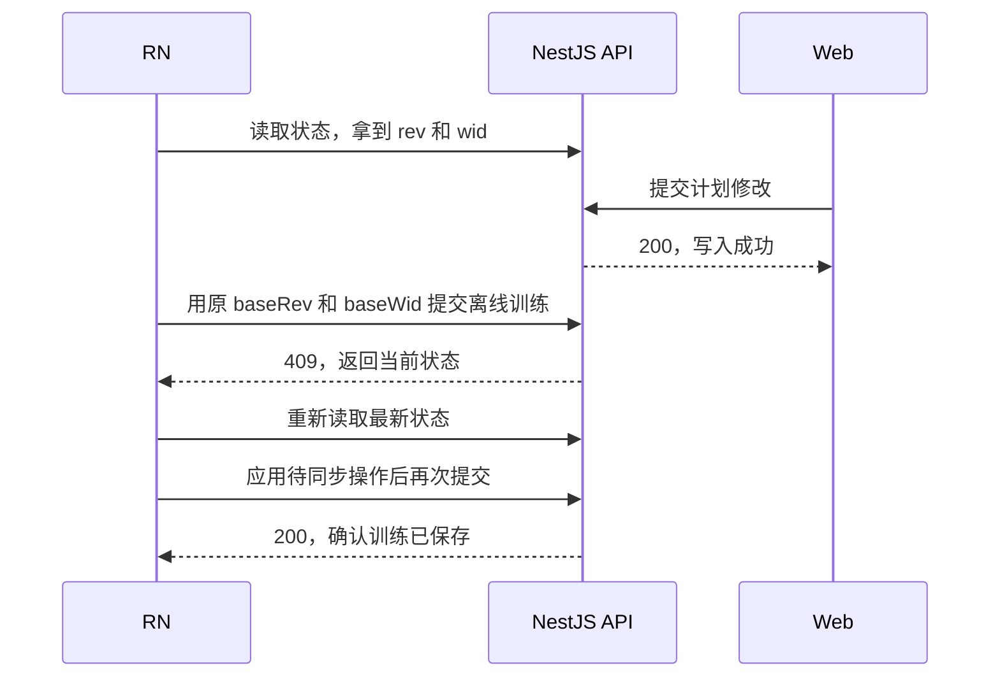

# openGym 服务端 NestJS 迁移设计

设计稿 · 2026-11-18（2026-11-19 修订） · 仓库基线 `a00970b68`

执行方案：[EXECUTION.md](./EXECUTION.md) · 功能点拆分：[features/README.md](./features/README.md)

## 1. 迁移范围

把 `api/server.js` 中的路由、请求处理、业务编排和后台任务接入 NestJS。第一版兼容现有 RN、Web、Capacitor 及仓库内的手表和 MCP 调用方。以当前 `/api` 契约、部署入口及 `DATA_DIR` 文件格式作为兼容基线，覆盖配置关闭和开启时的接口行为。服务端按领域在开发分支逐步迁移，自托管实例在完成兼容性验收后按整个 API 服务切换。 [现有架构](../../docs/ARCHITECTURE.md) · [OpenAPI](../../api/openapi.yaml) · [RN 迁移清单](../../docs/RN_MIGRATION_STATUS.md)

- **框架与工具链**。采用 NestJS 12、官方 `@nestjs/platform-node` 的 `NodeAdapter`、TypeScript 和 ESM。`@nestjs/*` 运行时包按同一版本锁定，以 12.5.1 作为设计基线。使用仓库 CI 和镜像已有的 Node.js 22。NodeAdapter 基于 `node:http`，其请求和响应对象可直接接入现有的请求体读取、上传和下载逻辑。12.5.1 的包可用性和 `NodeAdapter.setOnRequestHook` 的实际行为在阶段 0/1 先验证；不可用或行为不同则回到本文修订，不静默换版本。 [NestJS HTTP 适配器](https://docs.nestjs.com/techniques/performance#node-adapter) · [平台包版本](https://www.npmjs.com/package/@nestjs/platform-node/v/12.5.1) · [当前 CI](../../.github/workflows/test.yml#L29) · [API 镜像](../../api/Dockerfile)
- **存储与部署**。使用现有 JSON 文件和媒体目录，每个数据卷由一个 API 进程写入。Compose 与 Nginx 是首个切换场景。沿用对外地址、路径前缀、TLS 终止和数据卷挂载方式，以已配对客户端和现有浏览器账户完成升级演练。 [Compose](../../docker-compose.yml) · [Nginx 配置](../../web/nginx.conf.template) · [自托管说明](../../docs/SELF_HOSTING.md)

## 2. 模块与依赖

并行迁移使用现有 CI 和镜像的 Node.js 22。阶段 4 的候选制品与发布验收按 [执行方案](EXECUTION.md#阶段-4--切换入口制品ci-和升级演练) 对齐 Linux / Node.js 24。

Nest Controller 负责 HTTP 方法、路径、参数和响应。Service 负责一次操作的业务步骤和鉴权后的数据访问。文件存取集中在具体的账户和训练状态 Provider，领域代码继续复用现有 ESM 模块。Nest 入口放在 `api/src/main.ts`，由 `AppModule` 组合以下模块。 [当前服务端入口](../../api/server.js) · [NestJS 请求生命周期](https://docs.nestjs.com/faq/request-lifecycle)

| 模块 | 职责 | 对应的现有实现 |
| --- | --- | --- |
| `PersistenceModule` | 加载实例数据和密钥，提供账户库、训练文件、原子写入和版本缓存 | [启动与存储](../../api/server.js#L121) · [durable.js](../../api/durable.js) |
| `SystemModule` | `/api/health` 探针和 `/api/config` 的功能开关与公开配置汇总 | [探针与配置路由](../../api/server.js#L2058) |
| `AuditModule` | 审计记录、序号、IP 脱敏、保留规则、轮转及日志读取与清空，导出共享 `AuditService` | [审计实现](../../api/server.js#L908) · [审计写入](../../api/server.js#L968) |
| `PresenceModule` | 内存中的训练在线态、过期判断和清理，导出共享 `PresenceService` | [在线态](../../api/server.js#L870) · [提醒抑制](../../api/server.js#L453) |
| `AuthModule` | Cookie / Bearer 会话、Passkey、可选密码、设备链接和配对，提供 Owner / Admin 判定及认证与权限 Guard | [会话](../../api/server.js#L542) · [配对](../../api/server.js#L2349) · [Passkey](../../api/passkeys-store.js) · [密码](../../api/password.js) · [设备链接](../../api/device-link.js) |
| `AccountsModule` | 账户与邀请管理、角色变更、审计查询与清空接口、`POST /api/activity`、账户删除及本地恢复入口 | [账户删除](../../api/server.js#L1338) · [活动心跳](../../api/server.js#L2738) · [管理路由](../../api/server.js#L2761) · [恢复 socket](../../api/admin-socket.js) |
| `SyncModule` | 读取训练状态、修订号查询、条件写入、时间戳合并及提交后通知 | [同步路由](../../api/server.js#L2485) · [sync-stamps.js](../../api/sync-stamps.js) |
| `MediaModule` | 私有媒体的流式读写、额度、缺失检查、引用跟踪、清理 | [媒体路由](../../api/server.js#L2000) · [media.js](../../api/media.js) |
| `NotificationsModule` | Push 订阅、训练日及休息计时提醒、年度总结、`nudge-check` | [推送路由](../../api/server.js#L2630) · [提醒检查](../../api/server.js#L2514) · [提醒规则](../../api/nudge.js) · [年度总结](../../api/wrapped.js) |
| `WatchModule` | Zepp 配对、设备令牌、快照、事件队列及确认 | [手表路由](../../api/server.js#L2392) · [watch-relay.js](../../api/watch-relay.js) |
| `IntegrationsModule` | Webhook 开关、连接配置、事件投递、持久队列及重试 | [集成入口](../../api/integrations/index.js) · [投递队列](../../api/integrations/outbox.js) |
| `CoachModule` | Coach 用户和管理接口、配置、任务恢复、调度和提案通知 | [Coach Routes](../../api/coach/routes.js) · [任务](../../api/coach/jobs.js) · [定时调度](../../api/coach/cadence.js) |

`AuthModule` 从账户库鉴别主体，其他 Controller 通过对应的 Guard 取得主体。账户删除由 `AccountsModule` 协调训练、凭据、订阅、媒体、集成等现有清理步骤。同步服务提交训练状态后调用媒体引用维护和集成入队，投递由集成模块的后台任务处理。Coach 的共享业务代码继续从 `api/coach/core/` 提供给 Web 和 Capacitor 构建。 [账户清理](../../api/server.js#L1338) · [同步提交](../../api/server.js#L2610) · [客户端 Coach 引用](../../frontend/src/lib/coach-local.js) · [Web 镜像构建](../../web/Dockerfile)

### 依赖方向与共享 Provider

账户库、训练状态缓存、审计序号和在线态各保留一个进程内实例。各功能模块导入所属模块导出的 Provider，避免在多个模块的 `providers` 中重复声明同一个有状态服务。关键依赖如下，箭头表示使用方导入提供方。

| 使用方 | 导入与导出约定 |
| --- | --- |
| `AuditModule → PersistenceModule` | 复用数据目录与存储基础设施，导出 `AuditService`；记录调用方传入的主体、目标和请求元数据，独立完成 IP 处理。 |
| `PresenceModule` | 导出 `PresenceService`，只维护内存状态与清理计时器；HTTP 心跳入口由 `AccountsModule` 承载。 |
| `AuthModule → PersistenceModule / AuditModule / PresenceModule` | 导出会话服务、角色判定和 Guard；Owner / Admin 判定直接读取共享账户库，恢复操作调用在线态清理。 |
| `AccountsModule → AuthModule / PersistenceModule / AuditModule / PresenceModule / MediaModule / WatchModule / IntegrationsModule / CoachModule / NotificationsModule` | 使用 Guard 保护管理、心跳及审计接口；账户删除时调用各扩展模块导出的清理接口。 |
| `NotificationsModule → AuthModule / PersistenceModule / PresenceModule` | 复用同一个在线态实例，供提醒判断使用；导出推送服务供启动编排连接 Coach 提案回调。 |
| `SyncModule → AuthModule / PersistenceModule / MediaModule / IntegrationsModule` | 提交后调用媒体引用维护和集成入队；媒体读取档案时使用 `PersistenceModule` 提供的读取函数。 |

`AuditModule` 和 `PresenceModule` 不导入 `AuthModule` 或 `AccountsModule`。注册、登录、权限拒绝、配对和媒体操作直接调用 `AuditService`；审计查询与清空的鉴权放在 `AccountsModule` 的 Controller / Guard。这样 Auth 可以记录审计，Accounts 也可以复用 Auth 的 Guard，依赖方向保持单向。媒体、手表、集成和 Coach 按需导入共享模块并导出各自的服务，账户清理由 Accounts 发起；跨域的启动、回调连接和关闭顺序由 `AppModule` 的生命周期协调器统一负责。 [权限拒绝审计](../../api/server.js#L637) · [审计接口](../../api/server.js#L2940) · [NestJS 循环依赖](https://docs.nestjs.com/fundamentals/circular-dependency)

### 在线训练态

- `AccountsModule` 的 `POST /api/activity` 在鉴权后调用 `PresenceService`。活动心跳更新训练名称、进度和时间；`hidden` 只记录首次隐藏时间，后续心跳清除隐藏标记；`navigated`、`closed` 或旧客户端未提供原因的离开请求立即移除记录。
- `GET /api/admin/users` 与 `NotificationsModule` 的催练判断共用 `getLive(uid)`：距最后心跳达到 70 秒，或隐藏后 45 秒未恢复心跳，即不再视为正在训练。保留每 30 秒的清理和读取时的过期判断，正在训练时抑制催练推送。
- 禁用、删除账户及签发恢复链接时，沿用原入口调用同一个 `PresenceService` 清理记录。在线态不落盘，重启后等待客户端的新心跳恢复。 [在线态规则](../../api/server.js#L870) · [心跳路由](../../api/server.js#L2738) · [账户恢复](../../api/server.js#L1670) · [现有在线态回归](../../api/test/server-presence.test.js)

## 3. HTTP 与认证兼容

1. **在适配器路由前处理请求目标和预检**。使用 NodeAdapter 的 `setOnRequestHook` 接入现有的请求目标校验、CORS 标头和 `OPTIONS 204` 行为，保留移动 WebView 的私网预检及 Cloudflare Access 请求头。显式校验原始方法和路径，覆盖 NodeAdapter 会接受的尾斜杠和 `HEAD` 到 `GET` 的回退，确保这些请求得到旧入口对应的响应。`/api/media/{hash}` 仍仅匹配小写 SHA-256 路径段。 [旧请求分发](../../api/server.js#L3032) · [NodeAdapter 源码](https://github.com/nestjs/nest/blob/v12.5.1/packages/platform-node/adapters/node-adapter.ts) · [路由匹配](https://github.com/nestjs/nest/blob/v12.5.1/packages/platform-node/router/node-router.ts)
2. **在路由上执行访问策略**。密码和媒体路由根据现有开关注册，关闭时按路由不存在返回 `404`。Coach 和集成路由保留各自的开关检查。已匹配路由按旧顺序执行 CSRF、入口限流和路由权限校验，业务校验复用已有函数。保留 Cookie 和 Bearer 同时出现时的取值顺序、重复 Cookie 处理、WebAuthn 的 `RP_ID` 与 `ORIGIN`、管理员和 Owner 权限以及敏感操作等待异步校验后再次确认会话的行为。沿用 `TRUST_PROXY` 下的地址解析规则，结合 Nginx 实际覆盖的转发头验证限流。 [会话与 CSRF](../../api/server.js#L542) · [代理地址处理](../../api/server.js#L1067) · [可选路由注册](../../api/server.js#L2474) · [Nginx 配置](../../web/nginx.conf.template)
3. **按路由读取请求体**。启动时关闭 Nest 全局 body parser，由用到 JSON 的路由调用兼容读取器。保留 5 MiB 上限、空请求体语义、`application/json` 检查、无效 JSON 的 `400`、不支持类型的 `415` 和超限的 `413`。继续区分常规请求体时限和已授权媒体流的时限。训练状态沿用开放的 JSON 结构，仅校验请求外壳和现有业务入口要求的字段。 [请求体读取](../../api/server.js#L805) · [请求时限](../../api/server.js#L3015) · [NestJS Body Parser](https://docs.nestjs.com/techniques/performance#body-parsers)
4. **按旧协议发送响应**。Controller 显式声明成功状态码，统一的异常处理复用 JSON 错误结构和业务错误码。覆盖 `409` 的完整状态体、`401` 与 `403` 的差异、`Retry-After`、多条 `Set-Cookie`、JSON 的 `Cache-Control: no-store`，以及媒体响应的长度、类型和安全标头。媒体已开始回传时，流响应负责处理断开。 [响应与错误处理](../../api/server.js#L3099) · [媒体响应](../../api/server.js#L1978)
5. **兼容部署前签发的凭据**。从数据卷加载原签名密钥、用户会话版本和 Passkey 记录，继续验证已有 Cookie、配对 Bearer 和存量设备链接。`/api/me` 保留符合条件的 Bearer 续期行为。RN 使用网页生成的一次性配对码兑换账号信息和令牌，旧 Web 会话和旧 RN 令牌作为升级验收输入。内存中的配对码与 WebAuthn challenge 在进程重启后由客户端重新发起。 [续期](../../api/server.js#L2129) · [配对](../../api/server.js#L2349) · [RN 配对客户端](../../mobile-rn/src/server.ts)

## 4. 训练同步与存量数据

### 写入、冲突与重试

`GET /api/data` 返回当前账号的 `{ state, rev }`，`GET /api/data/rev` 返回轻量修订信息 `{ rev, wid? }`。版本缓存沿用有界大小和有效期，并在成功写入后按账号失效。新账号缺少状态文件时返回空状态。状态文件无法读取或 JSON 解析失败时，完整状态的读写返回 `503`。对客户端返回的状态继续过滤服务端内部的 `_unstamped`、`_prior`。 [状态读写](../../api/server.js#L196) · [版本缓存](../../api/server.js#L425) · [同步路由](../../api/server.js#L2485)

1. `PUT /api/data` 根据认证主体定位档案。完成请求校验后，在同一个同步临界区完成读盘、比较版本、合并及原子写入。此段沿用同步文件操作，保证两个同时到达的请求依次看见前一个请求提交的结果。
2. `baseRev` 与存储修订号不同，或符合现有检查条件的 `baseWid` 与当前写入 ID 不同，返回 `409` 及当前公开状态。保留没有 `baseRev` 的旧客户端和备份替换语义，以及 `stamped` 客户端的合并分支。
3. 继续使用 `stampPut` 处理删除记录、重置标记、历史记录更新和遗漏字段。保留 `_wid` 及祖先列表 `_wids`。当 `stampPut` 报告已修正客户端送来的档案时，磁盘修订号比本次回执多一步，客户端下一次探测能发现需要回读。进行中的训练草稿在同步写入时按现有规则剔除。
4. 完成临时文件写入、刷盘和替换后，使版本缓存失效，再执行媒体引用登记和 Webhook 入队。提交后的维护失败按既有规则单独记录，训练写入回执以档案是否已提交为准。 [现有写入分支](../../api/server.js#L2529) · [同步合并规则](../../api/sync-stamps.js) · [原子写入](../../api/durable.js)

RN 的重复发送继续按训练 ID 去重，冲突时重新拉取并应用本地队列，提交得到确认后清理对应待同步项。Web / Capacitor 使用版本探针和字段级合并，MCP 写入也走条件提交。用相同的初始档案分别驱动旧服务和 Nest 服务，对比最终训练、计划、体重、围度和照片引用，并核对未被本次操作修改的字段。 [RN 同步](../../mobile-rn/src/server.ts#L77) · [RN 队列消费](../../mobile-rn/src/useGym.ts#L82) · [Web 同步](../../frontend/src/store/useStore.js#L735) · [MCP 写入](../../mcp/src/write-tools.js)

### 数据卷兼容

| 数据 | 兼容要求 |
| --- | --- |
| `db.json`、`db.json.bak` | 账号 ID、凭据、邀请、订阅及旧字段默认值可回读。账户库只有一个进程内实例，所有更改走同一个保存 Provider。沿用主文件损坏回退与不可恢复时的启动失败行为。 |
| `state-<uid>.json` | 保留文件命名、旧档案字段、修订元数据及账户级缓存。升级后由 Nest 写过的档案可以由旧服务再次读取并同步。 |
| `secret`、`vapid.json`、`watch-<uid>.json`、`audit.log` | 保留签名连续性、Push 订阅身份、手表邮箱和活动日志。沿用文件权限、读取路径及审计规则。 |
| `uploads/`、`integrations/`、Coach 数据 | 保留各账号目录、媒体引用及清理标记、集成密文与 outbox、Coach 配置和任务文件。保留凭据文件权限，使用现有实例密钥读取加密配置。 |
| `/coach-auth` | 使用 Coach 镜像时单独挂载提供方登录缓存，沿用容器中 `coach` 用户的权限与运行方式。 |

MCP 直接读取 `db.json` 和 `state-<uid>.json`，并观察文件更新。管理员恢复 CLI 通过 Unix socket 请求运行中的服务写入账户库。两者均纳入升级演练。 [备份与恢复](../../docs/SELF_HOSTING.md#6-backups) · [MCP 文件读取](../../mcp/src/state.js) · [恢复 CLI](../../api/recover.js) · [账户库初始化](../../api/server.js#L121)

## 5. 私有媒体与后台任务

- **上传与下载**。`PUT /api/media/{hash}` 通过会话和限流后把原始请求流交给 `media.js`，以流式校验哈希、文件类型和大小，并先落临时文件。`GET` 继续按账号目录进行授权与流式响应，JSON 状态保存 `MediaRef`。保留上传空闲超时、断流清理、相同哈希的重复上传行为、`missing` 接口及 Nginx 对媒体代理的缓冲设置。 [媒体存储](../../api/media.js) · [RN 照片同步](../../mobile-rn/src/body/photos.ts) · [Web 媒体同步](../../frontend/src/lib/media-sync.js) · [媒体代理](../../web/nginx.conf.template#L95)
- **清理**。RN 先上传照片字节，再同步带引用的状态。保留两步之间的清理宽限期。状态提交后登记引用，清理任务只处理满足原有条件的未引用文件，遇到无法读取的状态或清理标记时跳过该账号的清理。账号删除沿用该账号的媒体清理路径。 [RN 上传顺序](../../mobile-rn/src/useGym.ts#L82) · [媒体引用与清理](../../api/media.js#L493) · [账号清理](../../api/server.js#L1338)
- **启动**。初始化时加载配置、数据卷和密钥，完成 Coach 任务恢复和媒体临时文件处理。复用模块仍在导入时读取环境变量，入口需在加载这些模块前准备好进程环境。`AppModule` 的生命周期协调器连接 Coach 提案通知等回调，在 `await app.listen(...)` 成功后统一启动提醒、队列、Coach 调度、媒体清理、在线态和审计维护计时器；`onApplicationBootstrap` 在监听前执行，只用于初始化。启动失败时关闭已经取得的资源。 [旧启动流程](../../api/server.js#L2989) · [Coach 配置](../../api/coach/config.js) · [NestJS 生命周期](https://docs.nestjs.com/fundamentals/lifecycle-events)
- **重启后的任务状态**。Webhook 从持久队列继续投递，入队、重试和去重沿用现有语义。Coach 中断的生成任务按 `recoverOnBoot` 结束并恢复可用状态，已有提案可继续查看。推送、训练提醒、手表事件和媒体清理按原规则读取账号与状态。实例启用的扩展在切换演练中走各自的对外入口。 [Webhook 队列](../../api/integrations/outbox.js) · [Coach 恢复](../../api/coach/jobs.js#L524) · [手表协议](../../docs/ZEPP_OS.md)

### 停机协议

生命周期协调器提供幂等的关闭操作，多次调用等待同一个关闭 Promise，并在 `onModuleDestroy` 中等待该操作完成。Linux 注册 Nest 的 `SIGTERM` / `SIGINT` 停机钩子，Windows 和进程内回归通过显式 `app.close()` 进入同一路径。各模块的资源关闭由协调器调用，避免分散的销毁钩子提前关闭仍有任务使用的依赖。

1. 先设置 `closing`，在第 3 节的请求入口拒绝新业务请求，并停止本地恢复 socket 接收新命令；已接纳的业务进入排空。停止提醒、清理、审计维护和 Coach cadence / warmup 的全部计时器，停止 Coach 队列继续出队和 Webhook 后续批次调度。
2. 跟踪并等待在途 HTTP 业务、媒体上传及其断流清理、推送、Webhook 投递和 Coach 任务的 Promise；客户端断开后尚未结束的清理也计入在途集合。排空期间，已接纳的训练提交仍可持久化 Webhook 事件，停止的投递器留待下次启动处理。
3. 默认使用 8 秒排空预算，超时后统一取消剩余请求流、provider 调用和受管理的运行时子进程，再给断流和子进程清理最多 1 秒。部署停机宽限至少为 10 秒。调整预算时同步调整 Compose 和 Kubernetes 配置。Webhook 保留未完成队列与投递 ID，Coach 保留待 `recoverOnBoot` 处理的中断任务及已有提案。
4. 请求钩子跟踪响应连接，拦截器独立跟踪 HTTP 处理器及其清理。协调器在清理完成或清理期限到达后交还关闭流程，由适配器回收剩余 HTTP 连接。计时器、队列完成回调和任务回调均不得在关闭期间重新启动调度。

实施时需要扩充现有模块的停止接口：`outbox.stop()` 目前只清定时器，需要增加停止后续批次和等待本轮投递的能力；Coach `pump()` 需要关闭门禁和在途任务跟踪；warmup 需要同时保留首次延迟任务与周期任务的句柄。关闭应用时保留用户数据，不调用具有清除用户记录语义的 `clearUser`。 [Outbox 调度](../../api/integrations/outbox.js#L148) · [Coach 队列](../../api/coach/jobs.js#L267) · [Coach 清除语义](../../api/coach/jobs.js#L68) · [Warmup](../../api/coach/warmup.js#L63)

## 6. 构建与迁移顺序

在 `api/` 内维护一套依赖和锁文件。构建使用 NodeNext / ESM 和 Nest 的装饰器配置，将入口编译到 `api/dist/src/main.js`，把复用的 ESM 模块及运行期资源按相对路径打包。源码中的 Coach 共享目录继续供 Web 构建导入。完成兼容性验收后，将 `api/server.js` 收敛为启动编译产物的入口，保留 `npm start`、`PORT=0` 和实际监听端口输出，接入现有容器、MCP 和 RN 的启动入口。RN 本地回归入口显式绑定 loopback，并按现有断网用例控制连接复用。 [当前包配置](../../api/package.json) · [RN 回归入口](../../mobile-rn/scripts/loopback-api.mjs) · [MCP 回归入口](../../mcp/test/log-workout.e2e.test.js) · [NestJS 运行要求与 ESM](https://docs.nestjs.com/migration-guide)

### 构建与回归接入清单

- 新增独立的 API 构建脚本。开发及 CI 按“安装依赖 → 编译 API → 启动入口或运行回归”的顺序执行；Windows 使用 `npm.cmd`。API 的 `node --test`、MCP 集成回归和 RN 本地回归在启动子进程前显式完成构建，一次构建供本轮子进程复用。CI 直接执行 `node --test`，因此构建前置也要写入工作流。运行镜像直接启动随镜像交付的编译产物。
- 更新 `.github/workflows/test.yml` 的变更路径：镜像作业覆盖 `api/src/**`、TypeScript / Nest 构建配置及构建脚本；MCP 作业覆盖其集成回归依赖的 API 源码、构建配置和包文件。API、MCP 和镜像作业都从干净检出验证，避免依赖开发机已有的 `dist`。
- 按被迁移的职责同步改造源码断言：除 OpenAPI 路由扫描外，还包括 `durable.test.js` 的原子写入、`server-state-read-cost.test.js` 的缓存调用、`server-media.test.js` 的服务器超时，以及 `dockerfile-copy.test.js` 的制品文件依赖。断言转向实际 Provider、服务器配置、HTTP 行为或构建后的文件树，并保留原先保护的刷盘、缓存、超时和文件完整性要求。 [源码断言](../../api/test/durable.test.js#L28) · [缓存断言](../../api/test/server-state-read-cost.test.js#L161) · [上传超时断言](../../api/test/server-media.test.js#L470) · [镜像文件检查](../../api/test/dockerfile-copy.test.js)

| 阶段 | 实施范围 | 完成条件 |
| --- | --- | --- |
| 1. 基线、启动和 HTTP | 固定旧服务制品与测试数据，建立 Nest 编译与启动入口、配置、错误映射及探针，接入构建前置 | 干净检出可编译并启动 Nest 入口，两版使用独立数据目录。对齐已迁移入口的路径、预检、内容类型、状态码和错误结构。`/api/health` 可发现数据卷不可写。 |
| 2. 账户、配对与同步 | 提取账户库、会话、审计和在线态 Provider，明确导入与导出关系，迁移注册登录、设备、管理、心跳及训练同步 | 存量 Cookie 和 RN Bearer 可继续使用。RN 和 Web 交叉写入、`409` 重试、离线补传和旧数据回读达到第 7 节标准；在线态和审计通过 A8、A9。 |
| 3. 媒体及后台能力 | 迁移媒体、Push、手表、Coach、集成和恢复 CLI，实现停止门禁、任务跟踪及统一启动与停机 | 媒体流与清理通过验收，两版在扩展开关开启和关闭场景下分别对齐。验证任务重启恢复、Coach 权限、原有共享构建及 A10 停机用例。 |
| 4. 制品、升级及回滚演练 | 交付 `default` 和 `coach` 镜像，完成 CI 路径过滤与回归断言迁移，接入文档校验并演练数据卷接管 | OpenAPI 与实际 HTTP 路由一致，两种镜像的入口可启动，A11 构建链路通过。使用存量数据副本完整走过旧版 → NestJS → 旧版，并读回 NestJS 阶段产生的有效写入。 |

接口继续以 `api/openapi.yaml` 作为仓库契约。将现有扫描旧路由字面量的校验改为检查 Nest Controller 注册的 HTTP 方法和路径，媒体路径沿用 OpenAPI 的 `{hash}` 表达。保留 API 文档生成和真实 HTTP 验证。镜像使用独立构建阶段编译，运行阶段分别验证 `default` 和 `coach` 所需文件、可选依赖及权限。Helm / Kubernetes 继续按单副本 `Recreate` 部署。随版本交付 Nix 包时，打包入口纳入编译制品和 ESM 包元数据。 [现有契约检查](../../api/test/openapi-routes.test.js) · [CI](../../.github/workflows/test.yml) · [镜像发布](../../.github/workflows/docker-publish.yml) · [Helm 部署](../../helm/templates/deployment.yaml) · [Kubernetes 部署](../../kubernetes/deployment.yaml) · [Nix 打包](../../contrib/nix/api.nix)

## 7. 发布验收

| 用例 | 操作和可观察结果 |
| --- | --- |
| A1 · 登录与设备 | 旧服务签发的 Web Cookie 和已兑换的 RN Bearer 可访问各自的档案，原 Passkey 可重新登录。切换前尚未兑换的配对码随旧进程退出而失效。切换后 Web 生成新配对码，RN 手动或扫码兑换成功。已消费或过期的配对码被拒绝。注销全部会话、禁用账号、普通用户访问管理接口，均返回旧客户端可识别的状态。 |
| A2 · 冲突与离线 | RN 断网记录、重启后联网补传。分别覆盖 Web 在离线期间修改计划，以及 Web 在 RN 本轮 `GET` 与 `PUT` 之间写入，后者触发 `409` 并重试。Web 计划和 RN 训练均可回读，重复补传只产生一条训练。验证相同 `rev`、不同 `wid` 的恢复分支，以及旧客户端写入后保留新字段和删除标记。 |
| A3 · 数据和缓存 | 同一档案的两个并发条件写入中，只有第一个匹配旧版本的请求提交。成功写入后修订号查询立即可见，包括同大小的两次快速写入。损坏档案的读写返回 `503`。账户库损坏时，有可用备份则回读账号，无可用备份则报告启动失败。 |
| A4 · 媒体 | 用 RN 上传进度照片、用 Web 上传自定义视频，另一端能回读对应媒体。验证同账号去重、其他账号读取被拒绝、实际文件与哈希一致、上传中断清理、仍被引用文件的保留，以及现有容器内存限制下的流式传输。 |
| A5 · 部署链路 | 经实际 Nginx 验证根路径或当前子路径、HTTPS Passkey、LAN 连接、转发头和媒体上传限制。`/api/config` 的公开字段符合功能开关，数据盘不可写时健康检查为 `503`，两种 API 镜像从预期入口启动。 |
| A6 · 扩展 | Web Coach 共享代码可构建，启用实例可恢复任务和读取凭据。Push 可接收测试通知和按时区触发训练提醒。Webhook 待投递任务重启后按既有规则处理。Zepp 邮箱可继续读写，MCP 能读到新写入的档案并继续记录训练，Linux 上管理员恢复 CLI 可用。 |
| A7 · 重启与回滚 | 使用数据卷副本升级，新增一笔训练和一条媒体引用，再切回旧镜像验证读取和继续写入。记录停机和恢复时间、健康检查、已配对客户端结果和持久任务状态。 |
| A8 · 在线训练态 | 客户端活动心跳可在管理后台读回，并抑制对应账号的催练推送。分别验证 `hidden` 后恢复心跳、隐藏 45 秒未恢复、最后心跳 70 秒过期、`navigated` / `closed` / 无原因离开，以及禁用、删除和签发恢复链接后的清理。重启后由新心跳重建在线态。 |
| A9 · 模块与审计 | Nest 从根模块启动，各模块共享同一个账户库、审计和在线态实例，Auth 与 Accounts 之间保持单向导入。登录、配对和管理权限拒绝保留原有审计规则，事件主体来自实际调用方；普通用户访问管理接口的 `403` 记入审计，未认证的管理探测 `401` 不产生 `admin.denied`。保留审计查询权限、Owner 清空权限及保留期，清空后序号不重置。 |
| A10 · 停机 | 在慢速上传、在途 Webhook 和排队 Coach 任务期间关闭应用：新业务被拒绝、队列停止继续出队，预算内完成的训练写入可回读，超时上传和子进程被回收。重启后未完成 Webhook 保留投递 ID 并按原规则重试，Coach 中断任务结束且已有提案保留。分别验证 Linux 信号关闭和 Windows 显式 `app.close()`，关闭后无残留调度或监听。 |
| A11 · 构建入口 | 从没有 `dist` 的干净检出安装并构建 API，分别经 API 回归入口、MCP 集成入口和 RN loopback 入口启动；两种镜像只依赖交付文件启动。仅修改 `api/src` 或 API 构建配置时，相关 API、MCP 和镜像 CI 作业会触发，迁移后的持久化、缓存、超时与制品断言仍覆盖原要求。 |

API 集成回归继续用仓库的 `node:test` 和独立数据目录。协议对照比较状态码、客户端依赖的响应头、JSON 结构和最终磁盘内容，对签发时间、随机写入 ID 等字段按规则断言。切换验收使用已构建的 RN 客户端、Web 浏览器及实际镜像，沿用已有 Android 回归记录作基线。 [API 用例](../../api/test/) · [RN 同步验收记录](../RN_ANDROID_EXECUTION.md#p1-验收结果)

## 8. 自托管切换与回滚

1. **记录部署输入**。实施前核对目标实例当前镜像 tag / digest、Compose 项目和数据卷路径、`ORIGIN`、`RP_ID`、`BASE_PATH`、代理设置、启用的功能及 `/coach-auth` 挂载。记录配置摘要。仓库 Compose 是设计基线，实际实例参数以现场核对为准。 [配置模板](../../.env.example) · [自托管说明](../../docs/SELF_HOSTING.md)
2. **演练**。使用数据卷副本启动与目标架构一致的镜像，验证现有凭据、账号、档案和媒体。演练环境的外部投递连接到受控的测试接收端。演练通过后锁定将要部署的镜像 digest。
3. **切换**。在维护窗口让旧 API 完成在途写入并退出，备份完整 `DATA_DIR` 与部署配置，再把同一个数据卷交给 Nest 镜像。通过原域名和路径检查健康、配置、Web 登录、已配对 RN 拉取及一次测试账号写入。确认反代解析到新容器后恢复正常流量。 [Nginx 上游配置](../../web/nginx.conf.template#L44) · [备份](../../docs/SELF_HOSTING.md#6-backups)
4. **回滚**。出现旧客户端鉴权或同步异常、写入失败、媒体异常等阻断问题时，停止 Nest API，用记录的旧镜像和配置接管当前数据卷。优先验证并保留切换后已经提交的写入。若数据卷本身损坏，先保全当前卷，核对切换后写入，再依据备份恢复和补录。回滚验收重复第 7 节 A7 的读取与写入检查。
