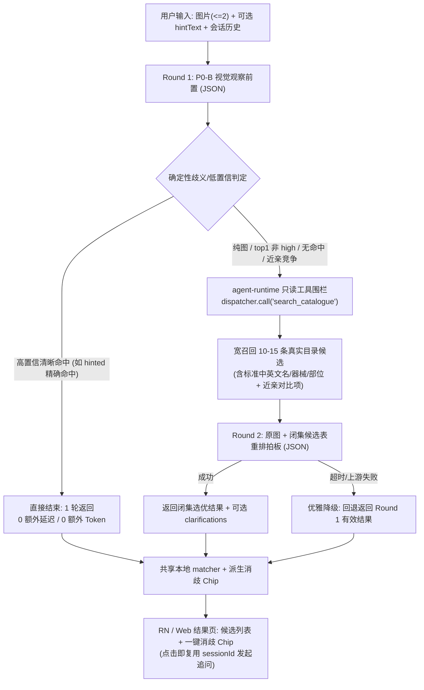

# AI 动作检索 P2（两阶段闭集多选重排 + 一键消歧 Chip）方案与执行计划

状态：已完成 Stage 0–3 实施与验收（见 [P2_RESULTS.md](eval/P2_RESULTS.md)）。其中 Stage 0（只读 `search_catalogue` 基建与紧凑快照 `619c3ee7e`）与 Stage 2（结构化 `clarifications` + RN / Web 一键消歧 Chip `f8c4b5ef0`）达标保留；Stage 1（条件触发两阶段“宽召回 + 闭集多选重排”）经两组 3× 真实模型 e2e 验证未达到硬保留门槛并按止损规则完整回退。评测聚焦 **RN 单端**（`platforms.rn`）。

---

## 1. 背景与核心痛点

截至 P0 + P1 合入 `main`（`10317619a`，见 [P0_RESULTS.md](eval/P0_RESULTS.md) 与 [P1_RESULTS.md](eval/P1_RESULTS.md)）：
- 有文字提示的 `hinted` 组在 3× 真实 e2e 中已达 **`15/15`（100%）** Top 1 / Top 5；
- 135 条离线回放达 Top 1 `95/133`（71.4%）、Top 5 `110/133`（82.7%）、Recall@5 `120/133`（90.2%），P1 现行 90 条子集达 Top 1 `74/90`（82.2%）、Top 5 `81/90`（90.0%）；
- 剩余瓶颈高度集中在**纯图场景（`photo-only`）**：
  1. **单轮闭卷盲猜**：`api/agent-runtime/tasks/exercise-search.js` 当前固定 `budgets: { rounds: 1, toolCalls: 0 }`，模型完全看不到动作库真实目录；
  2. **纯图 Top 1 与一致率天花板**：3× 真实 e2e 中 `photo-only` Top 1 为 `10/15`（66.7%），3/3 重复运行 Top-1 一致率为 `6/10`；未命中全部源于视觉近亲混淆（推胸机 vs 推肩机、腿屈伸 vs 腿弯举、滑车哈克 vs 杠杆哈克、倒蹬 vs 坐姿提踵）。

---

## 2. 总体技术方案

### 2.1 架构总览：条件触发两阶段“宽召回 + 闭集多选重排”



### 2.2 关键设计决策（待用户确认）

1. **两阶段驱动方式：编排器条件驱动 Round 2（推荐） vs 模型原生 `tool_calls`**
   - **推荐方案（编排器条件驱动 + `agent-runtime` 只读工具围栏）**：
     - Round 1 与 Round 2 均使用 `response_format: json_object`，兼容支持 JSON 输出的视觉模型。
     - **触发完全确定性可控**：`hinted` 高置信轮次 100% 保持 1 轮直接返回，仅对纯图/低置信/歧义轮次触发 Round 2；
     - **仍严格走 `agent-runtime` 只读工具围栏**：`search_catalogue` 注册为标准 `AgentTool`，经 `dispatcher.call('search_catalogue', ...)` 校验参数、结果与 `budgets.toolCalls`；
     - **优雅降级**：Round 2 若遇上游 >30s 超时或 `model_unavailable`，自动安全回退到 Round 1 已通过校验的结构化输出，不向用户报错。
   - *备选方案*：改由大模型原生发射 `tool_calls`（需在 `openai.js` 拆开 `tools` 与 `response_format` 并先做真实模型探针验证兼容性）。**本计划默认按推荐方案编排**。

2. **Server 端目录来源（保护 `api/Dockerfile` 独立构建边界）**
   - `api/Dockerfile` 仅复制 `./api` 目录，无法在镜像运行时读取 `../frontend/src/lib/exercises-data.js`。
   - **方案**：参照现有 `api/agent-runtime/tasks/exercise-search-vocabulary.json` 的成功模式，新增紧凑只读目录快照 `api/agent-runtime/tasks/exercise-search-catalogue.json`（仅存公开动作精简字段 `[id, n, zh, eq, bp, tg]`，约 ~450–620 KB，由脚本同步生成，并在 `api/test/agent-exercise-search.test.js` 与 `frontend/src/lib/exercises-data.js` 强校验一致性，同时纳入 `api/scripts/build-api.mjs` 的 `required` 构建产物清单）。
   - **RN 本机执行**直接桥接当前工作区的 `createLibrarySearch(data.profile)` 完整池（含用户保存的别名与自定义动作，且自定义动作绝不进入公共诊断日志）。

3. **一键消歧 Chip 数据契约与兜底策略**
   - 在 `EXERCISE_SEARCH_OUTPUT_SCHEMA` 顶层增加向后兼容的可选字段 `clarifications`（0..3 项 `{ label: string (<=16), prompt: string (<=60) }`）；
   - 同时在共享 `frontend/src/lib/exercise-ai-search.js` 提供纯函数 `deriveClarificationChips(matchResult, structured, hintText)`：优先取模型清洗后的 `clarifications`，不足时按已命中/候选中的易混淆家族表确定性兜底生成 2–3 个中文短标签，高置信单义命中时不显示，零额外 API 路由。

### 2.3 模块与文件改动边界

| 模块 / 文件 | 职责与改动内容 |
|---|---|
| `api/agent-runtime/tasks/exercise-search-catalogue.json`（新） | 5,632 条公开动作的精简只读快照（`id/n/zh/eq/bp/tg`），供 Server 与 Eval CLI 离线独立运行 |
| `scripts/sync-ai-search-catalogue.mjs`（新） | 从 `frontend/src/lib/exercises-data.js` + `frontend/src/exercise-names/zh.js` 确定性生成目录快照 |
| `api/agent-runtime/tasks/catalogue-search-tool.js`（新） | 共享只读 `search_catalogue` `AgentTool` 工厂：严格 `argsSchema`/`resultSchema`、无平台依赖宽召回 + 易混淆近亲扩展，最多返回 15 条受控条目 |
| `api/agent-runtime/run.js`（改） | 支持任务可选 `nextRound(...)` 钩子（仅声明该钩子的任务生效，零影响 `stub.v1`）及 Round 2 失败时可选 `fallbackOnError` 优雅降级；记录 Round 1/2 诊断事件 |
| `api/agent-runtime/tasks/exercise-search.js`（改） | 预算升级为 `rounds: 2, toolCalls: 3`；声明 `steps: [{ id: 'model', tools: ['search_catalogue'], maxToolCalls: 3 }]`；新增 `nextRound` 条件触发器、Round 2 闭集重排提示词与可选 `clarifications` 清洗 |
| `api/scripts/build-api.mjs`（改） | 将 `agent-runtime/tasks/exercise-search-catalogue.json` 与 `catalogue-search-tool.js` 加入 `required` 校验清单 |
| `api/src/agent/tasks/index.ts`（改） | Server 端 `exercise-search.v1` 注册基于目录快照的只读 `search_catalogue` 工具 |
| `mobile-rn/src/agent/tasks.ts`（改） | RN 本机 `exercise-search.v1` 注册基于 `createLibrarySearch(data.profile)` 的只读 `search_catalogue` 工具 |
| `frontend/scripts/ai-search-eval-model.mjs`（改） | 评估模型 runner 注入同一 `search_catalogue` 工具，使真实 e2e 评测与线上 1:1 对齐 |
| `frontend/src/lib/exercise-ai-search.js`（改） | 新增 `deriveClarificationChips(...)` 纯函数并在 `match()` 返回可选 `clarifications`（不改变现有 `items` 排序、分数常量与诊断事件 schema） |
| `mobile-rn/src/screens/ExerciseLibraryScreen.tsx`（改） | 遵循 [RN_UI_DESIGN_SYSTEM.md](../RN_UI_DESIGN_SYSTEM.md)，复用 `<Chip tone="neutral">` 在结果区渲染一键消歧行，点击复用既有追问通道 |
| `frontend/src/components/ExerciseAiSearch.jsx`（改） | 复用 `.chips.wrap` + `.chip` 渲染一键消歧行，点击调用 `sendRequest({ text, surface: 'follow' })` |

### 2.4 红线与约束

- **禁止修改现有匹配常数**：`AI_MATCH_CONSTANTS`（`BASE_FLOOR=60` 等）与 `QUERY_PICK_LIMIT=3` 保持不变；不破坏已有 `88/88` golden 与 135 条回放。
- **隐私与诊断安全**：`search_catalogue` 在 RN 本机虽可读取自定义动作供用户检索，但诊断事件仍沿用 `isPublicExercise` 过滤，绝不泄露自定义动作名/ID 或图片 Data URL。
- **工具围栏只读零副作用**：`search_catalogue` 仅读不写、无网络调用、无文件系统读取（快照启动时内存加载）、严受 `maxToolCalls: 3` 和 `resultSchema` 限制。
- **不新增 npm 依赖**，不新增 HTTP 路由（`api/openapi.yaml` 仅按需补充 `clarifications` 可选响应字段说明）。

---

## 3. Stage 0：独立工作树、目录快照与只读 `search_catalogue` 工具基建

- [x] **TODO 0.1**：在 `D:\dev\open-gym` 确认 `main` 干净（`10317619a`），新建独立 worktree `D:\dev\open-gym-ai-search-p2`（分支 `codex/ai-search-p2`），复制本执行文档并安装依赖（`frontend`、`mobile-rn`、`api`）。
- [x] **TODO 0.2**：编写 `scripts/sync-ai-search-catalogue.mjs` 生成 `api/agent-runtime/tasks/exercise-search-catalogue.json`，并在 `api/scripts/build-api.mjs` 将其加入 `required` 产物校验；在 `api/test/agent-exercise-search.test.js` 新增断言校验快照条数、ID 集合与 `frontend/src/lib/exercises-data.js` 100% 一致。
- [x] **TODO 0.3**：实现 `api/agent-runtime/tasks/catalogue-search-tool.js`（`id: 'search_catalogue'`）：
  - `argsSchema`：`{ queries: string[] (1..4), equipment?: string[], bodyParts?: string[], limit?: integer (1..15) }`；
  - `resultSchema`：`{ items: [{ id, nameEn, nameZh, equipment, bodyPart, target }], total: integer }`；
  - 内置无平台依赖的词法检索 + 器械/部位过滤 + **易混淆近亲家族扩展**（例如搜索 `chest press` 自动补入 `lever shoulder press` / `lever pec deck fly` 对比项；搜索 `leg extension` 自动补入 `lever seated leg curl`；搜索 `hack squat` 自动补入 `sled hack squat` / `lever hack squat` / `sled 45° leg press`），去重后稳定截断至最多 **15 条**。
- [x] **TODO 0.4**：将 `search_catalogue` 分别注册进 `api/src/agent/tasks/index.ts`、`mobile-rn/src/agent/tasks.ts` 和 `frontend/scripts/ai-search-eval-model.mjs`（本阶段 `exercise-search.v1` 仍保持 `rounds: 1, toolCalls: 0`，仅打通工具注册与单测，确保零行为变化）。
- [x] **TODO 0.5**：补充 `search_catalogue` 工具围栏单测（合法查询、空查询拦截、超预算拒绝、结果截断 ≤15、只读无副作用），运行 `api` + `frontend` + `mobile-rn` 单测确认全绿后独立提交基建 commit：
  `feat(ai-search): P2-0 add read-only search_catalogue tool and compact catalogue snapshot`（已提交：`619c3ee7e`）

```powershell
Set-Location 'D:\dev\open-gym'
git status --short
git worktree add -b codex/ai-search-p2 D:/dev/open-gym-ai-search-p2 main
Set-Location 'D:\dev\open-gym-ai-search-p2'
npm.cmd --prefix frontend ci
npm.cmd --prefix mobile-rn ci
npm.cmd --prefix api ci
```

---

## 4. Stage 1（P2-A）：条件触发两阶段“宽召回 + 闭集多选重排”

### 4.1 生产改动

- [x] **TODO 1.1**：修改 `api/agent-runtime/run.js`（已实验实现并在 Stage 1 评测，后随 Stage 1 回退）：
  - 在多轮循环内，当一轮模型输出 `calls.length === 0` 且 `round < budgets.rounds - 1` 且任务声明了 `typeof task.nextRound === 'function'` 时：
    - 先解析本轮输出 `roundParsed = outputOf(lastOutput, task, context)`；
    - 调用 `await task.nextRound({ round, output: lastOutput, parsed: roundParsed, dispatcher, input: request.input, context })`；
    - 若返回 `null` / `undefined`：直接 `break` 结束运行（1 轮完成，零额外开销）；
    - 若返回 `{ instructions?, toolResults?, fallbackOnError?: true }`：将工具返回结果注入下一轮 `modelInput`（并更新本轮指示词用于 Round 2 闭集重排），继续进入下一轮；
    - 若 Round 2 抛出可恢复的模型错误（`model_timeout` / `model_unavailable`）且 `fallbackOnError === true`：**不中断整次运行**，保留 Round 1 的 `lastOutput` 并记一条 `stage: 'model', round: 2, status: 'failed'` 诊断事件后正常完成！
  - 确认未声明 `nextRound` 的既有任务（如 `stub.v1`、`stub.local.v1`）执行路径 100% 不变。
- [x] **TODO 1.2**：修改 `api/agent-runtime/tasks/exercise-search.js`（已实验实现并在 Stage 1 评测，后随 Stage 1 回退）：
  1. `budgets` 升级为 `rounds: 2, toolCalls: 3`；`steps` 升级为 `[{ id: 'model', tools: ['search_catalogue'], maxToolCalls: 3 }]`。
  2. 新增确定性触发函数 `shouldTriggerClosedSetRerank(input, parsed)`：
     - **触发 Round 2 的条件**（满足任一即触发）：
       - 本轮包含图片且无文字提示（纯图 `photo-only`）；
       - `parsed.candidates.length === 0`；
       - `parsed.candidates[0].level !== 'high'`；
       - `parsed.candidates` 覆盖 ≥2 个不同 `bodyPart` 或属于易混淆近亲组（推胸/推肩/夹胸、腿屈伸/腿弯举、哈克深蹲/腿举/提踵）。
     - **直接 1 轮结束（不触发）**：存在有效 `hintText` 且 `candidates[0].level === 'high'` 且无跨部位歧义。
  3. 新增 `nextRound` 实现：
     - 从 Round 1 的 `candidates`（`nameEn` / `name`）和 `fallback`（`equipment` / `bodyParts`）构造 1–2 次 `dispatcher.call('search_catalogue', ...)` 宽召回，拿到最多 15 条带编号的真实目录候选；
     - 若宽召回返回 `0` 条（例如库外虚构物品或非健身图），返回 `null` 直接结束（避免把非健身图强塞进闭集产生误报！）；
     - 构造 Round 2 闭集重排指令 `RERANK_PROMPT`：明确要求模型**重新核对原图机械结构（握把高度/推举方向/背垫角度/滑轨 vs 杠杆臂/滚轮位置）**与下方真实目录列表逐条比对，优先选用列表中的精确 `nameEn`、`equipment` 与 `bodyPart`（若照片确实不属于列表中任一项，仍可如实返回空列表或诚实 `fallback`），并设置 `fallbackOnError: true`。
  4. Fixture 兼容：`fixture` 提供商保持默认 1 轮确定性返回，另增 `fixtureCase: 'rerank'` 供单测覆盖两轮完整路径与 Round 2 失败降级路径。

### 4.2 单元测试

- [x] **TODO 1.3**：补充 `api/test/agent-exercise-search.test.js` 与 `api/test/agent-runtime.test.js`（Stage 1 实验期间 78/78 全绿通过，后随 Stage 1 回退）：
  1. `hinted` 高置信清晰命中仅跑 1 轮（`usage.rounds === 1, toolCalls === 0`）；
  2. 纯图或低置信命中触发 `search_catalogue` 并进入 Round 2（`usage.rounds === 2, toolCalls >= 1`），Round 2 选出的目录精确名最终输出；
  3. 宽召回为空（如非健身图/虚构器械）时不触发 Round 2，零误报；
  4. Round 2 模拟 `model_timeout` / `model_unavailable` 时优雅降级返回 Round 1 有效结果，不报错；
  5. 既有 `stub.v1` / `stub.local.v1` 全部单测 100% 通过。

### 4.3 评测与保留门槛（RN 单端，3× 真实模型 e2e）

- [x] **TODO 1.4**：在 worktree 内运行（实验完成，结论见 `P2_RESULTS.md` 第 2 节）：
  1. **135 条冻结回放**（确认零回归：`Top 1 ≥ 95/133`、`Top 5 ≥ 110/133`、`FalsePositive = 0/2`）；
  2. **3× 真实模型 e2e 对照**（使用外部 `api/.env`，跑 `docs/ai-exercise-search/eval/manifest.json` 的 `--group hinted --group photo-only`，每轮 10 场景，共 3 轮 30 次，保存报告与 `--save-replay` 至 `.codex/ai-search-eval/p2/p2a-rep{1,2,3}.json`）；
  3. 同步统计每轮 **Round 2 触发率**（`hinted` vs `photo-only`）、**视觉延迟 P50/P95**、**3/3 Top-1 一致率** 与 **错器械首位**。
- [ ] **TODO 1.5**：**Stage 1 硬保留门槛（未达标并已完整回退，保留对照数据于 `.codex/ai-search-eval/p2/`）**：
  - 3× 聚合 `photo-only` Top 1 相对 P0-B+P1 基线（`10/15`）净增 **≥ +2**（达 `≥ 12/15`，80%+），**或** 3/3 Top-1 一致率相对基线（`6/10`）净增 **≥ +2**（达 `≥ 8/10`）——实测 Clean P2-A 为 `9/15` / `5/10`、探索轮为 `8/15` / `6/10`，未达标；
  - `hinted` 组保持 **`15/15`（100%）** Top 1 / Top 5，且 `hinted` Round 2 触发率 ≤ 20%——Clean P2-A `hinted` 为 `14/15`（20%）；
  - 错器械首位 `≤ 1/30`——Clean P2-A 为 `3/30`；
  - `88/88` golden 通过、`wrong-high = 0`；
  - 独立提交（未提交，已 `git checkout --` 完整回退）。

```powershell
# 3× 真实模型 e2e（在 worktree 内通过 --env-file 注入外部 api/.env，不读取/打印密钥）
$outDir = '.codex/ai-search-eval/p2'
New-Item -ItemType Directory -Force -Path $outDir | Out-Null
foreach ($rep in 1, 2, 3) {
  node --env-file='D:\dev\open-gym\api\.env' frontend/scripts/ai-search-eval.mjs `
    --mode e2e `
    --manifest docs/ai-exercise-search/eval/manifest.json `
    --group hinted --group photo-only `
    --web-locale zh --include-queries `
    --out "$outDir/p2a-rep$rep.json" `
    --save-replay "$outDir/p2a-rep$rep-replay.json"
}
```

---

## 5. Stage 2（P2-B）：结构化消歧建议 + RN / Web UI 一键消歧 Chip

### 5.1 契约与共享逻辑

- [x] **TODO 2.1**：修改 `api/agent-runtime/tasks/exercise-search.js`：
  - `EXERCISE_SEARCH_OUTPUT_SCHEMA` 增加可选 `clarifications`：数组 0..3 项，`{ label: string (1..16), prompt: string (1..60) }`；
  - `parseOutput` 清洗：非法项丢弃、超长截断、按 `label` 去重、超过 3 条截断；缺失时省略该字段（保持旧端 100% 兼容）；
  - 在 Prompt 中说明：仅当图片存在合理歧义或最高置信度非 `high` 时，才返回 2–3 个简洁中文 `clarifications` 供用户一键点选。
- [x] **TODO 2.2**：修改 `frontend/src/lib/exercise-ai-search.js`：
  - 新增纯函数 `deriveClarificationChips(items, structured, hintText)`：
    - 当 `items.length > 0 && items[0].level === 'high'` 且前 2 名不属于易混淆近亲家族时，返回 `[]`（不打扰清晰结果）；
    - 否则优先返回清洗后的 `structured.clarifications`（最多 3 条）；若模型未返回，则按命中的候选/兜底家族从确定性中文消歧表生成 2–3 条（如推胸/推肩、腿屈伸/腿弯举、哈克深蹲/腿举、绳索/固定器械）；
  - `match()` 返回值追加可选 `clarifications` 数组（不改变 `items` 和 `fallback` 结构）。

### 5.2 RN 与 Web UI 实现（遵守设计系统规范）

- [x] **TODO 2.3**：修改 `mobile-rn/src/agent/ai-search.ts` 与 `mobile-rn/src/screens/ExerciseLibraryScreen.tsx`：
  - `AiSearchMatch` 增加 `clarifications?: { label: string; prompt: string }[]`；
  - 参考 [RN_UI_DESIGN_SYSTEM.md](../RN_UI_DESIGN_SYSTEM.md) §7.10，在结果列表下方、追问栏上方复用 `<Chip tone="neutral">` 渲染一键消歧区（仅当 `ai.status === 'ready' && ai.controller.canContinue && ai.clarifications.length > 0` 显示，加 `testID="ai-clarification-chips"`）；
  - 点击任一 Chip 直接调用追问提交流程（传入 `chip.prompt`，保留当前会话 `sessionId` 与最新图片，自动置 `running` 防连点）。
- [x] **TODO 2.4**：修改 `frontend/src/components/ExerciseAiSearch.jsx`（及必要样式 `ExerciseAiSearch.css`）：
  - 在候选列表下方、追问输入行上方复用 `.chips.wrap` + `.chip` 渲染同一批消歧 Chip，点击直接触发 `sendRequest({ text: chip.prompt, surface: 'follow' })`；运行中或达追问上限时隐藏/禁用。

### 5.3 单元测试与 UI 验收

- [x] **TODO 2.5**：补充单测：
  - `api/test/agent-exercise-search.test.js`：`clarifications` 清洗、截断、去重与省略兼容；
  - `frontend/src/lib/exercise-ai-search.test.js`：`deriveClarificationChips` 高置信隐藏、模型优先、易混淆家族本地兜底、上限 3 条；
  - `frontend/src/components/ExerciseAiSearch.test.jsx`：Web 消歧 Chip 渲染与点击触发追问请求；
  - RN 静态检查：`npm.cmd --prefix mobile-rn run check`（`lint` / `lint:rules` / `typecheck` / `design:check` 全通过）。
- [x] **TODO 2.6**：通过全部测试与 135 条回放零回归后独立提交：
  `feat(ai-search): P2-B add one-tap disambiguation chips for ambiguous AI search results`（已提交：`f8c4b5ef0`）

---

## 6. Stage 3：最终全量回归与脱敏验收交付

在最终保留 HEAD 上运行以下命令（要求退出码全 `0`）：

```powershell
# 1. API 构建与 Agent / 诊断 / Nest 回归
npm.cmd --prefix api run build
node --test api/test/agent-exercise-search.test.js api/test/agent-providers.test.js api/test/agent-runtime.test.js api/test/exercise-search-diagnostics.test.js
npm.cmd --prefix api run test:nest -- test/nest/agent.test.js test/nest/agent-exercise-search.test.js

# 2. Frontend AI matcher（含 88 golden）、共享搜索、Web UI 组件、评估 CLI 与构建
npm.cmd --prefix frontend test -- src/lib/exercise-ai-search.test.js src/lib/exercise-search-rn.test.js src/lib/library-search-rn.test.ts src/lib/exercises.test.js src/components/ExerciseAiSearch.test.jsx
npm.cmd --prefix frontend run test:ai-search-eval
npm.cmd --prefix frontend run build

# 3. Mobile-RN 全套静态检查与格式检查
npm.cmd --prefix mobile-rn run check
git diff --check
```

- [x] **TODO 3.1**：编写脱敏验收报告 `docs/ai-exercise-search/eval/P2_RESULTS.md`，记录：
  - 基线 vs P2-A（3× 真实模型 e2e 逐轮与聚合数据、Round 2 触发率、延迟 P50/P95、3/3 一致率、降级测试结果）；
  - 135 条离线回放守恒数据；
  - P2-B 一键消歧 Chip 单测与端到端交互验证；
  - 全量回归命令与退出码。
- [x] **TODO 3.2**：勾选更新本执行文档 TODO 状态，确认 `git status --short` 干净、未提交 `.codex/`、未修改主工作区、未合并主分支，提交文档。

---

## 7. 止损与重规划条件

出现以下任一情况立即暂停并重规划，不做临时凑分：
1. Stage 1 在 3× 真实模型 e2e 上 `photo-only` Top 1 与 3/3 一致率均无提升，或 `hinted` 从 `15/15` 退化；
2. Round 2 触发后纯图视觉 P95 延迟超过 45 秒或连续触发上游超时导致降级率 > 30%；
3. 任意阶段导致 `88/88` golden 失败、`wrong-high > 0` 或 135 条回放 `空结果误报 > 0/2`；
4. `api` Docker/构建检查缺失目录快照或 `mobile-rn run check` 报错。
