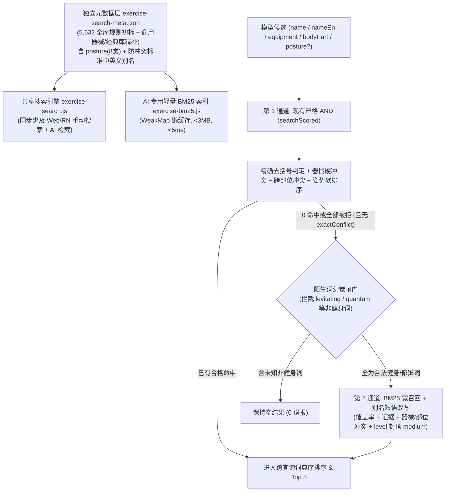

# AI 动作检索 P3（标准别名表 + 姿势打标 + 跨部位保护 + 去括号精确判定 + BM25 零结果兜底）方案与执行计划

状态：已完成（Stage 0–2 与补充修复 `82e5e0551`、`8fa0b82a5` 已保留提交；Stage 3 经 3× 真机对照未达硬门槛已单变量回退 `api/`；Stage 4 全量验收通过）。目标是从根源解决“动作库明明有该动作，但换个近义表达/多一个修饰词就搜不到，或因目录带括号后缀永远只给中置信度”的顽疾（典型案例：`1041 lever lying chest press (plate loaded)` / `杠杆仰卧推胸(挂片式)`）。按 Stage 0–4 严格单变量分阶段推进，前三个阶段纯本地零 Token 成本，提示词扩展独立拆分在 Stage 3 单独验证，评测聚焦 **RN 单端**（`platforms.rn`），最终验收报告写入 [P3_RESULTS.md](eval/P3_RESULTS.md)。

---

## 1. 背景与痛点复现

截至 P0 + P1 + P2 合入 `main`（`45a33b107`，见 [P1_RESULTS.md](eval/P1_RESULTS.md)、[P2_RESULTS.md](eval/P2_RESULTS.md)），实测发现以下 4 类系统性盲区：

1. **非语义括号/版本号后缀压低置信度**：`exactNameMatch` 要求与完整目录名一字不差，全库有 `537` 条带括号后缀（如 `1041 lever lying chest press (plate loaded)`）和 `331` 条带版本号（`v. 2` / `v. 3`），模型准确命中也因缺少括号后缀被强制压为 `medium`（中置信度）。
2. **严格全词 AND（`tokens.every`）导致纯图换表达直接 0 命中**：`lever lying bench press`、`plate loaded bench press`、`flat machine chest press`、`horizontal machine chest press`、`supine chest press` 在现行检索下全部返回 `0` 命中。
3. **缺少跨部位冲突拦截**：`lever bench press` / `machine bench press`（`candidate.bodyPart = "chest"`）因目录里存在带 `(bench press machine)` 备注的无关动作，反而误中 `1221 lever shrug (bench press machine)`（`back`）与 `1220 lever calf raise (bench press machine)`（`lower legs`）。
4. **动作库缺少结构化姿势标签（`posture`）**：全库仅 `400` 条名字带 `seated`、`395` 条名字带 `lying`，像 `0576 lever chest press`（实为坐姿）、`0585 lever leg extension`（实为坐姿）、`0025 barbell bench press`（实为仰卧）均未在名称中显式写明姿势，导致同器械不同姿势（如 `1041` 仰卧推胸 vs `0576` 坐姿推胸、`0586` 俯卧腿弯举 vs `0599` 坐姿腿弯举）难以精准区分。

---

## 2. 总体架构与分阶段设计



### 2.1 待用户确认的 3 项关键决策

1. **精补别名与姿势覆盖范围（推荐：全库规则自动派生 + 商用器械 ~400 条 + `V13_IDS` 经典力量库 1,324 条精补）**：
   - 全部 `5,632` 条经脚本自动去括号/版本号派生、提取显式姿势词与强规律隐含姿势；
   - 人工/结构化精修覆盖表（`scripts/exercise-search-meta-overrides.json`）覆盖全部商用固定器械（`leverage machine` 279 + `smith machine` 94 + `sled machine`）及 `V13_IDS` 经典力量库高频动作的中英文健身房俗称，并全程受自动化防碰撞单测把关；
   - 不改动上游 `frontend/src/lib/exercises-data.js`，以独立元数据文件 `frontend/src/lib/exercise-search-meta.json` 存放（体积控制在 ~200–350 KB）。
2. **诊断日志 `queryOrigin` 枚举增量扩展**：
   - 在 `api/agent-runtime/exercise-search-diagnostics.js` 将 `QUERY_ORIGINS` 从 `['primary', 'english']` 增量扩展为 `['primary', 'english', 'bm25']`（保持 `schemaVersion: 1` 向后兼容），便于在日志与回放报告中一眼区分严格词法召回与 BM25 零结果兜底召回。
3. **提示词扩展独立拆分在 Stage 3**：
   - Stage 0–2 完全不改提示词（零额外 Token 与模型方差），先通过离线 135 条回放、新增真实痛点回归集与 `88/88` golden 验收；
   - Stage 3 再单变量新增可选 `candidate.posture`（提示词 + Schema + 词表快照），单独用 3× 真实模型 e2e 对照验证，过硬门槛才保留，否则单阶段回退不影响 Stage 0–2。

### 2.2 受控姿势枚举（8 类互斥，与角度正交）

| Slug | 中文标签 | 英文同义触发词 | 典型动作 |
|---|---|---|---|
| `seated` | 坐姿 | `seated`, `sitting` | `0576` 杠杆推胸、`0585` 杠杆腿屈伸、`0599` 坐姿腿弯举 |
| `standing` | 站姿 | `standing`, `upright` | `3593` 深蹲、`0334` 哑铃侧平举、`1372` 站姿提踵 |
| `supine` | 仰卧 | `supine`, `lying`（胸/腹/上推/仰卧类）, `flat bench`, `reclined` | `1041` 杠杆仰卧推胸、`0025` 杠铃卧推、`0739` 滑车45°腿举 |
| `prone` | 俯卧 | `prone`, `lying`（腿弯举/后链/俯卧类）, `face down`, `chest supported` | `0586` 俯卧腿弯举、`0662` 俯卧撑、俯卧划船 |
| `side_lying` | 侧卧 | `side lying`, `side-lying`, `lateral lying` | 侧卧髋外展、侧卧腿抬举 |
| `kneeling` | 跪姿 | `kneeling`, `half kneeling`, `half-kneeling`, `quadruped` | 跪姿绳索卷腹、跪姿下拉、半跪姿推举 |
| `bent_over` | 俯身 | `bent over`, `bent-over`, `hinge`, `romanian`, `good morning` | 杠铃俯身划船、哑铃俯身飞鸟、罗马尼亚硬拉 |
| `hanging` | 悬垂 | `hanging`, `suspended`, `pull-up`, `chin-up`, `dip` | 引体向上、悬垂举腿、双杠臂屈伸 |

> 注：`incline`（上斜）/ `decline`（下斜）属于角度变式，可与 `supine`/`seated` 共存，继续由 `UNSUPPORTED_VARIANT_GROUPS` 独立管控，不混入 `posture` 单选枚举。

### 2.3 模块与文件改动边界

| 模块 / 文件 | 职责与改动内容 |
|---|---|
| `scripts/exercise-search-meta-overrides.json`（新） | 商用器械与经典核心力量库的精补中英文别名 + 姿势校准覆盖表 |
| `scripts/generate-exercise-search-meta.mjs`（新） | 结合 `EXDB`、`zh.js`、`V13_IDS` 与覆盖表，确定性生成元数据并运行防碰撞自检 |
| `frontend/src/lib/exercise-search-meta.json`（新） | 独立静态元数据表（`{ version, postures, byId: { [id]: { p?, a? } } }`），零侵入 `exercises-data.js` |
| `frontend/src/lib/exercise-search.js`（改） | `corpusOf` 接入内置标准别名与姿势中英文标签（保留用户自定义别名最高优先级，不改变 `rankByRelevance` 核心公式） |
| `frontend/src/lib/exercise-bm25.js`（新） | 纯 JS 轻量 BM25 倒排索引 + 陌生词幻觉闸门 + 动作短语改写（供 AI 零结果兜底） |
| `frontend/src/lib/exercise-ai-search.js`（改） | 去非语义括号后缀精确判定 + 跨部位冲突矩阵 `bodyPartConflictFor` + 本地姿势提取与 `postureMatch` 软排序 + BM25 零结果兜底接入 |
| `api/agent-runtime/exercise-search-diagnostics.js`（改） | `QUERY_ORIGINS` 增补 `'bm25'`（保持 `schemaVersion: 1`） |
| `scripts/sync-ai-search-catalogue.mjs` & `api/agent-runtime/tasks/exercise-search-catalogue.json`（改） | 同步把 `p`（posture）与精选别名并入服务端只读快照 |
| `api/agent-runtime/tasks/exercise-search-vocabulary.json` & `api/agent-runtime/tasks/exercise-search.js`（Stage 3 改） | 增补 `postures` 8 项枚举、可选 `candidate.posture` 字段清洗与 Prompt 规则 5 半句提示 |

### 2.4 全局红线

- **锁定既有常数**：`AI_MATCH_CONSTANTS`（`BASE_FLOOR=60`、`EQ_BONUS=25`、`BP_BONUS=15`、`CJK_DICE_MIN=0.6`、`CJK_LCS_MIN=3`、`CJK_MARGIN=0.12`）与 `QUERY_PICK_LIMIT=3` 保持不变。
- **严守防误报与防幻觉红线**：`88/88` golden（含 `ambiguous 6/6`、`conflict 3/3`、`boundary 10/10`）100% 通过、`wrong-high = 0`、135 条回放 `空结果误报 = 0/2`。
- **严禁剥离语义变式括号**：去括号精确判定只剥离明确非动作语义的包装后缀（`(plate loaded)`、`(挂片式)`、`v. 2`、`v. 3`、`(version 2)`、`(male)`、`(female)`），**严禁剥离含变式语义的括号**（如 `(inner)`、`(reverse)`、`(single arm)`、`(close grip)`）。
- **不新增 npm 依赖**，不修改 `frontend/src/lib/exercises-data.js`，不破坏 Metro 打包边界。

---

## 3. Stage 0（P3-0）：独立工作树、标准别名表与结构化姿势元数据基建

- [x] **TODO 0.1**：在 `D:\dev\open-gym` 确认 `main` 干净（`45a33b107`），基于 `main` 新建独立 worktree `D:\dev\open-gym-ai-search-p3`（分支 `codex/ai-search-p3`），复制本执行文档并安装依赖（`frontend`、`mobile-rn`、`api`）。
- [x] **TODO 0.2**：创建 `scripts/exercise-search-meta-overrides.json` 与 `scripts/generate-exercise-search-meta.mjs`，生成 `frontend/src/lib/exercise-search-meta.json`：
  - **全库 5,632 条自动派生**：
    1. 自动从英文名/中文名抽显式姿势并归入 8 类 `posture`；
    2. 对未显式带姿势词的动作按动作族/器械强规律补标默认姿势（如 `bench press` → `supine`；坐姿商用固定推胸/推肩/夹胸/腿屈伸机 → `seated`；非坐姿深蹲/硬拉/站姿提踵 → `standing`；引体/悬垂/臂屈伸 → `hanging`）；
    3. 自动生成去非语义括号/版本号后缀的标准英文/中文别名（覆盖 `537 + 331` 条）；
  - **高价值精补覆盖**：
    - 100% 覆盖商用固定器械（`leverage machine` 279 + `smith machine` 94 + `sled machine`）及 `V13_IDS` 经典力量库高频动作的健身房常见中英文俗称（例如 `1041` 补 `lever lying bench press`、`flat machine bench press`、`plate loaded flat bench press`、`杠杆仰卧卧推`、`平躺卧推机`；`0576`/`10671` 补 `seated chest press machine`、`坐姿推胸机`；`0603`/`1454` 补 `seated shoulder press machine`、`坐姿推肩机`；`0739` 补 `45 degree leg press`、`angled leg press`、`倒蹬机`、`斜躺腿举`；`1030`/`0596` 补 `butterfly machine`、`pec fly`、`蝴蝶机`、`蝴蝶机夹胸`；`0150`/`0197`/`2291` 补 `lat pulldown` ↔ `lateral pulldown`、`cable lat pulldown`、`绳索高位下拉`、`高位下拉`；`0585` 补 `坐姿腿屈伸机`；`0599` 补 `坐姿腿弯举机`；`0586` 补 `俯卧腿弯举机` 等）。
- [x] **TODO 0.3**：将元数据接入共享引擎与只读快照：
  - `frontend/src/lib/exercise-search.js`：`corpusOf(e)` 将内置标准别名与姿势中英文词（如 `supine`/`仰卧`、`seated`/`坐姿`、`kneeling`/`跪姿`）注入检索语料（不覆写 `nameWords` 精确名权重，避免污染手动精确名排序）；
  - 同步更新 `scripts/sync-ai-search-catalogue.mjs` 与 `api/agent-runtime/tasks/exercise-search-catalogue.json`。
- [x] **TODO 0.4**：新增自动化元数据防碰撞单测（`frontend/src/lib/exercise-search-meta.test.js`）：
  1. 元数据中所有 `id` 真实存在于 `EXDB`；
  2. 所有 `p` 均属于 8 项合法 `POSTURE_SLUGS`；
  3. 同一精确别名不得指向 2 个不同 `id`；
  4. 禁止收录过宽泛歧义词（`高位下拉`、`绳索划船`、`弯举`、`练胸的`、`卧推`、`深蹲`、`推胸` 等不得作为单一动作精确别名）；
  5. 变式词（`incline`/`decline`/`reverse`/`single arm`/`single leg`）不得挂到非对应变式动作。
- [x] **TODO 0.5**：运行常规搜索单测（`exercises.test.js`、`exercise-search-rn.test.js`、`library-search-rn.test.ts`）+ AI matcher 单测（含 `88/88` golden）+ 135 条回放（`.codex/ai-search-eval/p3/p3-0-135.json`），确认零回归且 `Top 1 ≥ 95/133`、`Top 5 ≥ 110/133`、`FalsePositive = 0/2`，独立提交：
  `feat(ai-search): P3-0 add catalogue posture tags and curated standard alias metadata`（`766c56bd6`）
- [x] **TODO 0.6**：新建扩展评测清单 `docs/ai-exercise-search/eval/manifest-p3.json`（纳入原 `manifest.json` 的 5 台器械 + `docs/ai-exercise-search/test_pic` 新增 5 张图片，共 10 台器械 `10 hinted + 10 photo-only`，**保持原 `manifest.json` 与 `frontend/scripts/ai-search-eval.test.mjs` 的 `13/5` 固定样本断言不变**），并先基于 `main` 对新增 5 图（`hinted` + `photo-only`）录制基线回放保存至 `.codex/ai-search-eval/p3/new5-main-baseline.json`：
  1. `../test_pic/坐姿推肩.png` → 插销式坐姿推肩机，`expectedIds: ["0603", "1454", "0869", "2318", "2962"]`，`expectedEquipment: ["leverage machine"]`，`posture: "seated"`；
  2. `../test_pic/坐姿推胸.png` → 插销式坐姿推胸机，`expectedIds: ["0576", "0577", "1455", "2277", "10671"]`，`expectedEquipment: ["leverage machine"]`，`posture: "seated"`；
  3. `../test_pic/杠杆\u200b仰卧推胸-Exigo ISO-Lateral Flat Chest Press.png`（实际文件名在 `杠杆` 与 `仰卧` 之间含不可见零宽空格 `U+200B`，写入 JSON 时保持精确字节/转义一致）→ 挂片式杠杆仰卧推胸机，`expectedIds: ["1041"]`，`expectedEquipment: ["leverage machine"]`，`posture: "supine"`；
  4. `../test_pic/蝴蝶机夹胸.png` → Cybex VR1 坐姿蝴蝶机（夹胸/后束双功能机），`expectedIds: ["1030", "0596"]`，`expectedEquipment: ["leverage machine"]`，`posture: "seated"`；
  5. `../test_pic/高位下拉.png` → Precor 绳索高位下拉/坐姿划船组合机，`expectedIds: ["0150", "0197", "0198", "2291", "2330", "7583"]`，`expectedEquipment: ["cable"]`，`posture: "seated"`（同步验证 `lat pulldown` ↔ `lateral pulldown` 别名映射）。

```powershell
Set-Location 'D:\dev\open-gym'
git status --short
git worktree add -b codex/ai-search-p3 D:/dev/open-gym-ai-search-p3 main
Set-Location 'D:\dev\open-gym-ai-search-p3'
npm.cmd --prefix frontend ci
npm.cmd --prefix mobile-rn ci
npm.cmd --prefix api ci
```

---

## 4. Stage 1（P3-A）：去括号精确置信度 + 跨部位冲突保护 + 本地姿势软排序

### 4.1 生产改动（`frontend/src/lib/exercise-ai-search.js`）

- [x] **TODO 1.1**：**非语义后缀去噪精确判定**：
  - 新增 `stripNonSemanticSuffix(name)`：仅剥离末尾明确无动作变式语义的包装/版本后缀——`/\s*\((?:plate[- ]?loaded|pin[- ]?loaded|selectorized|version\s*\d+|v\.?\s*\d+|male|female|挂片式|插销式)\)\s*$/i` 与 `/\s+v\.?\s*\d+\s*$/i`；**绝不剥离** `(inner)`、`(reverse)`、`(single arm)` 等语义变式括号。
  - 更新 `exactNameMatch(exercise, values)`：对目录主名、去非语义后缀名、保存别名以及内置标准别名进行标准化精确比对；当模型输出 `lever lying chest press`（`level: 'high'`, `equipment: 'leverage machine'`, `bodyPart: 'chest'`）命中 `1041 lever lying chest press (plate loaded)` 时，`exact` 判定为 `true` 且返回 `level: 'high'`（前提：无器械冲突且无跨部位冲突，守住 `wrong-high = 0`）。
- [x] **TODO 1.2**：**跨部位冲突矩阵 `bodyPartConflictFor(hintBodyPart, exercise)`**：
  - 定义合理近亲协同部位兼容表 `COMPATIBLE_BODY_PARTS`：
    - `chest` 兼容 `['chest', 'shoulders', 'upper arms']`
    - `shoulders` 兼容 `['shoulders', 'chest', 'upper arms', 'back']`
    - `back` 兼容 `['back', 'shoulders', 'upper arms', 'waist']`
    - `upper arms` 兼容 `['upper arms', 'chest', 'back', 'shoulders', 'lower arms']`
    - `lower arms` 兼容 `['lower arms', 'upper arms']`
    - `upper legs` 兼容 `['upper legs', 'lower legs', 'waist']`
    - `lower legs` 兼容 `['lower legs', 'upper legs']`
    - `waist` 兼容 `['waist', 'back', 'upper legs']`
    - `neck` 兼容 `['neck', 'shoulders', 'back']`
    - `cardio` / `full body` 不硬拦。
  - 仅当 `candidate.bodyPart` 为合法 slug 时生效：若命中动作的 `exercise.bp` 不在兼容集内（例如 `chest` 命中 `back` 耸肩 `1221` 或 `lower legs` 提踵 `1220`），在 `keywordRejection` 中拒绝（沿用/检查诊断 `decision` 合法枚举，注意 `exercise-search-diagnostics.js` 的 `FILTER_DECISIONS` 保持兼容，不随意新增未声明枚举导致被丢弃，或同步扩展并测试）。
- [x] **TODO 1.3**：**本地姿势提取与软排序（不改提示词）**：
  - 新增 `inferCandidatePosture(candidate, hintText)`：优先级 `合法 candidate.posture` > `name`/`nameEn` 显式姿势词 > `hintText` 显式中文/英文姿势词（如“仰卧”→`supine`、“俯卧”→`prone`、“坐姿”→`seated`、“跪姿”→`kneeling`、“站姿”→`standing`、“俯身”→`bent_over`、“侧卧”→`side_lying`、“悬垂”→`hanging`）。
  - 在 `pickQueryHit`、`isBetterQueryHit`、`isBetterCandidateQueryHit` 与 `compareRankedHits` 中，将 `postureMatch`（`Boolean(inferredPosture && exercisePosture === inferredPosture)`）作为软排序键（位于 `bodyPartMatch` 之后、`unsupportedVariants` 之前；输出前剥离内部字段）。（注：后续 `8fa0b82a5` 将 `compareRankedHits` 收窄为 `hintPostureMatch`，以防候选 1 名称中的姿势词抢过候选 0。）

### 4.2 单元测试与保留门槛（RN 单端）

- [x] **TODO 1.4**：在 `frontend/src/lib/exercise-ai-search.test.js` 补充 P3-A 单测：
  1. `1041` 收到 `lever lying chest press`（`high`, `leverage machine`, `chest`）返回 `level: 'high'`；含语义括号 `(inner)` 不被剥离误判为精确；
  2. `lever bench press`（`bodyPart: 'chest'`）拒绝 `1221`（`back`）与 `1220`（`lower legs`）；
  3. 姿势区分：`supine` / `hintText: '仰卧推胸'` 把 `1041` 排在 `0576` 前；`seated` / `hintText: '坐姿推胸'` 把 `0576` 排在 `1041` 前；`prone` vs `seated` 区分 `0586` 与 `0599`；
  4. 协同部位（如 `chest` 候选命中 `shoulders` 或 `upper arms`）不被误杀。
- [x] **TODO 1.5**：跑单测 + 135 条回放（`.codex/ai-search-eval/p3/p3a-135.json`）+ 仓库 13 条回放（`p3a-repo.json`）。
  - **硬保留门槛**：135 条 RN `Top 1 ≥ 95/133`、`Top 5 ≥ 110/133`、`Recall@5 ≥ 120/133`、`WrongEq ≤ 20/132`、`FalsePositive = 0/2`、`88/88` golden 全过、`wrong-high = 0`；全部满足独立提交：
    `feat(ai-search): P3-A add suffix-aware exact confidence, body-part conflict guard and posture soft ranking`（`9d5232182`）

---

## 5. Stage 2（P3-B）：AI 专用轻量 BM25 零结果/全拒兜底召回

### 5.1 生产改动

- [x] **TODO 2.1**：新增 `frontend/src/lib/exercise-bm25.js`（纯 JS，零外部依赖，`WeakMap` 按 `pool` 懒缓存倒排索引）：
  - 索引字段加权：名称 + 内置标准别名 + 用户别名（权重 `3.0`）、姿势 + 器械（权重 `1.5`）、部位 + 目标肌群（权重 `1.0`）；
  - 标准 Okapi BM25（`k1 = 1.2, b = 0.75`）+ 轻量动作短语扩展（仅限固定器械/胸肌语境 `bench press ↔ chest press`、`supine ↔ lying`、`overhead press ↔ shoulder press`、`flat`/`horizontal` 低权重可选词）；
  - **陌生词幻觉闸门 `hasUnknownNonFitnessToken(query, vocabSet)`**：
    - 允许词集 = 目录全部名称/别名/部位/器械/肌群词汇 ∪ 常见健身/体位/包装修饰词白名单（`flat`, `horizontal`, `supine`, `prone`, `seated`, `standing`, `kneeling`, `plate`, `loaded`, `pin`, `selectorized`, `converging`, `isolateral`, `machine`, `bench`, `press`, `commercial`, `gym`, `angled`, `vertical`, `dual`, `bilateral`, `unilateral`, `hammer`, `strength` 等）；
    - 一旦查询包含任何不在允许词集且拼写距离 > 1 的陌生英文词（如 `levitating`、`quantum`、`flux`、`pasta`、`orbital`、`prism`），**直接返回空数组**，彻底杜绝幻觉误报！
  - 覆盖率闸门：非泛化动作核心词至少命中 1 个，且整体有效词覆盖率 ≥ 50%。
- [x] **TODO 2.2**：在 `frontend/src/lib/exercise-ai-search.js` 接入 BM25 零结果兜底：
  - **触发条件**：仅当某候选的原始严格 AND 查询（`english` + `primary`）全部跑完后**没有合格命中（`!best`）且未触发 `exactConflict`** 时触发；
  - 对非 CJK 查询（及必要时的规范化短语）调用 BM25 召回 Top 5，经 `pickQueryHit`（强制经过 `hasNameEvidence`、器械硬冲突、跨部位冲突、姿势软排序与变体惩罚）选出最佳命中；
  - BM25 命中的 `hit` 标记 `bm25: true`、`exact: false`，`levelFor` 封顶 `'medium'`（绝不标 `'high'`，确保 `wrong-high = 0`），最终输出前剥离内部字段；
  - 诊断发 `queryOrigin: 'bm25'`。
- [x] **TODO 2.3**：修改 `api/agent-runtime/exercise-search-diagnostics.js` 第 33 行：
  - `const QUERY_ORIGINS = new Set(['primary', 'english', 'bm25']);`（保持 `schemaVersion: 1`），同步在 `api/test/exercise-search-diagnostics.test.js` 补测试。

### 5.2 单元测试与保留门槛（RN 单端）

- [x] **TODO 2.4**：在 `frontend/src/lib/exercise-ai-search.test.js` 新增 **杠杆仰卧卧推专项回归套件 + BM25 幻觉安全测试**：
  - 专项必过：`lever lying bench press`、`lying lever bench press`、`plate loaded bench press`、`flat machine chest press`、`horizontal machine chest press`、`supine chest press`、`lever bench press`（均带 `leverage machine` + `chest`）**全部从 0 命中/错中耸肩变为命中 `1041` 且 `level === 'medium'`**；
  - 幻觉/边界必空：`levitating barbell bench press`、`quantum flux squat machine`、`plate of pasta`、`orbital prism contraption` 全部保持 `[]`；
  - 已有命中不触发 `'bm25'` 诊断事件（零污染已有路径）。
- [x] **TODO 2.5**：运行单测 + 135 条回放（`.codex/ai-search-eval/p3/p3b-135.json`）+ 仓库 13 条回放（`p3b-repo.json`）。
  - **硬保留门槛**：
    - 专项 7 条“杠杆仰卧卧推”变体表达全部命中 `1041`；
    - 135 条回放 RN Top 1 / Top 5 / Recall@5 不低于 Stage 1（且 `WrongEq` 不增加）；
    - `空结果误报 = 0/2`、`88/88` golden 全过、`wrong-high = 0`、RN matcher P95 ≤ 150ms；
    - 全部满足独立提交：`feat(ai-search): P3-B add hallucination-gated BM25 zero-hit fallback recall`（`dad597737`；并在 `82e5e0551` 补充精确标准别名 `+120` 排序加分，在 `8fa0b82a5` 补充 `0198` `cable lat pulldown` 别名与 `hintPostureMatch` 范围限制）

---

## 6. Stage 3（P3-C，独立单变量）：Prompt & Schema 增补可选 `candidate.posture` + 3× 真实模型 e2e 对照

- [x] **TODO 3.1**：（已完成实验实现并在未过硬门槛后按计划回退 `api/`）
  - `api/agent-runtime/tasks/exercise-search-vocabulary.json` 增加 `postures` 8 项枚举；
  - `api/agent-runtime/tasks/exercise-search.js` 导出 `POSTURE_SLUGS`，在 `CANDIDATE_SCHEMA` 增补可选 `posture: { type: 'string', enum: POSTURE_SLUGS }`（不进 `required`），`parseOutput` 清洗非法值并省略，`instructions()` 附带 `## Allowed posture slugs`，`PROMPT` 规则 5 补充“当照片或文字明确可见体位姿势时填写 `posture`，看不清则省略”；
  - `api/test/agent-exercise-search.test.js` 补充 `posture` 词表一致性、合法透出、非法丢弃与省略兼容单测。
- [x] **TODO 3.2**：在 worktree 内跑两套真实模型 e2e 对照（均聚焦 RN 单端，通过 `node --env-file='D:\dev\open-gym\api\.env'` 注入）：
  - **历史基准 3× 对照**：对原 `docs/ai-exercise-search/eval/manifest.json`（`--group hinted --group photo-only --web-locale zh --include-queries`）跑 3× 真实模型 e2e，输出至 `.codex/ai-search-eval/p3/p3c-rep{1,2,3}.json` 与 `--save-replay`，统计 3× 聚合 Top 1 / Top 5 / WrongEq（总体、`hinted`、`photo-only`）、3/3 Top-1 一致率、`posture` 填充率与合理性、视觉延迟 P50/P95（对齐历史 `25/30` 基准）；
  - **新增 5 图专项实测对照**：同步对 `docs/ai-exercise-search/eval/manifest-p3.json` 中的新增 5 张测试图片跑真实模型 e2e（`hinted` + `photo-only`，输出至 `.codex/ai-search-eval/p3/new5-p3-e2e.json` 与 `.codex/ai-search-eval/p3/new5-p3c-e2e.json`），与 Stage 0 录得的 `new5-main-baseline.json` 做前后对照，重点验收 `1041` 仰卧推胸（纯图命中 + 置信度）、`0576/10671` 坐姿推胸配对姿势区分、`1030/0596` 蝴蝶机夹胸、`0150/0197/2291` 高位下拉、`0603/1454` 坐姿推肩。
- [x] **TODO 3.3**：**Stage 3 硬保留门槛**：
  - `hinted` 保持 **`15/15`（100%）**；
  - 3× 聚合 `Top 1 ≥ 25/30`、`Top 5 ≥ 29/30`、`WrongEq ≤ 1/30`、`photo-only` Top 1 ≥ `10/15`（持平且 `posture` 填充准确无退化，或净提升）；
  - `88/88` golden 通过、`wrong-high = 0`；
  - **实测判定与回退**：尽管 `new5-p3c-e2e` 取得 `8/10`（含 `1041` 纯图与提示双 Top 1）且 3× `hinted = 15/15`，但 3× 聚合 `Top 5 = 25/29`（`< 29/30`）、`WrongEq = 3/29`（`> 1/30`）且 `rep3` 出现上游 `model_unavailable`；严格按单变量原则执行 `git checkout -- api/` 完整回退 Stage 3 并保留对照数据于 [P3_RESULTS.md](eval/P3_RESULTS.md)，**完整保留 Stage 0–2 收益与补充修复 `82e5e0551`、`8fa0b82a5`**。

---

## 7. Stage 4：最终全量回归与脱敏验收交付

在最终保留 HEAD 上运行以下命令（要求退出码全 `0`）：

```powershell
# 1. API 构建与 Agent / 诊断 / Nest 回归
npm.cmd --prefix api run build
node --test api/test/agent-exercise-search.test.js api/test/agent-providers.test.js api/test/agent-runtime.test.js api/test/exercise-search-diagnostics.test.js
npm.cmd --prefix api run test:nest -- test/nest/agent.test.js test/nest/agent-exercise-search.test.js

# 2. Frontend 元数据质检、BM25、AI matcher（含 88 golden）、共享搜索、Web UI、评估 CLI 与构建
npm.cmd --prefix frontend test -- src/lib/exercise-search-meta.test.js src/lib/exercise-ai-search.test.js src/lib/exercise-search-rn.test.js src/lib/library-search-rn.test.ts src/lib/exercises.test.js src/components/ExerciseAiSearch.test.jsx
npm.cmd --prefix frontend run test:ai-search-eval
npm.cmd --prefix frontend run build

# 3. Mobile-RN 全套静态检查与格式检查
npm.cmd --prefix mobile-rn run check
git diff --check
```

- [x] **TODO 4.1**：编写脱敏验收报告 `docs/ai-exercise-search/eval/P3_RESULTS.md`，记录：
  - 元数据规模统计（全库自动派生条数、精补条数、姿势分布、防碰撞质检结果）；
  - 135 条回放逐阶段对照表（Baseline → P3-0 → P3-A → P3-B → Final `8fa0b82a5`）与仓库 13 条回放；
  - “杠杆仰卧卧推（`1041`）”及同类零结果/低置信/跨部位痛点专项前后对照表；
  - 新增 5 张测试图（`manifest-p3.json`）在 Baseline vs P3 后的实测前后对照表；
  - Stage 3（P3-C）3× 真实模型 e2e 对照与保留/回退判定；
  - 全量回归命令退出码与摘要。
- [x] **TODO 4.2**：勾选更新本执行文档 TODO 状态，同步提交文档（不提交 `.codex/`，不改主工作区，合并主分支另行确认）。

---

## 8. 止损与重规划条件

出现以下任一情况立即暂停并重规划，不做临时凑分：
1. 任意阶段导致 `88/88` golden 中 `ambiguous` / `conflict` / `boundary` 失败或 `wrong-high > 0`；
2. 135 条回放出现 `空结果误报 > 0/2` 或 `Top 1` / `Top 5` 净退化；
3. 元数据或别名引入常规搜索测试（`exercises.test.js` / `exercise-search-rn.test.js` / `library-search-rn.test.ts`）回归；
4. Stage 2 BM25 兜底导致 RN matcher P95 延迟超过 `150ms`。
