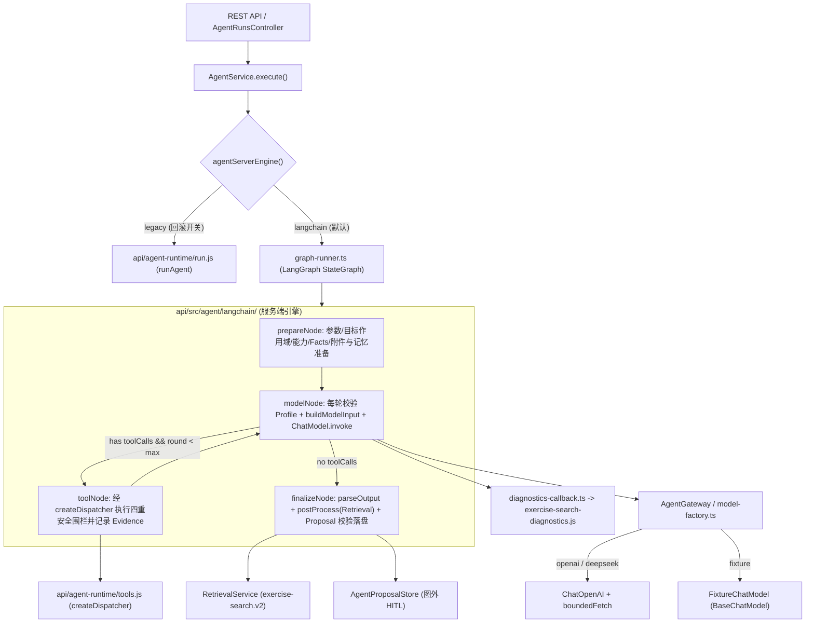

# 服务端 Agent Runtime 迁移至 LangChain / LangGraph（方案 B）设计文档

> **状态**：`implemented`（已实施验收）
> **子系统**：`ai-agent`（主要）、`api-sync`（依赖与打包清单）
> **关联执行计划**：[`EXECUTION.md`](EXECUTION.md)
> **子系统路由**：[`docs/subsystem/ai-agent/README.md`](../../../../docs/subsystem/ai-agent/README.md)

---

## 1. 背景与目标

当前 openGym 的 Agent 运行时分为两层：

1. **跨端共享纯 JS 核**：[`api/agent-runtime/`](../../../../api/agent-runtime/)，包含契约（`contracts.d.ts` / `contracts.js`）、错误码（`errors.js`）、上下文裁剪与证据账本（`context.js`）、四道工具围栏（`tools.js`）、线性运行编排（`run.js`）以及自研 OpenAI HTTP 客户端（`providers/openai.js`）。该目录同时被 RN 本机直连模式复用（[`mobile-rn/src/agent/shared.js`](../../../../mobile-rn/src/agent/shared.js)），并受 [`api/test/agent-portability.test.js`](../../../../api/test/agent-portability.test.js) 守卫，**禁止引入任何 Node 内置模块或 Node 专有第三方库**。
2. **NestJS 服务端宿主层**：[`api/src/agent/`](../../../../api/src/agent/)，负责异步 Run 生命周期、幂等去重、Session / Memory / Proposal 持久化（[`AgentStore`](../../../../api/src/agent/agent.store.ts)）、媒体附件读取、每轮 Profile 解密与版本校验（[`AgentGateway`](../../../../api/src/agent/agent-gateway.ts)）以及调用 [`runAgent()`](../../../../api/agent-runtime/run.js)。

### 1.1 为什么切到方案 B（服务端 LangChain + LangGraph）

继续沿用自研 `run.js` + `providers/openai.js` 存在四个结构性天花板：

1. **非原生多轮消息序列**：[`buildOpenAIRequest()`](../../../../api/agent-runtime/providers/openai.js) 每轮仅发 1 条 `system` + 1 条 `user`，把 `facts`、`memories`、`history` 和 `toolResults` 全部 `JSON.stringify` 拼进单条 `user` 文本。这既不符合模型原生 `assistant(tool_calls)` -> `tool(tool_call_id)` 训练格式，也破坏了多轮对话中的 KV Prefix Cache 命中。
2. **多模型扩展维护成本高**：新增 Anthropic、Google Gemini 等原生协议或 Responses API 时，需重复手写多模态图片块、工具调用、JSON 模式与异常解析。
3. **固定线性循环难以支撑复杂编排**：`run.js` 写死了单一 `model/tool` `for` 循环加单一 `postProcess` 回调。后续若收编 [`api/coach/`](../../../../api/coach/)（意图分流、负荷/伤病查询、结构化输出自检重修、Token/节点流式推送），手写循环会迅速膨胀。
4. **可观测性与 Token 统计缺失**：当前 `usage` 仅有 `{ rounds, toolCalls }`，缺少标准化的输入/输出/缓存 Token 统计及统一 Callback 体系。

### 1.2 架构边界（只换服务端执行引擎，不动跨端契约与存储）

- **改造范围**：仅限服务端 [`api/src/agent/`](../../../../api/src/agent/)（新增 `api/src/agent/langchain/` 并接入 `AgentService` / `AgentGateway` / `agent.flags.ts` / `agent.types.ts`）以及 [`api/package.json`](../../../../api/package.json) / [`api/scripts/build-api.mjs`](../../../../api/scripts/build-api.mjs)。
- **严格隔离**：[`api/agent-runtime/`](../../../../api/agent-runtime/) 与 [`mobile-rn/src/agent/`](../../../../mobile-rn/src/agent/) **保持只读复用与隔离**，继续零第三方/零 Node 依赖，确保 RN 本机执行与 `agent-portability.test.js` 100% 不受影响。
- **保持 HITL 与存储不变**：不引入 LangGraph Checkpointer 替代 `AgentStore`；继续沿用「图内只读 + 图外 Proposal 确认事务 + Session 多轮续接」的 HITL 机制（见第 4 节）。

---

## 2. 改前语义级变更声明（Semantic Change Declaration）

### 子系统：`ai-agent`
- **涉及模块与真实入口**：
  - 入口路由 / 服务：`POST /api/agent/runs` / `GET /api/agent/runs/:runId` / `POST /api/agent/runs/:runId/cancel` -> [`AgentRunsController`](../../../../api/src/agent/agent-runs.controller.ts) -> [`AgentService.execute()`](../../../../api/src/agent/agent.service.ts)
  - 新增服务端引擎模块：`api/src/agent/langchain/`（`errors.ts`、`http-fetch.ts`、`fixture-chat-model.ts`、`model-factory.ts`、`messages.ts`、`diagnostics-callback.ts`、`graph-runner.ts`、`index.ts`）
  - 关联修改文件：[`api/src/agent/agent.service.ts`](../../../../api/src/agent/agent.service.ts)、[`api/src/agent/agent-gateway.ts`](../../../../api/src/agent/agent-gateway.ts)、[`api/src/agent/agent.flags.ts`](../../../../api/src/agent/agent.flags.ts)、[`api/src/agent/agent.types.ts`](../../../../api/src/agent/agent.types.ts)
  - 跨端对偶 / 隔离文件：[`api/agent-runtime/run.js`](../../../../api/agent-runtime/run.js) 与 [`mobile-rn/src/agent/runtime.ts`](../../../../mobile-rn/src/agent/runtime.ts) **不作修改**；服务端通过环境变量开关保留回退至 `runAgent()` 的双轨能力。
- **触发条件（Trigger）**：
  - 服务端处于启用状态（`AGENT_RUNTIME_DISABLED` 未置位）且 `AGENT_SERVER_ENGINE` 未显式设为 `legacy`（默认 `langchain`）时，任何经由 HTTP 提交的服务端 Agent Run（当前覆盖 `stub.v1`、`exercise-search.v1`、`exercise-search.v2` 及后续注册任务）。
- **改前 / 改后行为（Before / After）**：
  - **Before**：`AgentService.execute()` 调用纯 JS 共享编排器 `runAgent()`，模型调用经 `AgentGateway` 实例化 `providers/openai.js`（或 `providers/fixture.js`）；多轮工具调用时，所有 `toolResults` 被序列化进同一条 `user` 文本消息重新发送；`usage` 仅包含 `{ rounds, toolCalls }`。
  - **After**：`AgentService.execute()` 在默认引擎（`langchain`）下交由 LangGraph `StateGraph` 执行引擎 `runServerAgentWithLangChain()` 运行；首轮使用标准 `SystemMessage` + 历史会话消息 + 多模态 `HumanMessage`（含 `[label]` 与 `image_url` DataURL）+ `Facts` / `Confirmed memories`；多轮工具调用在图状态内以原生 `AIMessage(tool_calls)` -> `ToolMessage` 序列追加往返；模型调用由 `@langchain/openai` `ChatOpenAI`（或 `FixtureChatModel`）执行，底层注入带 1MB 响应截断和流级超时控制的自定义 `fetch`；外部可观察到的任务结果、证据记录、四重工具围栏拒错码、Proposal 产出与确认行为、以及 `exercise-search.*` 脱敏诊断事件时序与改前保持一致；`result.usage` 在保留 `{ rounds, toolCalls }` 的同时补充可选的 Token 统计字段。当设置 `AGENT_SERVER_ENGINE=legacy` 时，完整回退至原 `runAgent()` 执行路径。
- **接口 / 状态 / 兼容性变化（Contract, State & Compatibility）**：
  - **接口契约**：所有 `/api/agent/*` HTTP 路由、请求校验、响应状态码及 `api/openapi.yaml` 无破坏性变更；`AgentRunResult.usage` 向后兼容保留 `{ rounds, toolCalls }`，新增可选字段 `inputTokens?: number`、`outputTokens?: number`、`totalTokens?: number`。
  - **状态与持久化**：`AgentStoredRun`、`AgentStoredSession`、`AgentMemory`、`AgentProposal` 的 JSON 存储格式与 `AgentStore` 原子写逻辑完全不变；不新增外部数据库依赖。
  - **兼容性与迁移**：新增开关 `AGENT_SERVER_ENGINE=langchain|legacy`（缺省 `langchain`），支持零数据迁移瞬时回滚；历史遗留 Run/Session/Proposal 记录与新引擎完全兼容。
- **失败模式与降级兜底（Failure Modes & Fallback）**：
  - **模型超时 / 响应体过大 / 取消中断**：通过 `http-fetch.ts` 与 `errors.ts` 递归解包 OpenAI SDK / LangChain 异常链，稳定映射回 `AgentError` 错误码 `model_timeout`（504）、`model_response_too_large`（502）、`run_cancelled`（409）、`model_unavailable`（503），不向客户端或诊断日志泄露原始 API Key、图片 Base64 或未脱敏堆栈。
  - **工具安全围栏触发**：`tool_not_allowed`（403）、`tool_args_invalid`（400）、`tool_target_out_of_scope`（403）、`tool_budget_exceeded`（429）在 `toolNode` 内直接硬中断并按 `AgentError` 终结 Run，**禁止被 LangChain 默认工具异常捕获机制包装为 `ToolMessage` 喂回模型继续执行**。
  - **轮次上限与死循环**：超过 `budgets.rounds` 或触发 LangGraph `GraphRecursionError` 时抛出 `AgentError('invalid_request', 'the model kept calling tools after the round budget')`。
  - **Profile 轮间变更 / 取消竞态**：`modelNode` 每轮调用前复核 `profile.version` 与能力集，版本不匹配报 `profile_not_found`；`finalizeNode` 落盘 Proposal 前后与 `postProcess` 前后复核 `signal.aborted` 与 `state.acceptResult()`，已取消则调用 `proposals.discard()` 回滚并标记 `cancelled`。
  - **紧急降级**：若线上遇到 LangChain 兼容问题，设置 `AGENT_SERVER_ENGINE=legacy` 重启服务即可切回原 `runAgent()`。
- **实测证据（Empirical Evidence）**：
  - **改前基线（2026-11-24 实测）**：
    - `node --test api/test/agent-portability.test.js api/test/agent-runtime.test.js api/test/agent-providers.test.js api/test/agent-exercise-search.test.js`：64/64 通过（446.8ms）。
    - `node api/scripts/test-nest.mjs test/nest/agent.test.js test/nest/agent-exercise-search.test.js`：16/16 通过（8.60s）。
  - **改后闭环实测证据**（实施后回填至 [`EXECUTION.md`](EXECUTION.md)）：
    - `npm.cmd --prefix api run build`
    - `node --test api/test/agent-portability.test.js api/test/agent-runtime.test.js api/test/agent-providers.test.js api/test/agent-exercise-search.test.js api/test/agent-store.test.js api/test/agent-crypto.test.js`
    - `node api/scripts/test-nest.mjs test/nest/agent.test.js test/nest/agent-exercise-search.test.js test/nest/agent-langchain.test.js test/nest/routes.test.js`
    - `npm.cmd --prefix frontend run test:ai-search-eval`
    - `node scripts/build-api-docs.mjs --check`
    - `.\.agent\scripts\verify-governance.ps1`

### 子系统：`api-sync`
- **涉及模块与真实入口**：[`api/package.json`](../../../../api/package.json)、[`api/scripts/build-api.mjs`](../../../../api/scripts/build-api.mjs)。
- **触发条件**：执行 `npm.cmd --prefix api install`、`npm.cmd --prefix api run build` 及构建服务端镜像产物 `api/dist/`。
- **改前 / 改后行为**：
  - **Before**：`api/package.json` 仅包含 NestJS / pg / undici 等基础依赖，无 `@langchain/*` 与 `zod`。
  - **After**：新增 `@langchain/core`、`@langchain/openai`、`@langchain/langgraph`、`zod` 运行时依赖；`build-api.mjs` 编译 `src/agent/langchain/*.ts` 至 `dist/src/agent/langchain/` 并校验关键产物存在。
- **接口 / 状态 / 兼容性变化**：纯 ESM（`"type": "module"`）+ TypeScript `NodeNext` 模块解析；无 OpenAPI 变动。
- **失败模式与降级兜底**：`tsconfig.build.json` 开启 `noEmitOnError: true` 与 `strict: true`，构建阶段拦截任何类型或 ESM 扩展名缺失问题。
- **实测证据**：同上 `npm.cmd --prefix api run build` 与 `test-nest.mjs`。

---

## 3. 整体架构与模块设计

### 3.1 分层架构图

### 3.2 新增模块清单与详细规格（`api/src/agent/langchain/`）

#### (1) `errors.ts` — 异常归一化与隐私脱敏
- **职责**：将 LangChain / OpenAI SDK / `fetch` 抛出的各种异构异常统一映射为稳定的 `AgentError`，同时避免泄露密钥、Base64 图片和未脱敏堆栈。
- **关键逻辑**：
  - `extractNestedAgentError(error)`：沿 `error` 与 `error.cause`（最多递归 6 层）查找是否已包装了 `AgentError`（如 `http-fetch.ts` 抛出的 `model_timeout`、`model_response_too_large`、`run_cancelled`），若命中则直接原样抛出，防止被 OpenAI SDK 的 `APIConnectionError` 吞掉错误码。
  - `mapProviderError(error, signal)`：
    - 若 `signal?.aborted` 或错误名/信息属于 `AbortError` / `APIUserAbortError` -> `AgentError('run_cancelled', 'the run was cancelled')`；
    - 若属于 `APIConnectionTimeoutError` / `HeadersTimeoutError` / `BodyTimeoutError` / 超时信息 -> `AgentError('model_timeout', 'provider did not answer in time')`；
    - 若带有 HTTP `status`（`APIError` 等） -> `AgentError('model_unavailable', 'provider answered HTTP <status>', { details: { status, ...(safeMsg ? { providerMessage: safeMsg.slice(0, 300) } : {}) } })`；
    - 其他网络或未知模型异常 -> `AgentError('model_unavailable', 'could not reach the provider')`。
  - `sanitizeErrorMessage(text)`：脱敏潜在的 `Bearer ...`、`sk-...`、`data:image/...` 长串，防止意外落入日志或 `RunRecord.error.message`。

#### (2) `http-fetch.ts` — 1MB 响应上限与流级超时保护
- **职责**：弥补 `@langchain/openai` 底层 `openai` SDK 默认不限制响应字节数且 `fetch` 返回 headers 后 `res.text()` 可能无限卡死的缺口，对齐现有 [`api/agent-runtime/providers/http.js`](../../../../api/agent-runtime/providers/http.js)。
- **关键导出**：`createBoundedFetch({ timeoutMs, maxBytes, signal })`
- **关键逻辑**：
  - 默认 `timeoutMs = 60_000`、`maxBytes = 1024 * 1024`（1MB）。
  - 每次请求组合调用方 `signal` 与 OpenAI SDK 传入的 `init?.signal` 生成内部 `AbortController`，启动贯穿整个 body 读取周期的 `setTimeout`。
  - 先检查 `Content-Length` 响应头，超限立即抛出 `AgentError('model_response_too_large')`。
  - 使用 `response.body.getReader()` 流式按块计数，累计超过 `maxBytes` 时立即取消流并抛出 `AgentError('model_response_too_large')`。
  - 若期间超时则抛 `AgentError('model_timeout')`，若外部 `signal` 取消则抛 `AgentError('run_cancelled')`。
  - **关键兼容细节**：读完有界文本后，重新构造 `new Response(bytes, { status, statusText, headers })`（**剔除可能引起二次解压错误的内容编码头**，如 `content-encoding` / `content-length`）返回给 OpenAI SDK，确保 SDK 后续 `res.json()` / `res.text()` 零兼容问题且不发生二次缓冲失控。

#### (3) `fixture-chat-model.ts` — `BaseChatModel` 兼容层
- **职责**：让内置 `fixture` provider 作为一等 `BaseChatModel` 运行在 LangGraph 中，使全部现存集成测试与无密钥验收路径保持 100% 行为等价。
- **关键逻辑**：
  - 继承 `@langchain/core/language_models/chat_models` 的 `BaseChatModel`。
  - 内部持有一个可接收 `ModelInput` 快照（通过调用期上下文或 `RunnableConfig.configurable` 注入）的适配器，调用 [`createFixtureProvider()`](../../../../api/agent-runtime/providers/fixture.js)。
  - 将 `fixture` 返回映射为标准的 `ChatResult` -> `AIMessage`：
    - `toolCalls` 映射为 LangChain 标准 `AIMessage.tool_calls`（`{ id, name, args, type: 'tool_call' }`）；
    - `structured` 载荷通过 `AIMessage.additional_kwargs.__openGymStructured` 传递（供 `extractModelOutput()` 无损还原，对齐 `fixture.js` 的 `'proposal'`、`'candidates'`、`'fallback-only'` 用例）；
    - `error` 载荷映射为对应 `AgentError`；
    - `'late'` 用例需在等待延时期间监听 `options.signal`，一旦中止立即提前 reject，不拖慢取消测试回收。

#### (4) `model-factory.ts` — 按 Profile 构造 `BaseChatModel`
- **职责**：根据 [`AgentConfigStore.resolve()`](../../../../api/src/agent/agent-config.store.ts) 的结果，在每轮调用前动态构造对应的 LangChain 模型实例（支持 `fixture`、`openai`、`deepseek`、`compatible`）。
- **关键设计细节**：
  1. **BaseURL 安全与规范化**：
     - 复用 [`validateBaseUrl()`](../../../../api/agent-runtime/providers/endpoint.js) 拦截非法协议、URL 内嵌凭据、query/hash 及误填 `/chat/completions` 后缀。
     - `deepseek` 默认 `baseUrl = DEEPSEEK_BASE_URL`（`https://api.deepseek.com`）。
     - `openai` 若未提供 `baseUrl`（如 BYOK 用户配置）或等于裸域名 `'https://api.openai.com'`，规范化为 `'https://api.openai.com/v1'`（使 OpenAI SDK 正确请求 `/v1/chat/completions`）；若管理员配置了带特定路径的兼容地址（如测试中的 `http://127.0.0.1:<port>` 或 `/v4`），保留原路径不变以兼容现有行为。
  2. **禁用隐式重试与日志**：显式设置 `maxRetries: 0`（避免超时或错误被 LangChain 静默重试放大延迟）与 `verbose: false`（防止图片 Base64 泄露到控制台）。
  3. **DeepSeek 与 JSON 模式参数透传**：
     - 当 `resolved.provider === 'deepseek'` 时，在发往 OpenAI SDK 的请求体透传 `thinking: { type: 'disabled' }`（**实施阶段须立即通过 `@langchain/openai` 类型检查与本地 Fake HTTP Server 实测确认 `modelKwargs` 或自定义请求参数是否完整落到 HTTP JSON Body**）。
     - 当 `responseFormat === 'json'` 时，配置 `modelKwargs`（或 `response_format` 选项）透传 `response_format: { type: 'json_object' }`。
  4. **按需绑定工具**：仅当当前步 `tools.length > 0` 时调用 `model.bindTools(openAiTools, { tool_choice: 'auto' })`；无工具任务（如 `exercise-search.v1/v2`）严禁传入空 `tools: []`，避免部分兼容接口报错。

#### (5) `messages.ts` — 多模态消息构建、预算裁剪与输出提取
- **职责**：将任务的 `ModelInput` 转换为标准 LangChain `BaseMessage[]`，并从模型返回的 `AIMessage` 提取统一的 `ModelOutput` 与 Token Usage。
- **关键逻辑**：
  1. **上下文预算保护**：在构建首轮消息前，先调用现有 [`trimContext(modelInput, budgets)`](../../../../api/agent-runtime/context.js) 执行媒体字节与文本字符数硬预算裁剪，保留 `context_budget_exceeded`（413）精准报错行为。
  2. **标准消息序列构建 (`buildInitialMessages`)**：
     - `SystemMessage`：`modelInput.instructions`。
     - 历史消息：将裁剪后的 `modelInput.history` 映射为原生 `HumanMessage` / `AIMessage` 对话序列，不再拼进同一条用户消息。
     - 当前轮 `HumanMessage`：组装文本指令（`user.text`）、附加上下文块（`## Facts`、`## Confirmed memories`），若有图片附件则以标准多模态数组呈现（包含 `[label]` 文本标识与 `{ type: 'image_url', image_url: { url: attachment.dataUrl } }`），保持与 [`providers/openai.js`](../../../../api/agent-runtime/providers/openai.js) 的多模态语义对齐。
     - 后续多轮工具调用：由 `toolNode` 追加原生 `ToolMessage({ tool_call_id, name, content })` 与模型的 `AIMessage`，**彻底告别旧版把 `toolResults` 拍平塞进 `user` 文本的做法**。
  3. **输出归一化 (`extractModelOutput`)**：
     - 从 `AIMessage` 读取文本 `content`（支持 string 与多模态 part 数组拼接）、`additional_kwargs.__openGymStructured`（仅 fixture 使用）、`tool_calls`（`name`、`args`、`id`），交由现有 [`normalizeModelOutput()`](../../../../api/agent-runtime/model-gateway.js) 进行强校验与统一结构化，同时提取 `usage_metadata`（`input_tokens`、`output_tokens`、`total_tokens`）。

#### (6) `diagnostics-callback.ts` — `exercise-search.*` 脱敏诊断桥接
- **职责**：仅当 `task.id.startsWith('exercise-search.')` 且存在 `context.meta.exerciseSearchDiagnostic` 时，将节点与模型生命周期映射为现有诊断事件，保证与 [`exercise-search-diagnostics.js`](../../../../api/agent-runtime/exercise-search-diagnostics.js) 100% 同构且零敏感泄露。
- **关键约束**：
  - 事件阶段顺序严格保持：`attachments` -> `model (completed|failed|cancelled)` -> `recognition` -> `retrieval` / `rerank` -> `end`。
  - 任一回调报错均静默隔离（`try/catch`），绝不影响主 Run 执行。
  - 绝不向诊断 sink 或 logger 写入 `apiKey`、图片 `dataUrl` 或原始异常文本。

#### (7) `graph-runner.ts` — LangGraph `StateGraph` 编排主引擎
- **职责**：在服务端完全替代对 [`runAgent()`](../../../../api/agent-runtime/run.js) 的调用，保持外部参数、状态机、`RunResult`、`Proposal` 产销、取消竞态处理与 `run.js` 语义完全对齐。
- **图状态定义 (`Annotation.Root`)**：
  - `messages`: `BaseMessage[]`（使用 `MessagesAnnotation` / `messagesStateReducer` 追加）
  - `rounds`: `number`（已调用模型轮次）
  - `toolCalls`: `number`（累计工具调用次数）
  - `inputTokens` / `outputTokens` / `totalTokens`: `number`（累计模型 Token）
  - `lastOutput`: `ModelOutput | null`
  - `cancelled`: `boolean`
- **节点流转**：
  1. **`prepareNode`**：
     - 校验 `request`（`taskId` / `requestId` / `profileId` / `input` / `sessionMode`）与 `context` 绑定一致性；
     - 若 `state.isTerminal()` 或 `signal.aborted` 直接中止返回；
     - 执行 `task.inputSchema` 校验、`task.validateInput()`、`task.targetScope()`（填充 `context.targetScope`）、`task.capabilities()`（校验 `profileRef.capabilities`）；
     - `state.start()` 转换至 `running`；
     - 执行 `task.readFacts()` 注入 `context.evidence`；
     - 读取 `taskAttachments()` 并发出 `attachments` 诊断事件；
     - 投影 `memories`（遵守 `task.memoryCategories` 为 `[]` 时不读记忆的契约）并调用 `buildInitialMessages()` 生成首轮 `messages`。
  2. **`modelNode`**：
     - 检查 `signal.aborted`、`state.acceptResult()`、`context.deadline`；
     - 计算当前轮的 `ModelInput` 预算（按 `rounds`、`contextChars` 裁剪历史/记忆），注意：在多轮工具循环中保留首轮 `SystemMessage` 与已有 `AIMessage` / `ToolMessage` 链；
     - 调用服务端 `gateway.invokeMessages(...)`：**每轮重新 `AgentConfigStore.resolve(uid, profileId)` 校验 Profile 版本未变化且具备所需能力**，构造 `ChatModel` 并调用 `.invoke(messages, { signal, callbacks })`；
     - 若调用期间收到取消信号（`signal.aborted || !state.acceptResult()`），发出 `cancelled` 诊断事件并标记 `cancelled: true` 退出图（不把迟到答案交给工具或 Proposal）；
     - 否则记录 `rounds + 1`、`lastOutput` 与累计 Token；若有 `toolCalls` 且已是最后一轮（`rounds >= budgets.rounds`），抛出 `AgentError('invalid_request', 'the model kept calling tools after the round budget')`。
  3. **条件边 (`routeAfterModel`)**：
     - 若 `state.cancelled` -> 跳转 `END`；
     - 若 `lastOutput.toolCalls?.length > 0` -> 跳转 `toolNode`；
     - 否则 -> 跳转 `finalizeNode`。
  4. **`toolNode`**：
     - 逐个检查 `signal.aborted || !state.acceptResult()`；
     - 调用 [`createDispatcher()`](../../../../api/agent-runtime/tools.js) 的 `dispatcher.call(call.name, call.arguments, { callId: call.id })`，完整执行 **白名单 -> 参数 schema -> 次数预算 -> targetScope 越界 -> resultSchema** 校验；
     - **任何围栏 `AgentError` 直接向上抛出硬中断，绝不伪装成 `ToolMessage` 让模型继续跑**；
     - 若工具返回 `{ objectId, content, version }`，自动调用 `addEvidence(context, ...)` 注册为证据；
     - 生成标准 `ToolMessage({ tool_call_id: call.id, name: call.name, content: JSON.stringify(resultWithEvidence) })` 追加进图状态。
  5. **`finalizeNode`**：
     - `parseOutput` 解析模型输出并按 `task.outputSchema` 强校验（对齐 `recognition` 诊断阶段）；
     - 若传入 `postProcess`（即 `exercise-search.v2` 的 `RetrievalService.retrieve()`），在执行前后均校验取消状态；
     - 校验 `proposalCandidate(parsed)`：
       - `memory` / `memory.save` 校验单条 `save` 操作和合法分类；
       - 业务提案校验 `targetId` 属于 `context.targetScope`、必填 `targetVersion` 且与本次 `context.evidence` 中见到的版本号一致（否则抛 `scope_denied` / `fact_missing`）；
       - 调用 `proposals.create(...)` 落盘后再次复核取消状态，若在持久化瞬间被取消则立即调用 `proposals.discard()` 回滚并结束为 `cancelled`。
     - 组装标准 `RunResult`（含 `evidence`、`proposal`、`usage: { rounds, toolCalls, ...(tokens) }`），提交 `state.completed(result)`，触发 `store?.saveResult`，并发送终态诊断事件 `end`。

---

## 4. Human-in-the-Loop（HITL）与未来演进留口

本期**保持图外显式确认与多轮续接模式**，不把 LangGraph 执行现场挂起在磁盘/数据库中：

1. **写操作审批（Proposal-Confirm HITL）**：
   - 图内工具全程只读；需要改数据时由 `finalizeNode` 校验并生成 `pending` 态 `AgentProposal` 后结束 Run。
   - 用户通过 `POST /api/agent/proposals/:proposalId/confirm` 或 `/reject` 异步确认；确认时在 [`AgentProposalStore.confirm()`](../../../../api/src/agent/agent-proposal.store.ts) 单次原子更新中验证 Run 状态为 `completed` 与 `targetVersion` 乐观锁，确认后标记 `consumed`。
2. **澄清/追问（Session Multi-Turn HITL）**：
   - 动作检索返回 `clarifications` 选项并结束当前 Run；用户点选后携带原 `sessionId` + `sessionMode: 'continue'` 发起新 Run。
3. **未来 Mid-Run `interrupt()` 扩展口**：
   - 因底层已采用标准 LangGraph `StateGraph`，后续若引入需要“中途暂停->用户改参->同一 Run 续跑”的复杂任务（如 AI Coach 交互审批），只需：① 基于 `AgentStore` 实现轻量 `BaseCheckpointSaver`；② 在 `RunStatus` 补充非终态（如 `waiting_approval`，区别于表示重启中断的终态 `interrupted`）；③ 增加 `POST /api/agent/runs/:runId/resume` 接口调用 `Command({ resume })`。一期代码无需为此引入额外表结构。

---

## 5. 接入点与配置设计

1. **`api/src/agent/agent.flags.ts`**：
   - 新增 `export type AgentServerEngine = 'langchain' | 'legacy'` 与 `export function agentServerEngine(): AgentServerEngine`：读取 `process.env.AGENT_SERVER_ENGINE`，仅当显式为 `'legacy'` 时返回 `'legacy'`，默认返回 `'langchain'`。
2. **`api/src/agent/agent-gateway.ts`**：
   - 保留现有 `forAccount(uid).invoke(...)` 签名（向后兼容 `legacy` 引擎与直接调用方）；
   - 新增 `forAccountLangChain(uid)` / `invokeLangChain(uid, profileRef, { messages, requiredCapabilities, tools, responseFormat, fixtureInput, signal, callbacks, timeoutMs })` 方法，每次调用前执行 `AgentConfigStore.resolve()`、版本一致性检查、能力集断言，再创建一次性 `BaseChatModel` 执行调用并归一回 `ModelOutput + TokenUsage`。
3. **`api/src/agent/agent.service.ts`**：
   - `execute()` 根据 `agentServerEngine()` 分流：`'langchain'` 走 `runServerAgentWithLangChain(...)`，`'legacy'` 走原有 `runAgent(...)`。
   - 两个分支共享完全一致的 `session` 读写、并发锁（`session_busy`）、`AI_MAX_RUNS_PER_SESSION` 限制、`postProcess`（`RetrievalService`）与 `sessions.append()` 消息投影逻辑。
4. **`api/src/agent/agent.types.ts`**：
   - `AgentRunResult['usage']` 扩展为 `{ rounds: number; toolCalls: number; inputTokens?: number; outputTokens?: number; totalTokens?: number }`。
5. **`api/scripts/build-api.mjs`**：
   - 在 `required` 构建产物校验数组中添加 `src/agent/langchain/index.js` 与 `src/agent/langchain/graph-runner.js`，确保容器打包阶段不会遗漏编译产物。

---

## 6. 风险与验证策略

| 风险项 | 应对措施 | 验证手段 |
|---|---|---|
| `@langchain/openai` 剥离 DeepSeek `thinking` 等非标字段 | 在 `model-factory.ts` 测试确认 `modelKwargs`（或自定义 client 配置）落盘到 HTTP 请求体 | `agent-langchain.test.js` 用本地 `node:http` Fake Server 断言实际收到的 JSON Body |
| OpenAI SDK 吞掉自定义 `AgentError` 错误码 | `http-fetch.ts` 保留原 `AgentError` 实例并在 `errors.ts` 递归排查 `error.cause` | Fake Server 模拟 1MB 超限、headers 后响应体卡死超时、运行时 abort |
| LangChain ToolNode 捕获错误喂回模型 | `graph-runner.ts` 手写 `toolNode` 并直调 `dispatcher.call()`，不吞任何 `AgentError` | 用工具围栏 4 类拒绝场景验证任务立刻失败且错误码精准 |
| 污染跨端共享 `api/agent-runtime/` | 严禁在 `api/agent-runtime/` 内增删任何依赖 | `api/test/agent-portability.test.js` 源码扫描强守卫 |
| 诊断与测试日志泄露 `apiKey` / 图片 Base64 | 全程禁开 `verbose: true`，错误信息经 `sanitizeErrorMessage` 脱敏 | `agent-langchain.test.js` + `frontend/scripts/ai-search-eval.test.mjs` |
