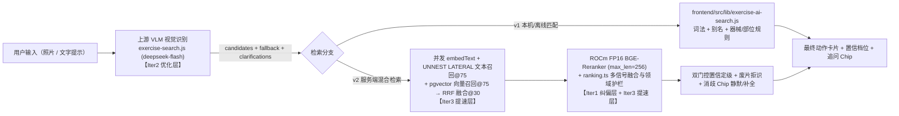
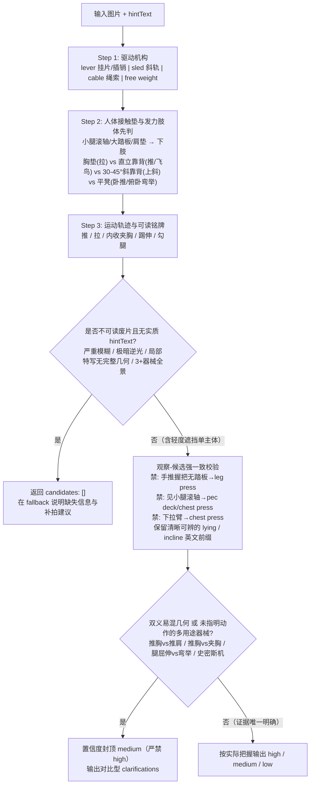
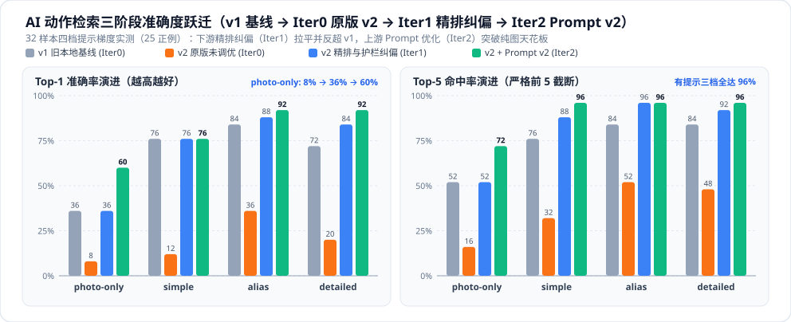
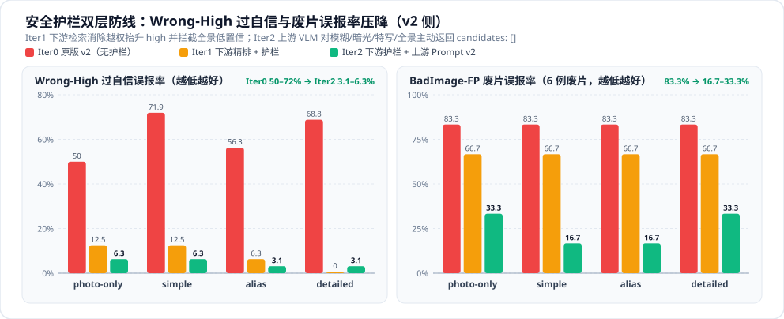
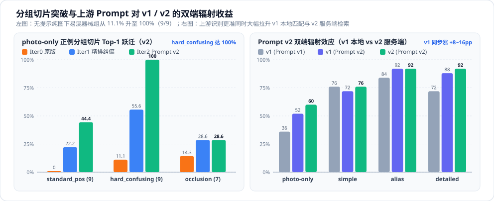
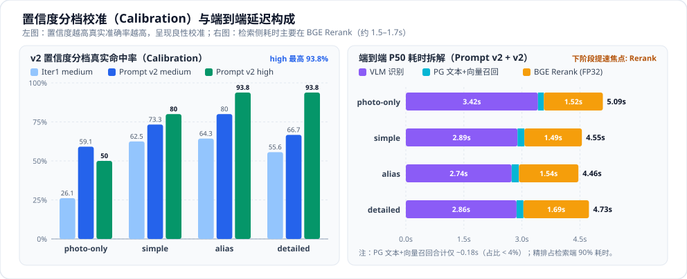
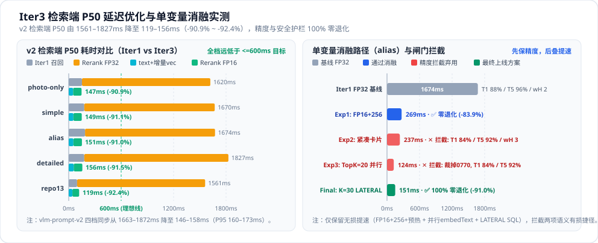

# AI 动作检索三轮优化复盘与核心评测指标解读（Iter0 → Iter3）

> 所属子系统：`ai-agent` · 关联文档：[精排纠偏设计](DESIGN.md) · [Iter1 对比报告](ITER1_COMPARISON.md) · [Prompt 优化设计](VLM_PROMPT_DESIGN.md) · [Prompt 优化对比](VLM_PROMPT_COMPARISON.md) · [P50 提速设计](P50_LATENCY_DESIGN.md) · [P50 提速执行](P50_LATENCY_EXECUTION.md) · [P50 提速对比](P50_LATENCY_COMPARISON.md) · [子系统路由](../../../../docs/subsystem/ai-agent/README.md)

本文件完整沉淀 openGym AI 动作检索从 **「服务端 `v2` 初版上线不升反降（Iter0）」** → **「下游精排与领域护栏纠偏（Iter1）」** → **「上游 VLM Prompt 结构化优化（Iter2）」** → **「检索端 P50 延迟优化与单变量消融（Iter3）」** 的全过程方法论、可视化数据演变，以及评测体系中各项核心指标（含精度、安全与性能延迟维度）的定义、产品含义与排查判读指南。

---

## 1. 端到端链路与三轮优化定位

openGym 的动作识别检索采用 **「上游 VLM 视觉理解（跨端共用） + 下游词库检索与精排（`v1` 本地匹配 / `v2` 服务端混合检索）」** 两段式架构。三轮优化分别精准落刀在三处核心瓶颈：

- **Iter1（下游 `v2` 精排与护栏）**：解决「召回已经 `92%–100%`，但被精排掀翻、过自信乱标 `high`」的工程排序问题，仅改动 `api/src/agent/retrieval/`，零改动上游 Prompt 与 `v1`。
- **Iter2（上游 VLM Prompt v2）**：解决「下游排序触顶后，上游 VLM 看对结构却猜错动作、废片强猜 `medium`、易混乱给 `high`」的识别源头问题，仅改动 `api/agent-runtime/tasks/exercise-search.js` 的 3 处规则，零改动检索器与 Schema，**同时惠及 `v2` 与 `v1` 双端**。
- **Iter3（下游 `v2` 检索端 P50 延迟优化）**：解决「准确度与安全护栏已达标，但检索端 P50 高达 `1561–1872ms`（FP32 `bge-reranker-v2-m3` 独占 ~90%）」的工程性能瓶颈，经单变量消融拦截两项有损精度方案后，将 `v2` 检索 P50 压降至 **`119–158ms`（提速 11–13x）**，精度与安全 **100% 零退化**。

---

## 2. 优化过程复盘（Iter0 → Iter1 → Iter2 → Iter3）

### 2.1 阶段一：基线诊断（Iter0 — 为什么 `v2` 反而比 `v1` 差？）

首轮引入 `PostgreSQL pgvector + BGE-M3 + BGE-Reranker` 后，在 32 样本四档梯度评测中出现了反直觉的「不升反降」：`v2` 在 `simple` 档 Top-1 暴跌至 `12.0%`（`v1` 为 `76.0%`），`Wrong-High` 飙升至 `50.0%–71.9%`。

通过拆解**召回漏斗（`Text@75 / Vec@75 / RRF@30` → 最终 `Top-1`）**，我们迅速确认**召回层没问题，病根全在精排与后处理**：
- `alias` 与 `detailed` 的 `RRF@30` 召回率已达 **`100% (25/25)`**，甚至 `RRF #1` 本身在 `detailed`（`76%`）与 `repo13`（`72.7%`）上已经领先 `v1`；
- 但送进 `BGE-Reranker` 时出现了 6 大工程缺陷：
  1. `rerankQuery` 漏掉了 VLM 识别出的动作名（`name`/`nameEn`），只喂了长段中文 `understanding`；
  2. Cross-Encoder 的 Sigmoid 输出全部饱和在 `0.97–0.9999`，冷门变式（如 `v. 2`、单臂变式）靠 `0.0001` 微差掀翻高共识主动作；
  3. `textRecall` 将 VLM 候选 `0..4` 平权对待，后位 `low` 候选可反超首位 `high`；
  4. 首轮检索缺乏器械大类（固定器械 vs 自重/悬吊带）与部位冲突惩罚；
  5. 置信度单靠精排分 `>= 0.8` 就强行标 `high`，越权把 VLM 标 `low` 的健身房全景废片抬升为 `high`；
  6. 消歧 Chip 无条件透传，既在清晰场景高频打扰，又因乱标 `high` 导致歧义保护归零。

### 2.2 阶段二：下游精排与领域护栏纠偏（Iter1）

在 `D:\wt\og-retrieval\api\src\agent\retrieval\ranking.ts` 中落地纯 TypeScript 排序与护栏模块（零模型重训、零 PG 重建索引）：

1. **序位与置信加权召回**：对 `candidates[0..4]` 按序位衰减与 VLM 置信度赋权，并让 `vectorQuery` / `rerankQuery` 对齐索引结构（主动作英文/中文名置顶，剥离冗长描述噪声）。
2. **Logit 反算破除 Sigmoid 饱和 + 多信号联合重排**：对 `[0, 1]` 精排分执行 `logit = ln(p / (1 - p))` 展开分差，与 `RRF` 排名、去非语义后缀精确匹配、器械/部位属性一致、跨大类冲突罚分、标准主动作优先（抑制无依据的 `v. 2`/单臂变式）联合打分。
3. **双门控置信校准（VLM 硬上限铁律）**：检索层**只能降级、绝不越权抬升** VLM 置信档位；标 `high` 必须同时满足 VLM=`high`、高分地板、零冲突、强共识、非易混动作对（推胸/推肩/夹胸、腿屈伸/腿弯举、哈克/倒蹬）与足够 Logit Margin。
4. **低分与全景废片拒识 + 双向消歧规则**：对全 `low` 且分散 `>= 3` 组 `(equipment, bodyPart)` 的全景废片及低分地板触发安全回落 `rankedIds: []`；高置信清晰结果自动静默 `clarifications`，歧义场景补齐对比 Chip。

**Iter1 成效**：`v2` 彻底扭转颓势并在全部四档追平或反超 `v1`（`alias` `88% / Top-5 96%`、`detailed` `84% / Wrong-High 0%`、独立留出集 `repo13` 达到 `90.9% / Top-5 100%`）。同时**暴露出新瓶颈**：`photo-only` 卡在 `36.0%`、`BadImage-FP` 卡在 `4/6`，核查发现 100% 源自上游 VLM 自身吐错。

### 2.3 阶段三：上游 VLM Prompt 结构化优化（Iter2 — `Prompt v2`）

通过逐条审阅 Iter1 冻结回放中 `deepseek-flash` 的真实输出，我们识别出四类 Prompt 可直接修复的上游错误，并构建了高密度、非膨胀的观测-自检决策链：

**为什么克制篇幅很关键？** 轻量多模态模型（如 `deepseek-flash`）对冗长规则敏感，容易诱发“为了满足清单而脑补不存在的零件”的幻觉。因此 Iter2 仅在 `PROMPT` 规则 4、规则 6 和 `## Names` 末句做了约 6–8 行高信息密度修订，保留全部 11 项旧单测子串契约与原 JSON Schema，一次实测即全面越过验收门槛，未出现正例误拒（全四档 `Coverage = 25/25`）。

### 2.4 阶段四：检索端 P50 延迟优化与单变量消融（Iter3 — `p50-latency-v2`）

完成精度与安全闭环后，现场性能画像确认检索端延迟（`1561–1872ms`）的四大硬件与工程根因：`AMD Radeon RX 9070 XT` 上 `CrossEncoder` 默认跑 FP32 + `max_length=512` + 无启动预热（单步占 `88%–92%` / `1443–1665ms`）；`rerank_text` 均值 `367` 字符；`textRecall` 在 `for` 循环中逐词串行执行 PG `Seq Scan`（`95–132ms`）；以及 `textRecall` 与 `embedText` 串行等待（浪费 `~55ms` 重叠窗口）。

本轮严格坚持**「单变量验证 → 精度红线拦截 → 无损方案叠加上线」**，最终保留 3 项零损提速、拦截 2 项有损捷径：

1. **落地提速方案（3 项）**：
   - **ROCm 半精度推理 + `max_length=256` + 预热（`services/retrieval-model/main.py`）**：开启 `RETRIEVAL_RERANK_DTYPE=fp16` `torch.autocast`、`max_length=256`、`pad_to_multiple_of=8`（对齐 WMMA 内核），并在显式检查 `torch.isfinite(logits)` 后转 FP32 再做 Sigmoid（防止 `+inf` 被 Sigmoid 掩盖为 `1.0`）；任何非有限值触发单 batch 自动回退 FP32 并递增 `rerank_fp32_fallbacks`（全量实测为 **`0`**）；启动期完成模型预热；`embedding` 维持 FP32 默认值以保证与已入库向量零余弦漂移。仅此一项即使 `rerankMs` P50 暴降 **94%**（`1443–1665ms → 75–89ms`）。
   - **并发重叠 `embedText` 与 `textRecall`（`retrieval.service.ts`）**：在 `!fixture` 且 `textRecall` 事务启动前同步发起 `embedText`，并用独立 `AbortController` + `.catch(() => undefined)` 管理取消与异常清理，严守 `BEGIN READ ONLY === 4` 契约，将感知 `vectorMs` 压至 **`9–17ms`**（仅余最后等待与 pgvector HNSW 查询时间）。
   - **`UNNEST + CROSS JOIN LATERAL` 批量 `textRecall`（`retrieval.service.ts`）**：实测发现朴素 `JOIN ... ON (... OR ...)` 会导致 PG 放弃 B-Tree/GIN 索引回退 `Seq Scan`（6 词 `153ms`，反慢于旧循环 `151ms`）；改写为 `WITH q AS MATERIALIZED (...) CROSS JOIN LATERAL (exact UNION trgm UNION fts)` + 外部单次 `short_cjk ILIKE` 后，`EXPLAIN (ANALYZE, BUFFERS)` 实测 6 词降至 **`43ms`**（纯英文 3 词 `24ms`），与原循环返回 75 条完全一致。
2. **消融拦截项（2 项，坚守“不用准确率换速度”红线）**：
   - **拦截 P0.1 Stage B（删步骤与描述的紧凑 `rerank_text`）**：Stage A 实验虽可再省 ~30ms，但丢失了仅存于步骤和 `description` 中的关键机械语义（如 `1350 lever seated row` 的 `"with chest support"`），导致 `alias` 档 `Top-1` 由 `88% → 84%`、`Top-5` 由 `96% → 92%`、`Wrong-High` 由 `2/32 → 3/32`（`machine_014`、`machine_024`、`machine_017`）。按安全闸门果断放弃 Stage B，保持 `catalogue.ts`（`v2`）与 `ranking.ts` 零改动，也免去了线上索引迁移成本。
   - **锁定 `rerankTopK` 默认 `30`（拦截 `20`/`16` 截断）**：在 `config.ts` 新增可配置 `EXERCISE_SEARCH_RERANK_TOP_K`（`10..30`），但 A/B 实测显示 `16` 与 `20` 均会提前裁掉 `alias machine_024` 中位于 `retrieval_fusion` 第 21–30 位的标准动作 `0770`，导致 `alias` `Top-1`/`Top-5` 各掉 4pp（`topk16` 还使 `simple` `Top-5` 掉 4pp）。锁定默认 `30` 后多耗仅 `~25ms`，全栈 P50 依然仅有 **`119–156ms`**。

---

## 3. 核心成果可视化与数据演进

### 3.1 准确度三阶段跃迁（`Top-1` 与 `Top-5`）

- **Iter1 解决“排不准”**：把 `v2` 从远落后于 `v1`（`8%–36%`）拉升至全面追平并反超 `v1`（`36%–88%`），`Top-5` 在有提示三档站上 `88%–96%`。
- **Iter2 打破“纯图天花板”**：在最难的无提示纯图（`photo-only`）场景，`v2` `Top-1` 由 `36.0% (9/25)` 跃升至 **`60.0% (15/25)`（`+24.0pp`）**，`Top-5` 由 `52.0%` 跃升至 **`72.0%`（`+20.0pp`）**；`alias` 与 `detailed` 双双站上 **`92.0% Top-1 / 96.0% Top-5`**；`simple` `Top-5` 亦提升至 **`96.0%`**。

### 3.2 安全护栏双层防线（`Wrong-High` 与 `BadImage-FP`）

- **过自信 `Wrong-High` 暴降**：从 Iter0 灾难性的 `50.0%–71.9%` 经 Iter1 下游硬上限压到 `0%–12.5%`，再经 Iter2 上游易混封顶进一步压降至 **`3.1%–6.3%`**（`detailed` 正例 `Wrong-High = 0/25`）。
- **废片误报 `BadImage-FP` 腰斩以上**：下游检索看不到原图，Iter1 仅能靠“全 `low` 多器械发散”截下 `1/6`（`83.3% → 66.7%`）；Iter2 从视觉源头引入拒识条款后，四档 `BadImage-FP` 骤降至 **`16.7%–33.3%`（`1/6–2/6`）**，且 `simple`/`alias`/`detailed` 三档 `BadImage-High-FP` 全部保持 **`0/6`**。

### 3.3 分组切片突破与双端辐射收益

- **易混器械组实现全四档 100% 命中**：`hard_confusing`（9 例，含史密斯机、推胸/推肩、腿屈伸/腿弯举、髋内收/外展、坐姿划船）在纯图 `photo-only` 下从 Iter0 `11.1%` → Iter1 `55.6%` → **Iter2 `100.0% (9/9)`**，且四档全程 `Wrong-High = 0/9`。
- **上游优化天然惠及 `v1` 本地端**：由于 `exercise-search.js` 由服务端 `v2` 与端侧 `v1` 共用，Prompt v2 同时让本地 `v1` 在 `photo-only` 与 `detailed` 各暴涨 **`+16.0pp`**（`36% → 52%`、`72% → 88%`），`alias` 涨 **`+8.0pp`**（`84% → 92%`）。而在同轮 `Prompt v2` 配对下，`v2` 仍在 `photo-only` Top-1（`+8pp`）、`simple` Top-5（`+16pp`）及二合一双动作共现（领先 `30–74pp`）上稳居优势。

### 3.4 置信度分档校准与 Iter2 延迟基线构成

- **良性置信度校准**：在 `Prompt v2` 下，`v2` 标 `high` 的真实命中率在 `alias`/`detailed` 达 **`93.8%`**、`simple` 达 **`80.0%`**；标 `medium` 的命中率在 `photo-only` 从 `26.1%` 翻倍至 **`59.1%`**、`alias` 达 **`80.0%`**——前端可以放心用 `high` 做强推荐、用 `medium` 引导用户轻点确认。
- **Iter2 延迟基线结构（Iter3 起点）**：右图记录了 Iter3 优化前的基线耗时构成——当时 `v2` 检索侧 P50 为 `1.56–1.87s`，其中 **FP32 `BGE-Reranker` 独占 ~90%（`1.44–1.74s`）**，直接锚定了 Iter3 的主攻靶点。

### 3.5 检索端 P50 延迟跃迁与单变量消融（Iter3）

- **检索端提速 11.0x–13.1x（全档击穿 `<=600ms` 理想线）**：
  - `v1-vs-v2` 主基线 4 档 P50 从 `1620–1827ms` 降至 **`147–156ms`**（P95 `1833–2102ms → 173–252ms`）；
  - `repo13` 留出集 P50 从 `1561ms` 降至 **`119ms`**（P95 `1998ms → 239ms`，**-92.4%**）；
  - `vlm-prompt-v2` 四档二次回归 P50 从 `1663–1872ms` 降至 **`146–158ms`**（P95 `1857–2215ms → 160–173ms`）。
- **全量 9 份冻结回放精度/安全 100% 持平**：`Top-1`、`Top-5`、`MRR@5`、`nDCG@5`、`Wrong-High`、`BadImage-High-FP`、`Coverage` 与 `multiValidCoverage` 全部与对应基线零差异，ROCm 实测 `fp32_fallbacks = 0`。

---

## 4. 评测体系与核心指标深度解读（Metrics Guide）

为了避免“只看一个平均准确率被表象误导”，本项目的评测框架按 **「测试集设计 × 五类指标维度（含新增性能延迟维度）」** 构建了完整观测面。以下是面向研发与产品评审的指标白话解读与判读手册。

### 4.1 评测设计：为什么必须测「四档提示梯度 + 独立 `repo13`」？

| 维度 | 内容与样本分布 | 为什么必须测它 |
|---|---|---|
| **4 档提示梯度**（`test_pic` 32 样本 × 4） | `photo-only`（纯图无字）→ `simple`（简短词如“练胸”）→ `alias`（健身房俗称如“蝴蝶机/悍马卧推”）→ `detailed`（完整姿势描述） | 模拟真实用户的四种提问习惯。纯图考视觉下限，`simple`/`alias` 考图文互补与别名泛化，`detailed` 考长文本下是否会被噪声带偏。 |
| **5 类样本切片**（32 样本构成） | `standard_positive`（9 常规）· `hard_confusing`（9 易混近亲）· `cross_domain_occlusion`（7 遮挡/异角 + 1 逆光全景）· `near_ood`（1 库外高相似器械）· `bad_image`（5 模糊/特写/全景废片） | 拆开看才能防止“简单题刷高分、难例和废片全崩”。正例算召回与排序（分母 25），负例算拒识安全（废片共 6 例，库外 1 例）。 |
| **独立留出集 `repo13`** | 仓库历史独立评测集（13 回放门禁 / 10 实况样本） | 防过拟合检验（Holdout Set）：确认针对 32 样本调出来的规则在新图与历史语料上同样有效、不退化。 |
| **两种评测模式** | **Paired Single-VLM Replay**（冻结同一份 VLM 输出重跑下游 `v1`/`v2`） vs **实况 E2E**（实时调真实 `deepseek-flash`） | 调下游检索（Iter1/Iter3）用 Replay 可零成本剥离 VLM 随机波动并做毫秒级延迟消融；改上游 Prompt（Iter2）必须跑实况 E2E 才能测到真实的模型行为变化。 |

---

### 4.2 排序与召回准确度指标（“找得对不对、排得靠不靠前”）

| 指标 | 白话定义 | 产品体验含义 | 本次优化判读要点 |
|---|---|---|---|
| **Top-1** | 第 1 名结果落入该样本**可接受答案集合**（`acceptableIds`，允许近义标准变式）的比例 | 用户一眼看到的首选推荐是否正确 | 最核心的北极星指标。`Prompt v2 + Iter3` 最终达 `photo-only 60%` / `simple 76%` / `alias 92%` / `detailed 92%`（`v1-vs-v2` 基线亦 100% 零退化）。 |
| **Strict Top-1** | 第 1 名精确命中**唯一标准主动作 ID**（`groundTruthId`）的比例 | 是否把最规范的主动作排在冷门版本（如 `v. 2`）前面 | 若 `Top-1` 高但 `Strict Top-1` 明显低，说明排序被冷门变式抢了第 1（Iter1 专门修复此项）。 |
| **Top-5** | 前 5 名中至少命中 1 个可接受答案的比例（`v2` 严格按前 5 截断与 `v1` 公平对齐） | 用户在第一屏候选列表中能否直接点选，不用重搜 | 有提示三档全达 **`96.0%`**，纯图达 **`72.0%`**，意味着绝大多数场景一屏即可选中。 |
| **MRR@5** | Mean Reciprocal Rank：首个正确答案排名的倒数均值（第 1 名=1，第 2 名=0.5，第 5 名=0.2，未进前 5=0） | 衡量用户平均要往下翻几条才能找到正确动作 | 比 Top-1 更细粒度。`photo-only` 从 `0.420 → 0.641`，说明不仅第 1 名变多，未排第 1 的也大幅前移。 |
| **nDCG@5** | 归一化折损累计增益，综合考量**前 5 名里多个相关动作的整体排序质量**（精准匹配权重高于次相关变式） | 衡量整个候选列表的“整齐度”，防止第 1 对了但第 2–5 全是杂项 | 反映列表综合体验；`alias`/`detailed` 达 `0.887` / `0.874`（远高于 `v1` 的 `0.754` / `0.704`）。 |
| **召回漏斗 (`Text@75` / `Vec@75` / `RRF@30`)** | 仅 `v2` 诊断指标：正确答案进入文本前 75、向量前 75、融合前 30 的比例 | **定位瓶颈的手术刀**（见下方排查速查表） | `alias`/`detailed` `RRF@30` 达 `100%`，说明词库索引和召回天花板极高。 |

> **漏斗排查速查口诀**：
> - `Text@75` 和 `Vec@75` 都低 → **上游 VLM 认错了**（或词库缺别名），改 Prompt / 别名词典（对应 Iter2）；
> - `Text@75` / `Vec@75` 高、`RRF@30` 高，但 `Top-1` 低 → **精排或打分规则掀翻了好候选**，改 `rerankQuery` / `ranking.ts`（对应 Iter1）；
> - `Top-1` 高但 `Strict Top-1` 低 → **冷门变式/版本号抢占首位**，强化主动作加权。

---

### 4.3 安全护栏与过自信红线指标（“认不准时敢不敢说不确定”）

| 指标 | 白话定义 | 为什么它比普通排错更致命 | 当前表现 |
|---|---|---|---|
| **Wrong-High** | 全部 32 样本中，系统给出 **`level = high` 却答错**（正例答错或负例误报）的占比 | 产品上 `high` 意味着高置信直推与静默消歧——**答错还给 `high` 就是“一本正经胡说八道”**，最伤用户信任 | Iter0 `50–72%` → Iter2/3 **`3.1–6.3%`**（`detailed` 正例 **`0/25`**） |
| **BadImage-FP** | 6 例不可读废片（严重模糊、逆光全景、局部特写）中，系统**未能拒识（仍吐出候选列表）**的比例 | 用户拍糊了或拍了整个健身房，强行塞一堆无关动作卡片会显得系统“强行瞎猜” | Iter0 `83.3% (5/6)` → Iter2/3 **`16.7–33.3% (1–2/6)`** |
| **BadImage-High-FP** | 6 例废片中，不仅没拒识还敢标 **`high`** 的比例 | 不可接受的 P0 安全底线 | `simple`/`alias`/`detailed` 全为 **`0/6`**；`photo-only` 仅 `1/6`（特写含清晰印刷字样 `machine_029`） |
| **NearOOD-FP** | 词库中**不存在的近亲器械**（`machine_027`），系统是否给出了候选 | 衡量面对库外长尾器械的边界感；当前 `photo-only`/`simple` 已消除 `High-FP`（降至 `medium`） | `repo13` 留出集 **`0/2`**；`test_pic` 1 例在纯图/简述已降 `medium` |

---

### 4.4 结构性错误、交互体验与校准指标

| 指标 | 白话定义 | 怎么解读它的变化 |
|---|---|---|
| **WrongBP（部位大错）** | 首选结果的肌群部位与真实目标完全冲突（如把腿屈伸认成练胸） | **Iter2 最有说服力的机制证据**：`photo-only` `WrongBP` 直接从 **`48.0% (12/25)` 腰斩至 `24.0% (6/25)`**，直接印证了「人体接触垫与发力肢体先判 + 观察-候选强一致」在底层改变了 VLM 的视觉推理，而非偶然涨分。 |
| **WrongEq（器械大类错）** | 首选结果跨大类错配器械（如把挂片固定器械认成自重/悬吊带/哑铃） | `simple` 从 Iter0 灾难性的 `56.0%` 经 Iter1 护栏压到 `12.0%`，Iter2 进一步降至 **`8.0%`**，`detailed` 降至 **`4.0%`**。 |
| **Coverage（正例覆盖率）** | 25 例合法正例中，系统成功返回至少 1 个候选（未误拒为空）的比例 | 与 `BadImage-FP` 构成**天平两端**：引入废片拒识最怕误伤合法正例（尤其是 `cross_domain_occlusion` 遮挡图）。Iter2/3 在全四档保持 **`25/25 (100%)`** 零误拒，说明拒识边界拿捏精准。 |
| **Calibration（置信度分档准确率）** | 分别统计所有标 `high`、`medium`、`low` 结果的真实 Top-1 命中率 | 健康的系统必须满足 **`Acc(high) > Acc(medium) > Acc(low)`**。在 `Prompt v2` 下，`alias` 达到 `high 93.8% > medium 80.0% > low 0%`，`simple` 达到 `80.0% > 73.3% > 0%`，且 Iter3 `fp16` 下分档校准曲线 100% 保持不变。 |
| **歧义消歧率（`clarNoHigh`） vs 清晰组打扰率** | 前者衡量易混场景下“既不乱标 `high` 又给出追问 Chip”的保护率；后者衡量清晰单义场景下“多此一举弹出追问 Chip”的打扰比例 | **天然的体验权衡（Trade-off）**：Iter2 为了守住安全线（`Wrong-High` 减半），在 `photo-only`/`simple` 主动把更多边界样本封顶为 `medium`，因此 `clarNoHigh` 上升（`75% → 87.5%`、`59.4% → 68.8%`），代价是清晰组打扰率在信息少时略升，而在 `alias`/`detailed` 信息充分时分别保持 **`22.2%`** 与降至 **`33.3%`**。 |
| **二合一双动作共现（`multiValidCoverage`）** | 对一台器械支持两个合法相近动作（如双功能机、常见近义动作）的样本，前 5 名同时覆盖多个合法动作的比例 | 衡量候选列表的**探索实用性**。`v2` 借向量+RRF 多路召回达到 **`78.3%–95.7%`**（`alias` `22/23`），远超 `v1` 词法匹配的 `17.4%–30.4%`。 |

---

### 4.5 性能与延迟工程指标深度解读（Iter3 新增）

在精度达标之后，性能指标决定交互流畅度与优化ROI；以下指标帮助区分“真提速”和“假优化/统计假象”：

| 指标 | 白话定义 | Iter1/2 → Iter3 演变 | 工程判读与踩坑警示 |
|---|---|---|---|
| **检索端 P50 / P95** | 扣除上游 VLM 调用后，单次服务端 `retrieve()` 完整耗时（PG 召回 + 向量 + 融合 + 精排 + 校准）的中位数与第 95 百分位 | P50: `1561–1872ms` → **`119–158ms`**；P95: `1833–2215ms` → **`160–252ms`** | **P50 看常态体验，P95 盯尾延迟尖刺**。若未加启动 `_warmup_models()`，首批请求会因 ROCm HIP 内核 JIT 编译把 P95 拉高数百毫秒；加上预热后 P95 压在 `<=252ms`，端到端不再抖动。 |
| **`textMs`（PG 文本召回 P50）** | 文本召回单事务耗时的中位数 | `95–132ms` → **`25–44ms`**（`repo13` `59 → 25ms`） | **用 `EXPLAIN (ANALYZE, BUFFERS)` 验索引，不能凭直觉改批量 SQL**：朴素 `UNNEST JOIN (... OR ...)` 让 PG 放弃 GIN/B-Tree 退化为 `Seq Scan`（`153ms`），改写为 `CROSS JOIN LATERAL (... UNION ...)` 才真正命中全部索引（`43ms`）。 |
| **`vectorMs`（增量向量阶段 P50）** | 并发架构下的“等待 `embedText` 就绪 + PG HNSW 向量检索”增量耗时 | `55–61ms` → **`9–17ms`** | **必须按增量壁钟时间口径解读**：`bge-m3` 编码本身仍需 ~50ms，但它已与 `textRecall`（~40ms）**并行重叠执行**；因此 `textRecall` 结束后主链路仅需额外等待 ~10–17ms 即拿到向量并完成 HNSW 查询，几乎白赚整段编码时间。 |
| **`rerankMs`（Cross-Encoder 精排 P50 / P95）** | 对融合候选执行精排推理的耗时中位数与 P95 | P50: `1443–1665ms` → **`78–88ms`**；P95: `1633–1829ms` → **`90–97ms`** | **本轮最大提速来源（18–19x）**：FP16 `autocast` + `max_length=256` + `pad_to_multiple_of=8` 释放了 RX 9070 XT 矩阵计算吞吐，使曾经占 90% 耗时的瓶颈彻底瓦解。 |
| **`fp32_fallbacks` 与 分数漂移（Score Drift）** | 半精度推理触发非有限值回退 FP32 的次数；以及半精度后 Sigmoid `rawScore` 相对 FP32 的最大偏移 | `fp32_fallbacks = 0`；分数漂移 **`0.0001–0.002`** | **安全兜底与数值保真度证明**：先判 `torch.isfinite(logits)` 再转 FP32 Sigmoid，避免 `+inf` 被激活函数掩盖为 `1.0`；`<=0.002` 微小浮点尾差远小于 `ranking.ts` 分档间隔，校准结果 100% 稳定。 |
| **端到端耗时占比（Amdahl 视角）** | 检索耗时占「VLM 识别 + 检索」总耗时的比例 | `~32%–36%`（`~1.6–1.9s / ~4.8s`）→ **`< 5%`（`~0.15s / ~3.0–3.6s`）** *(按图 4 VLM P50 与 Iter3 检索 P50 估算)* | **瓶颈已完全转移**：检索耗时已从秒级降至 ~150ms（接近本地 `v1` 体验量级），目前端到端等待时间 **>95% 来自上游 VLM 推理**。继续在检索端抠几十毫秒对用户体感收益极低，且风险远大于收益。 |

> **精度-延迟帕累托决策法则（Iter3 消融经验）**：
> 同为提速手段，**“硬件/并发无损优化”**（FP16 + 并发重叠 + 索引化 `LATERAL` SQL）一次砍掉 **`1500ms+`** 且精度 **0 损失**；而**“删语义/裁候选的近似捷径”**（删 `rerank_text` 步骤/描述、或把 `rerankTopK` 从 `30` 裁到 `20`）仅再省 **`25–30ms`**，却立刻丢失关键机械特征或标准动作（`alias` `Top-1`/`Top-5` 各掉 4pp）。当延迟已进入 `< 200ms` 区间，绝不用精度换取边际毫秒收益。

---

## 5. 全流程优化总账与下阶段演进方向

### 5.1 三轮优化总账（`v2` 端到端演进：Iter0 → Iter1 → Iter2 → Iter3）

| 梯度 | Top-1 (`I0 → I1 → I2/I3`) | Top-5 (`I0 → I1 → I2/I3`) | Wrong-High (`I0 → I1 → I2/I3`) | BadImage-FP (`I0 → I1 → I2/I3`) | 检索 P50 (`I1/I2 → Iter3`) | 检索 P95 (`I1/I2 → Iter3`) |
|---|---|---|---|---|---|---|
| `photo-only` (32) | `8.0% → 36.0% →` **`60.0%`** | `16.0% → 52.0% →` **`72.0%`** | `50.0% → 12.5% →` **`6.3%`** | `83.3% → 66.7% →` **`33.3%`** | `1620–1677ms →` **`146–147ms`** | `1833–1857ms →` **`160–252ms`** |
| `simple` (32) | `12.0% → 76.0% →` **`76.0%`** | `32.0% → 88.0% →` **`96.0%`** | `71.9% → 12.5% →` **`6.3%`** | `83.3% → 66.7% →` **`16.7%`** | `1663–1670ms →` **`149ms`** | `1879–1902ms →` **`162–173ms`** |
| `alias` (32) | `36.0% → 88.0% →` **`92.0%`** | `52.0% → 96.0% →` **`96.0%`** | `56.3% → 6.3% →` **`3.1%`** | `83.3% → 66.7% →` **`16.7%`** | `1674–1725ms →` **`148–151ms`** | `1912–1913ms →` **`163–184ms`** |
| `detailed` (32) | `20.0% → 84.0% →` **`92.0%`** | `48.0% → 92.0% →` **`96.0%`** | `68.8% → 0.0% →` **`3.1%`** *(正例 0%)* | `83.3% → 66.7% →` **`33.3%`** | `1827–1872ms →` **`156–158ms`** | `2102–2215ms →` **`173ms`** |
| `repo13` (13 回放) | `- → 90.9% →` **`90.9%`** | `- → 100.0% →` **`100.0%`** | `- → 0.0% →` **`0.0%`** | `N/A` *(NearOOD 0/2)* | `1558–1561ms →` **`119ms`** | `1998–2153ms →` **`239ms`** |

> 注：`Iter3` 在 `v1-vs-v2`（Iter1 VLM 输出）、`repo13` 及 `vlm-prompt-v2`（Iter2 VLM 输出）全部 9 份冻结回放集上均实现**精度与安全 100% 持平零退化**，P50 全面压进 **`119–158ms`**（远优于 `<=800ms` 及 `<=600ms` 理想目标）。

### 5.2 已完结工作与剩余演进方向

1. **检索端提速优化（✅ Iter3 已超额完成）**：通过 ROCm FP16 `autocast` + `max_length=256` + 启动预热 + `embedText`/`textRecall` 并发重叠 + `UNNEST LATERAL` 索引化 SQL，检索 P50 已从 `1.56–1.87s` 压降至 **`119–158ms`**（P95 **`160–252ms`**），当前已不再是系统瓶颈。
2. **上游 VLM 首字/总时延体验优化（下一阶段最高 ROI）**：当前端到端总耗时中 **>95%（`2.7–3.4s`）** 集中在上游 VLM 识别阶段。后续如需继续缩短用户体感等待，应优先评估更快的视觉模型路由、图片客户端预压缩尺寸调优，或流式中间态反馈（如识别中骨架提示）。
3. **轻量 VLM 底层视觉天花板与产品协同引导**：`photo-only` 剩余失误多为仰拍/局部遮挡下的底层几何错看，更适合在 UI 层**引导用户补一句简短提示（进入 `simple`/`alias` 后 Top-5 立即跃升至 `96%`）**；对局部铭牌特写（`machine_029`）与库外变体（`machine_027`），可结合低置信提示文案与「拍完整器械轮廓」引导卡片进一步兜底。
