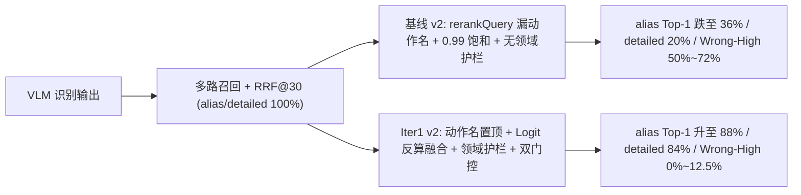
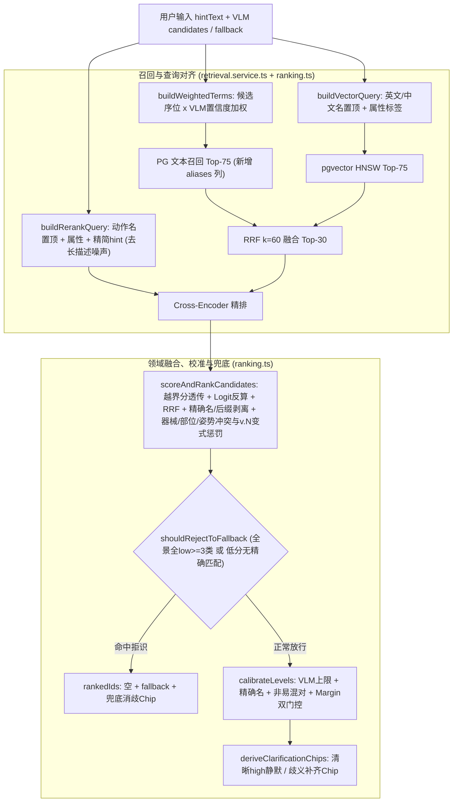
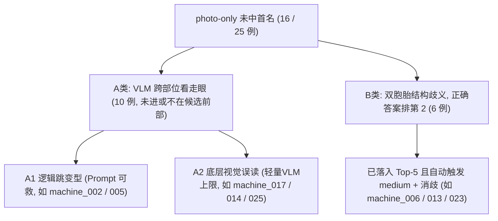

# AI 动作检索 `v2` 精排纠偏：优化过程与评测指标完整解读

> 关联文档：[设计方案](DESIGN.md) · [执行记录](EXECUTION.md) · [Iter1 对比报告](ITER1_COMPARISON.md) · [VLM Prompt 交接](VLM_PROMPT_HANDOFF.md) · [基线对比报告](../ai-search-eval-v2/COMPARISON_REPORT.md) · [基线交接](../ai-search-eval-v2/HANDOFF.md) · [子系统路由](../../../../docs/subsystem/ai-agent/README.md)

---

## 1. 问题背景：为什么改前会出现“不升反降”？

在首轮 Paired Single-VLM（同一份 VLM 输出同时评测客户端 `v1` 与服务端 `v2`）对比中，`v2` 的上游多路召回能力已经优于或持平 `v1`（`alias` 档 `RRF@10` 达到 `25/25 = 100%`，`detailed` 与 `repo13` 的 `RRF@30` 也达到 `100%`），但最终呈现给用户的 `Top-1` 与安全性反而大幅倒退：

### 六大核心归因

1. **精排 `rerankQuery` 漏掉动作名 + Sigmoid 饱和 + 一票否决 RRF**：`retrieval.service.ts` 原先构造 `rerankQuery` 只拼了 `hintText` + 冗长中文 `fallback.understanding` + 裸 slug，遗漏了 VLM 识别的动作名（`name`/`nameEn`）；`bge-reranker-v2-m3` 经 Sigmoid 后几乎把 30 个候选都挤在 `0.97–0.9999`，导致偏门变式靠 `0.0001` 分差掀翻已排在 `RRF #1` 的标准主动作（`simple` 18 例命中被掀翻 15 例、`detailed` 19 例被掀翻 14 例）。
2. **VLM 序位与置信度全被丢弃（平权召回）**：`textRecall` 把 `candidates[0..4]` 平权取最高分并按 `exercise_id` 字典序破平，低位 `low` 候选可轻易反超首位 `high`；`vectorQuery` 也未对齐索引侧的 `English / Chinese / Attributes` 模板。
3. **首轮缺少器械/部位冲突拦截与标准主动作优先**：首轮对跨大类器械冲突（如自重拉伸、悬吊带盖过 `leverage machine`）零惩罚，导致 `simple` 的 `WrongEq` 飙到 `56%`；缺少 `stripNonSemanticSuffix` 与 `v. 2`/`v. 4`/单臂变式惩罚，导致版本变式抢占标准主动作首位。
4. **单靠 Rerank 饱和分越权抬升 VLM `medium/low`**：Cross-Encoder 看不到原图画质，却凭文本分 `>= 0.8` 把 VLM 已标为 `low` 的全景废片（`machine_028`）强行抬成 `high`。
5. **缺少 Score Floor 与全景低置信废片拒识**：除 VLM 零候选外一律硬吐 10 条推荐。
6. **盲目透传 `clarifications`**：`standard_positive` 清晰组打扰率暴涨到 `66.7%–100%`，而 `hard_confusing` 组因错标 `high` 导致 `clarificationNoHigh` 跌为 `0/9`。

---

## 2. 本轮优化过程与架构演进

### 2.1 本轮工程边界（刻意克制变量）
- **不改动 `v1` 基线**：`frontend/src/lib/exercise-ai-search.js` 保持原样，保证前后配对对比完全同口径。
- **暂不做提速改造**：不改 `catalogue.ts` 的 `rerankText` 模板、不重建 PG 索引、不改 `services/retrieval-model/main.py`（保持 FP32）、不收窄 RRF Top-30 候选池。
- **零过拟合约束**：全部规则基于通用领域知识设计，不在代码中硬编码任何测试样本 ID，并使用从未参与调参的独立集 `repo13` 做留出检验。

### 2.2 端到端优化链路对比图

### 2.3 执行与验证闭环（5 个阶段）
1. **Phase 1（设计建档）**：在主仓完成 [DESIGN.md](DESIGN.md)（含 `ai-agent` 语义级变更声明）与 [EXECUTION.md](EXECUTION.md)，并更新子系统路由。
2. **Phase 2–3（核心实现）**：通过 `Gemini 4 Hydrogen (High)` 子 Agent 在 `D:\wt\og-retrieval` 新增纯 TS 模块 `api/src/agent/retrieval/ranking.ts`，接入 `retrieval.service.ts` 与 `fixture-retrieval.ts`，并保持单事务 `BEGIN READ ONLY === 4` 契约与越界分数（`level: undefined`）兼容；在 `retrieval.service.test.js` 扩充 6 组边界单测。
3. **Phase 4（构建与零 VLM 成本回放）**：
   - `npm.cmd --prefix api run build`：通过（`build: dist ready`）
   - `node --test api/test/retrieval.service.test.js api/test/exercise-search-diagnostics.test.js api/test/agent-exercise-search.test.js`：**`59/59` 通过**
   - `node --test api/test/nest/agent-exercise-search.test.js`：**`10/10` 通过**
   - `npm.cmd --prefix frontend run test:ai-search-eval`：**`10/10` 通过**
   - 使用冻结的 4 档 VLM Replay 与独立 `repo13` 在真实 PG + ROCm BGE 上完成全量配对复测（零误差）。
4. **Phase 5（四步核对与治理收尾）**：核对 Diff 边界与隐私脱敏后归档报告，并通过 `.\.agent\scripts\verify-governance.ps1` 全绿校验。

---

## 3. 核心评测指标通俗速查

| 指标 | 一句话含义 | 怎么看才算好 |
|---|---|---|
| `Top-1` / `Strict Top-1` | 第 1 名就命中任意可接受答案 / 第 1 名精确命中唯一标准主动作（`groundTruthId`） | 越高越好；`Strict Top-1` 能检验有没有被 `v. 2` 等变式抢走首位 |
| `Top-5` | 前 5 名中命中期望动作（`v2` 强制截断前 5 与 `v1` 公平对照） | 越高越好，代表真实展现在手机首屏内的召回率 |
| `MRR@5` | 前 5 名第一个正确答案位置倒数 `1/rank` 的平均值 | `0~1` 越高越好，越靠前分越高（第 1 名 `1.0`、第 2 名 `0.5`） |
| `nDCG@5` | 综合排位权重与标准主动作优先（主动作权 2、近亲权 1）的前 5 排序质量分 | `0~1` 越高越好，能反映前 5 里标准动作与二合一兄弟动作的质量 |
| **`Wrong-High`** | 首名标为 `high`（高置信）但结果错误（正例选错或废片非空）占全部样本比例 | **第一产品红线，越低越好（理想 `0`）**，防止高置信误导用户记错训练 |
| `WrongEq` / `WrongBP` | 正例首名器械类别不对 / 首名训练部位不在预期部位集合内 | 越低越好 |
| **`BadImage-FP` (`High-FP`)** | 6 张应拒识废片（暗光、特写、模糊、全景等）仍返回非空结果的比例（及其中错标 `high` 比例） | 越低越好，至少要保证 `High-FP = 0` |
| `NearOOD-FP` | 库外近亲器械（`machine_027`）仍返回非空结果的比例 | 越低越好，且严防标成 `high` |
| **`歧义 clarNoHigh`** | 9 张易混/二合一器械中，既弹出了追问消歧按钮又没有瞎标 `high` 的比例 | **越高越好**（该问时谦虚追问） |
| **`清晰打扰`** | 9 张清晰单义正例中，仍然弹出追问按钮的比例 | **越低越好**（清晰图少打扰用户） |
| `二合一双动作共现` | 二合一器械样本在前 5 名里同时覆盖至少 2 个合法动作的比例 | 越高越好，省去用户重拍 |
| **独立留出集 (`repo13`)** | 完全未参与调参的仓库历史 13 条实拍与边界样本集（11 正例 + 2 异常空例） | 用来检验是否对 32 张主测试集过拟合；留出集大涨才是真泛化 |

---

## 4. 完整实测结果对比与可视化分析

### 4.1 跨梯度数值总表（`v1` vs 基线 `v2` vs 调优后 `v2`）

| 数据集 (样本) | 版本 | Top-1 | Strict Top-1 | Top-5 | MRR@5 | nDCG@5 | Wrong-High | WrongEq / WrongBP | BadImage-FP (High) | 歧义 clarNoHigh / 清晰打扰 | 二合一双动作 | P50 延迟 |
|---|---|---:|---:|---:|---:|---:|---:|---:|---:|---:|---:|---:|
| `photo-only` (32) | `v1` | 36.0% | 28.0% | 52.0% | 0.440 | 0.348 | 21.9% (7/32) | 12.0% / 48.0% | 5/6 (-) | 6/9 / 5/9 | 13.0% | 67ms |
| `photo-only` (32) | 基线 `v2` | 8.0% | 4.0% | 16.0% | 0.107 | 0.073 | 50.0% (16/32) | 16.0% / 64.0% | 5/6 (-) | 2/9 / 5/9 | 8.7% | 2260ms |
| **`photo-only` (32)** | **Iter1 `v2`** | **36.0%** | **32.0%** | **52.0%** | **0.420** | **0.399** | **12.5% (4/32)** | **12.0% / 48.0%** | **4/6 (0/6)** | **8/9 / 5/9** | **43.5%** | **1620ms** |
| `simple` (32) | `v1` | 76.0% | 68.0% | 76.0% | 0.760 | 0.593 | 15.6% (5/32) | 12.0% / 0.0% | 5/6 (-) | 4/9 / 2/9 | 13.0% | 54ms |
| `simple` (32) | 基线 `v2` | 12.0% | 4.0% | 32.0% | 0.213 | 0.147 | 71.9% (23/32) | 56.0% / 20.0% | 5/6 (-) | 0/9 / 9/9 | 13.0% | 2276ms |
| **`simple` (32)** | **Iter1 `v2`** | **76.0%** | **72.0%** | **88.0%** | **0.801** | **0.756** | **12.5% (4/32)** | **12.0% / 0.0%** | **4/6 (0/6)** | **6/9 / 2/9** | **82.6%** | **1670ms** |
| `alias` (32) | `v1` | 84.0% | 76.0% | 84.0% | 0.840 | 0.668 | 12.5% (4/32) | 8.0% / 0.0% | 5/6 (-) | 5/9 / 4/9 | 21.7% | 62ms |
| `alias` (32) | 基线 `v2` | 36.0% | 28.0% | 52.0% | 0.403 | 0.344 | 56.3% (18/32) | 24.0% / 12.0% | 5/6 (-) | 0/9 / 5/9 | 30.4% | 2399ms |
| **`alias` (32)** | **Iter1 `v2`** | **88.0%** | **80.0%** | **96.0%** | **0.901** | **0.845** | **6.3% (2/32)** | **4.0% / 0.0%** | **4/6 (0/6)** | **6/9 / 2/9** | **87.0%** | **1674ms** |
| `detailed` (32) | `v1` | 72.0% | 72.0% | 84.0% | 0.780 | 0.636 | 15.6% (5/32) | 12.0% / 0.0% | 5/6 (-) | 4/9 / 2/9 | 13.0% | 60ms |
| `detailed` (32) | 基线 `v2` | 20.0% | 8.0% | 48.0% | 0.299 | 0.195 | 68.8% (22/32) | 12.0% / 28.0% | 5/6 (-) | 0/9 / 6/9 | 13.0% | 2572ms |
| **`detailed` (32)** | **Iter1 `v2`** | **84.0%** | **84.0%** | **92.0%** | **0.880** | **0.833** | **0.0% (0/32)** | **8.0% / 0.0%** | **4/6 (0/6)** | **5/9 / 4/9** | **78.3%** | **1827ms** |
| `repo13` 留出 (13) | `v1` | 45.5% | 27.3% | 63.6% | 0.546 | 0.396 | 0.0% (0/13) | 40.0% / 0.0% | NearOOD 0/2 | 12/13 (全集) | 9.1% | 34ms |
| `repo13` 留出 (13) | 基线 `v2` | 18.2% | - | 63.6% | - | - | 46.2% (6/13) | - | NearOOD 1/2 | - | - | 1635ms |
| **`repo13` 留出 (13)** | **Iter1 `v2`** | **90.9%** | **72.7%** | **100.0%** | **0.927** | **0.824** | **0.0% (0/13)** | **9.1% / 0.0%** | **NearOOD 0/2** | **12/13 (全集)** | **100.0%** | **1561ms** |

### 4.2 趋势对比图：`Top-1` 准确率与 `Wrong-High` 误报率

```mermaid
xychart-beta
    title "Top-1 Accuracy (%): v1 vs Baseline v2 vs Tuned v2"
    x-axis ["photo-only", "simple", "alias", "detailed", "repo13-holdout"]
    y-axis "Top-1 (%)" 0 --> 100
    bar [36.0, 76.0, 84.0, 72.0, 45.5]
    bar [8.0, 12.0, 36.0, 20.0, 18.2]
    bar [36.0, 76.0, 88.0, 84.0, 90.9]
```

> 图注：每组柱子从左到右依次为 **`v1`**、**基线 `v2`**、**调优后 `v2`**。在文字线索越丰富的场景（`alias`、`detailed`、`repo13`），`v2` 的语义与多路融合优势越大。

```mermaid
xychart-beta
    title "Wrong-High Rate (%): Baseline v2 Collapse vs Tuned v2 vs v1 (Lower is Better)"
    x-axis ["photo-only", "simple", "alias", "detailed", "repo13-holdout"]
    y-axis "Wrong-High (%)" 0 --> 80
    bar [21.9, 15.6, 12.5, 15.6, 0.0]
    bar [50.0, 71.9, 56.3, 68.8, 46.2]
    bar [12.5, 12.5, 6.3, 0.0, 0.0]
```

> 图注：每组柱子从左到右依次为 **`v1`**、**基线 `v2`**、**调优后 `v2`**。四档及留出集上的高置信误报率已全部压低至严格低于或持平 `v1`。

### 4.3 四大实测收益解读

1. **四档 128 样本相对 `v1` 做到 `0` 翻错**：翻正 8 例（`machine_005` 击败 `3386 v. 2`、`machine_020` 仰卧推胸纠正坐姿、`machine_025` 俯卧弯举纠正坐姿、`machine_028/030` 废片拒识）、翻错 0 例。
2. **留出集 `repo13` 证明强泛化能力**：`v1` 在 `repo13` 把多台固定器械错配成绳索/杠铃且中文模糊词零召回（`45.5%`）；`v2` 做到 `Top-1 90.9%`、`Top-5 100%`、`Wrong-High 0%`、`NearOOD-FP 0/2`。
3. **二合一双动作共现爆发式提升**：`simple` `82.6%`、`alias` `87.0%`、`detailed` `78.3%`（`v1` 仅 `13%–21.7%`），双路召回与 RRF 真正发挥了保留同器械兄弟动作的价值。
4. **置信度校准与交互分寸恢复**：`high` 档真实准确率回到 `alias 86.7%`、`detailed 100.0% (11/11)`；`WrongBP` 在有文本档全部归 `0%`；`clarNoHigh` 恢复到 `5/9–8/9` 且清晰打扰率显著回落；同时因精排 Query 去噪，未改模型服务的 P50 延迟也顺带由 `2.26–2.57s` 降至 `1.62–1.83s`。

---

## 5. 异常图覆盖情况与纯图瓶颈拆解

### 5.1 测试集中的 7 张异常图表现
`test_pic/` 共 32 张样本，除 25 张正例（含 7 张带仰拍/水印/多器械背景干扰的拍摄样本）外，显式设计了 **7 张应拒识异常图**：
- **6 张废片（`reject_insufficient_info`）**：`machine_022`（暗光多主体）、`machine_028`（多器械杂乱全景）、`machine_029`/`030`（局部特写）、`machine_031`（严重模糊过曝）、`machine_032`（非器械无意义图）。
- **1 张库外近亲（`reject_ood`）**：`machine_027`（库外未收录的悍马多连杆卧推）。

调优后 `v2` 成功拦截了 `machine_032`（VLM 短路）、`machine_028`（全景全 `low` 发散拦截）及 `detailed` 下的 `machine_030`，并把 **`BadImage-High-FP` 四档全部压成 `0/6`**；余下 4 张之所以仍报 `medium`，是因为上游 VLM 对模糊/特写图脑补出了标准英文名。

### 5.2 为什么 `photo-only` 只有 `36%`，而加 2~5 个字立刻跳到 `76%`？

对 `photo-only` 档未命中的 **16 个正例**逐条拆解后，瓶颈清晰落在上游 VLM 纯看“无人空器械照片”时的识别链路：

- **A1 逻辑跳变型**：如 `machine_002`（上斜推胸）VLM 观察写了“双手握住手柄向上向前推”，结果结论却跳猜 `sled leg press`；`machine_005`（腿屈伸）写出了“小腿水平圆柱滚轴”，却猜成了 `lever pec deck fly`。**这类靠优化 Prompt 的接触结构校验与强一致约束可直接挽回。**
- **A2 底层视觉误读**：如仰拍 `machine_017`（哈克深蹲）把肩垫直接看成推肩握把臂；正面 `machine_014`（坐姿划船）把胸垫看成靠背、撑脚架看成腿举踏板。
- **加 2 个字立刻生效的原因**：只要给出 `练胸 / 练肩 / 练腿 / 练背` 部位锚点，A 类跨部位走眼和 B 类双胞胎歧义瞬间消除，`Top-1` 随即从 `36%` 跃升至 `76%`（`simple`）、`88%`（`alias`）。

---

## 6. 剩余短板与下一阶段路线

1. **上游 VLM Prompt 优化（已交接，见 [VLM_PROMPT_HANDOFF.md](VLM_PROMPT_HANDOFF.md)）**
   - 在共享 `exercise-search.js` `PROMPT` 中加入三项精简约束：**人体接触结构先判**、**观察与候选强一致**、**废片/全景/特写 `candidates: []` 拒识条款**，重点拉高 `photo-only`、压低 `BadImage-FP` 与上游 VLM 高置信误判。
2. **Stage 3 检索提速优化（目标 P50 `<= 800–1000ms`）**
   - 精简 `catalogue.ts` 的 `rerankText` 卡片并 `--rebuild` 索引、验证后收窄精排候选池（如 `30 → 16–20`），并在 `services/retrieval-model/main.py` 对 ROCm 推理开启 FP16 `autocast`。
3. **前端交互低成本提效**
   - 在拍照识别界面增加轻量的“目标部位快捷标签（胸/背/肩/腿/臀）”作为可选补充线索，以零额外推理成本直接把纯图场景推向 `simple` 档 `76%–88%` 的高命中区间。
