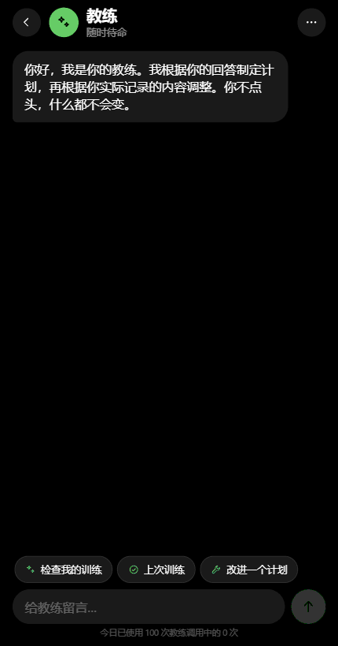

# AI Coach 生成式 UI v2 验收报告（`ACCEPTANCE.md`）

> 状态：**自动化门禁 + 真实 DeepSeek 实测 + 真实浏览器 GIF 硬验收全部通过（待合入后迁入 `implemented/`）**  
> 关联文档：[REQUIREMENTS.md](REQUIREMENTS.md) · [DESIGN.md](DESIGN.md) · [EXECUTION.md](EXECUTION.md)

---

## 1. 编排执行总览（OpenCode `opencode-go/deepseek-v4.1-flash` 并行分片）

| 阶段 | 分片 | 负责范围 | 关键交付与结果 |
|---|---|---|---|
| Stage 1（并发） | **V2-W1** | `api/agent-runtime/` + `api/test/coach-genui-protocol.test.js` | 11 种节点协议与防幻觉清洗、可配置预算门控、零依赖增量 NDJSON 状态机解析器、`coach-genui` v2 Prompt 与 Fixture，**55/55 通过** |
| Stage 1（并发） | **V2-W3** | `frontend/src/`（水合、SSE 客户端、`CoachGenUI`、`CoachChat`、`coach.css`、19 语言包、Vitest） | 单列统一 `.genui-briefing` 叙事简报、5 新原子原语、`exercise_trend`/`muscle_load` 零网络内联切换、`checklist` 持久化、停止保留与 19 语言包全同步，**74/74 通过** |
| Stage 2 | **V2-W2** | `api/src/agent/` + `api/openapi.yaml` + `website/api.html` + `api/test/nest/coach-genui-sse.test.js` | `createBoundedFetch({ streaming: true })` 透传流、LangGraph `model.stream()` 实时交错推送、`maxVisuals` 预算与 OpenAPI 同步，**16/16 SSE + 7/7 LangChain 通过** |
| Stage 3 | **主协调者** | 全量跨端门禁 + 真实 DeepSeek 4 场景实测 + `ego-browser` 真实交互录屏 GIF + 视觉 QA 微调 | 4 场景端到端实测通过；捕获 41 帧真实交互生成 `evidence/coach-genui-v2-e2e.gif`；基于视觉 QA 微调 `tone-lead` 字重与 `comparison_table` 列规范 |

---

## 2. 自动化门禁实测结果

- **后端构建**：`npm.cmd --prefix api run build` → `build: dist ready`（退出码 `0`）
- **前端构建**：`npm.cmd --prefix frontend run build` → 通过（退出码 `0`）
- **后端核心与集成测试**：`node --test api/test/coach-genui-protocol.test.js api/test/agent-portability.test.js api/test/nest/coach-genui-sse.test.js api/test/nest/agent-langchain.test.js api/test/openapi-routes.test.js` → **82/82 通过**（含零依赖可移植守卫与 OpenAPI 路由一致性）
- **前端单测**：`npx.cmd vitest run src/lib/coach-genui-hydration.test.js src/components/CoachGenUI.test.jsx src/views/CoachChat.test.jsx src/lib/pt-br-locale.test.js src/lib/locale-coverage.test.js` → **74/74 通过**
- **多语言严格校验**：
  - `node scripts/check-locales.mjs` → `19 locales, 3740 keys each — in sync.`
  - `node scripts/check-source-strings.mjs --strict` → `3083 translated strings in src/, all present in the locale packs.`
- **OpenAPI 与仓库治理门禁**：
  - `node scripts/build-api-docs.mjs --check` → `website\api.html in sync: 109 endpoints, 45 schemas`
  - `.\.agent\scripts\verify-governance.ps1` → 全部 `README.md ≤ 300` 行、零断链、无漏升格复盘规则。

---

## 3. 真实 DeepSeek 端到端实测记录（`npm run dev` + `deepseek-flash`）

1. **场景 1（上斜卧推停滞分析 + 调整建议）**：
   - 首字延迟 `firstProseDelta = 536ms`，首个结构化节点提交 `1253ms`，尾段 `prose` `4126ms`，实证真交错流式生长（节点数按 `1 → 2 → 6 → 8` 实时增长）。
   - 重型视觉锚点严格 ≤ `1`（满足默认 `maxVisuals = 1` 预算）；全中文接地（`杠铃上斜卧推`、`杠铃卧推`、`胸部双杠臂屈伸`）；生成的 `proposal_action` 实测点击「一键应用」成功写入计划。
2. **场景 2（动作肩部压力对比 + 4 步热身清单）**：
   - 节点流：`prose → comparison_table → prose → checklist → prose`（重型图 `0`，无堆卡）。
   - 真实点击 `checklist` 前两项，进度计数即时更新为 `2/4 已完成` 并随消息持久化。
3. **场景 3（组件内本地交互，零网络请求）**：
   - 在 `exercise_trend` 内联切换周期与指标（`1RM` / `重量` / `总量`、`4周` / `8周` / `12周` / `24周`），实测期间 `/api/agent/coach*` 网络请求计数 `coachFetchCount = 0`。
4. **场景 4（纯概念问答克制）**：
   - 提问「RIR 1 和 RIR 3 的区别是什么，简短说」→ 实测仅渲染紧凑 `.bub` 气泡（`lastHasBriefing: false, lastHasBubble: true`），不硬塞任何无关 UI 卡片。

---

## 4. 前端视觉硬验收证据（真实浏览器交互 GIF）

> 录制环境：本地 `npm run dev`（NestJS + Vite + 真实 `deepseek-flash`），`ego-browser` Chromium 移动端视口 `430×820`，连续覆盖「初始中文态 → 逐节点流式生长 → 内联切换周期 → 一键应用提案 → 对比表与 4 步热身清单勾选 → 纯文字克制气泡」。

### 视觉 QA 抽检与收尾打磨
- 抽检 5 个关键状态帧（流式进度、场景 1 简报、场景 2 对比表、场景 2 勾选态、场景 4 纯文字气泡），确认双主题变量对比度、44px 触控热区、零横向溢出与纯文字克制均达标。
- 根据抽检反馈，收尾额外完成两项细节打磨：
  1. 将 `.genui-prose.tone-lead` 字重由 `600` 调整为 `500`，使多句导语段落视觉更轻盈，贴合 `index.css` 排版阶梯；
  2. 在 `COACH_GENUI_SYSTEM_PROMPT` 中明确 `comparison_table` 仅在第 0 列使用 `{ exId }`，避免其他列重复渲染动作徽章。
