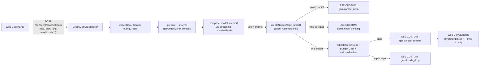
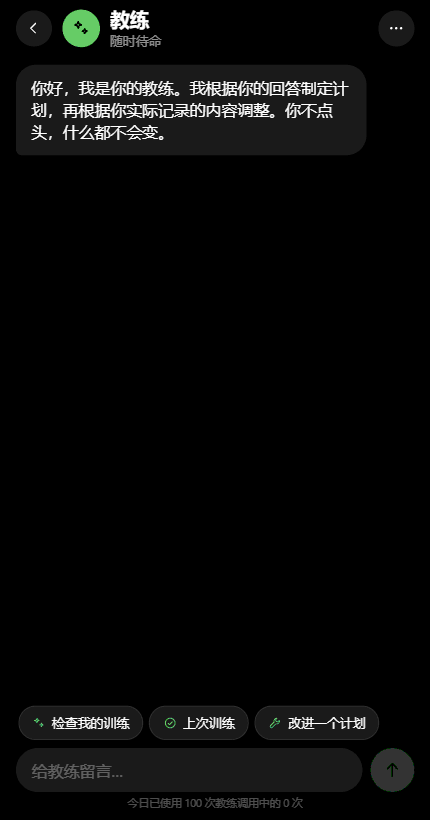

# AI Coach 生成式 UI v2 设计文档：叙事穿插流与细粒度原子原语（Interleaved Narrative GenUI）

> 状态：**设计已锁定 / 待实施（Proposed）**  
> 需求来源：[REQUIREMENTS.md](REQUIREMENTS.md)  
> 执行计划：[EXECUTION.md](EXECUTION.md)  
> 前置基线（v1）：[v1 设计](../coach-genui/DESIGN.md) · [v1 体验打磨](../coach-genui/POLISH_EXECUTION.md) · [v1 中文化](../coach-genui/I18N_EXECUTION.md)  
> 受影响子系统：`ai-agent`、`web-client`、`api-sync`（OpenAPI 契约同步）

---

## 1. 设计目标与架构演进

v1 的核心瓶颈在于协议层 `{ text, blocks[] }` 造成的「正文气泡与底部卡片堆割裂」、仅 5 种重型卡片导致的「一轮堆卡」，以及后端 `model.invoke()` + `createBoundedFetch` 全量缓冲造成的「非真流式」。

v2 通过四项关键架构升级解决上述痛点，同时 **100% 坚守零数值幻觉、白名单安全写操作、共享核心零依赖（RN/Metro 可移植）与历史消息无损兼容**：

1. **扁平有序叙事节点模型（`nodes: GenUINode[]`）**：统一 `prose` 段落与 UI 原语/业务块到同一有序扁平数组，前端按到达顺序交错渲染为一份连贯简报（`.genui-briefing`）。
2. **全链路真增量流式（Upstream Streaming Fetch → `model.stream()` → Incremental NDJSON Parser → AG-UI SSE）**：
   - 修复 `api/src/agent/langchain/http-fetch.ts` 中 `createBoundedFetch` 整包 `readBoundedBytes` 阻塞问题，增加 `streaming: true` 透传限流 `ReadableStream`（逐块校验 `maxBytes` / `timeoutMs` / `AbortSignal`）。
   - `CoachGenUIService` 移除 `response_format: { type: 'json_object' }`（避免上游 API 强制单对象阻塞 NDJSON），调用 `model.stream()` 实时喂入共享零依赖 NDJSON 增量状态机。
   - `prose` 节点未闭合前实时推送 `genui.prose_delta`；非 `prose` 节点检测到 `"type"` 即刻推送 `genui.node_pending`；行闭合瞬间原地校验（含 `validExIds` / `validateReview` / 预算裁剪）并推送 `genui.node_commit`（或 `genui.node_drop`）。
3. **细粒度原子原语 + 既有块轻量内联交互**：
   - 新增 5 个轻量原语：`prose`、`kpi_strip`（强区分真实水合项与处方标签项）、`comparison_table`（支持 `{ exId }` 自动解析中文动作名与缩略图）、`checklist`（本地勾选并持久化至会话消息）、`callout`（左色条提示）。
   - 既有 5 个业务块视觉轻量化融入简报；`exercise_trend` 与 `muscle_load` 支持本地胶囊切换指标/周期/时间窗（零网络请求即时重水合）。
4. **可配置防堆卡预算 + 移动端单列纵排**：
   - 重型可视化（`exercise_trend` / `muscle_load`）单轮默认上限 `DEFAULT_MAX_VISUAL_NODES = 1`，支持环境变量 `COACH_GENUI_MAX_VISUALS` 与请求级 `maxVisuals`（范围 `0..4`）动态覆盖；整轮总节点硬上限 `MAX_GENUI_NODES = 8`。
   - 全程单列竖排流式布局，不做双列并排卡组。



---

## 2. 改前语义级变更声明（Semantic Change Declaration）

### 子系统 A：`ai-agent`
- **涉及模块与真实入口**：
  - 共享协议核（零依赖，Metro/Nest/Web 共用）：`api/agent-runtime/genui/protocol.js`、`protocol.d.ts`、`ndjson-parser.js`（新增）、`ndjson-parser.d.ts`（新增）、`index.js`、`api/agent-runtime/tasks/coach-genui.js`、`api/agent-runtime/index.js`。
  - 服务端执行链路：`api/src/agent/langchain/http-fetch.ts`、`api/src/agent/langchain/model-factory.ts`、`api/src/agent/coach-genui.service.ts`、`api/src/agent/coach-genui.controller.ts`。
- **触发条件（Trigger）**：
  - 用户在 Web AI Coach 提交消息或 `quick_form` 回答，向 `POST /api/agent/coach/stream` 发起 SSE 流式请求。
- **改前 / 改后行为（Before / After）**：
  - **Before**：`createBoundedFetch` 整包读取响应体，`CoachGenUIService` 调用 `model.invoke()`（带 `response_format: json_object`）等待完整 `{ text, blocks[] }` JSON，随后先切片回放 `TEXT_MESSAGE_CONTENT`，最后在 `validate` 节点批量发射 `genui.block_upsert`。仅支持 5 类重型块与 `fallback_notice`。
  - **After**：`createBoundedFetch({ streaming: true })` 透传限字节/限时 `ReadableStream`；`CoachGenUIService` 调用 `model.stream()`（NDJSON 契约，不设 `json_object`），边收 token 边通过 `createNdjsonNodeParser` 实时交错推送 `genui.prose_delta`、`genui.node_pending`、`genui.node_commit`（校验或预算未通过时对已 pending 节点发射 `genui.node_drop`）。支持 11 种扁平节点类型（5 新原子原语 + 5 业务块 + `fallback_notice`），重型视觉节点受可配置预算约束。
- **接口 / 状态 / 兼容性变化（Contract, State & Compatibility）**：
  - `POST /api/agent/coach/stream` 请求体新增可选整数 `maxVisuals`（合法范围 `0..4`，越界自动钳制），并正式在 `api/openapi.yaml` 补全 `lang`、`today`、`maxVisuals` 字段说明。
  - `RUN_STARTED` / `RUN_FINISHED` 新增 `protocolVersion: 2`；`RUN_FINISHED` 同时携带 `nodes`（v2 权威数组）与派生 `text`、`blocks`（保证所有 v1 消费方与既有测试零破坏）。
  - 保留 `validateGenUIBlock`、`sanitizeGenUIBlocks`、`GENUI_BLOCK_TYPES`、`MAX_GENUI_BLOCKS` 全量导出与语义。
  - 模型偶发返回旧版整包 JSON `{ text, blocks }` 或多行缩进 JSON 时，解析器自动识别为 `legacy_payload` 并归一化为 `nodes[]` 按序发射；纯文本输出自动包装为 `prose` 节点。
- **失败模式与降级兜底（Failure Modes & Fallback）**：
  - 单行畸形 JSON 仅丢弃该行（若已发 `node_pending` 则补发 `genui.node_drop`），不中断后续节点。
  - 上游模型 `stream()` 不可用时自动回退 `invoke()` 并复用同一套 NDJSON/legacy 归一化管线。
  - `proposal_action` 未通过 `validateReview` 时原地降级为单条本地化 `fallback_notice` 节点提交。
  - 客户端断开/点击停止时，AbortSignal 立即取消上游 `boundedFetch` ReadableStream，释放模型连接。
- **实测证据（Empirical Evidence）**：
  - 改前基线：v1 单测与真实 DeepSeek 对话暴露「正文与卡片重复 + 整包等待无交错流式」痛点（见 `REQUIREMENTS.md` §1）。
  - 改后交付：`api/test/coach-genui-protocol.test.js`、`api/test/agent-portability.test.js`、`api/test/nest/coach-genui-sse.test.js`、`npm --prefix api run build`、`node scripts/build-api-docs.mjs --check` 全部实跑日志。

### 子系统 B：`web-client`
- **涉及模块与真实入口**：
  - `frontend/src/lib/coach-genui-client.js`、`frontend/src/lib/coach-genui-hydration.js`、`frontend/src/components/CoachGenUI.jsx`、`frontend/src/views/CoachChat.jsx`、`frontend/src/coach.css`、全部 19 个 `frontend/src/locales/*.js`。
- **触发条件（Trigger）**：
  - 用户在 `#/coach` 页面发送提问、提交 `quick_form`、点击停止生成、切换图表指标/周期/时间窗、勾选 `checklist` 项或回看历史消息。
- **改前 / 改后行为（Before / After）**：
  - **Before**：`CoachChat` 将回复拆为顶部 `.bub` 气泡 + 底部 `<GenUISurface>` 卡片堆；流式期间展示固定双卡大骨架；`exercise_trend`/`muscle_load` 参数写死；点击停止清空未完成内容。
  - **After**：含 UI 节点的教练回复渲染为单一连贯 `.genui-briefing` 叙事简报，按 `nodes[]` 顺序交错呈现 `prose` 与原语/图表；纯 `prose` 回复保持紧凑普通气泡；流式阶段仅在尾部按节点类型展示轻量局部微骨架（`GenUINodePending`）；点击停止保留已提交节点入历史记录；`kpi_strip` 全量从本地日志水合；`checklist` 支持点击勾选并随消息持久化；`exercise_trend` 与 `muscle_load` 支持本地秒切指标与时间窗（零网络请求）。
- **接口 / 状态 / 兼容性变化（Contract, State & Compatibility）**：
  - `S.coach.chat` 中 `kind: 'genui'` 消息新增 `nodes` 数组与可选 `checklistState: Record<string, string[]>`，同时保留 `text`、`blocks` 字段；历史旧消息 `{ text, blocks }` 经 `normalizeGenUINodes()` 无缝归一化渲染，无需迁移脚本。
  - 严格不修改 `S.routines` / `S.workouts` 存储结构；`proposal_action` 继续走 `applyChangeSet` + `revertLast` 事务闭环。
  - `streamDemo()` 保持原样并兼容 v1 事件到 `nodes[]` 归一化。
- **失败模式与降级兜底（Failure Modes & Fallback）**：
  - 未知 `node.type` 静默忽略或轻量提示，绝不崩溃消息列表。
  - `kpi_strip` / `exercise_trend` / `muscle_load` 无训练历史时展示 `–` 或克制空态，绝不出现 `NaN` 或空 SVG。
  - `comparison_table` 中的未知 `exId` 单元格安全回退为空白/占位而不报错。
- **实测证据（Empirical Evidence）**：
  - 改后交付：Vitest 套件（`coach-genui-hydration.test.js`、`CoachGenUI.test.jsx`、`CoachChat.test.jsx`）、`check-locales.mjs`、`check-source-strings.mjs --strict`、`npm --prefix frontend run build`，以及真实 DeepSeek 端到端交互录屏 GIF（`.agent/notes/proposed/coach-genui-v2/evidence/coach-genui-v2-e2e.gif`）。

### 子系统 C：`api-sync`（OpenAPI 文档同步）
- **涉及模块与真实入口**：`api/openapi.yaml`、`website/api.html`（由 `node scripts/build-api-docs.mjs` 生成）。
- **变更摘要**：更新 `POST /api/agent/coach/stream` 请求字段（`lang`、`today`、`maxVisuals`）与 v2 叙事节点 SSE 契约说明，保持 `build-api-docs.mjs --check` 零漂移。

---

## 3. 锁定的跨端协议契约（V2-W1 / V2-W2 / V2-W3 唯一真源）

### 3.1 常量与枚举（`api/agent-runtime/genui/protocol.js`）

```js
export const GENUI_PROTOCOL_VERSION = 2;
export const MAX_GENUI_BLOCKS = 6;          // v1 兼容保留
export const MAX_GENUI_NODES = 8;           // v2 整轮总节点硬上限（含 prose）
export const DEFAULT_MAX_VISUAL_NODES = 1;  // 重型视觉块默认预算
export const MAX_VISUAL_NODES_LIMIT = 4;    // 可配置预算上限

export const GENUI_CUSTOM_EVENTS = Object.freeze({
  BLOCK_UPSERT: 'genui.block_upsert',       // v1 兼容保留
  PROSE_DELTA: 'genui.prose_delta',         // v2 prose 增量文本
  NODE_PENDING: 'genui.node_pending',       // v2 结构化节点局部微骨架占位
  NODE_COMMIT: 'genui.node_commit',         // v2 节点校验通过并提交
  NODE_DROP: 'genui.node_drop',             // v2 已 pending 的节点校验失败/超预算时撤回占位
});

export const GENUI_NODE_TYPES = Object.freeze({
  PROSE: 'prose',
  KPI_STRIP: 'kpi_strip',
  COMPARISON_TABLE: 'comparison_table',
  CHECKLIST: 'checklist',
  CALLOUT: 'callout',
  EXERCISE_TREND: 'exercise_trend',
  MUSCLE_LOAD: 'muscle_load',
  EXERCISE_ALTERNATIVES: 'exercise_alternatives',
  QUICK_FORM: 'quick_form',
  PROPOSAL_ACTION: 'proposal_action',
  FALLBACK_NOTICE: 'fallback_notice',
});

export const GENUI_HEAVY_VISUAL_TYPES = Object.freeze([
  GENUI_NODE_TYPES.EXERCISE_TREND,
  GENUI_NODE_TYPES.MUSCLE_LOAD,
]);
```

### 3.2 新增 5 个原子原语精确 Schema 与清洗规则

| `type` | 必填字段 | 可选字段 | 清洗 / 校验与防幻觉边界 |
|---|---|---|---|
| `prose` | `id`, `text` (`1..280` 字符) | `tone`: `'normal' \| 'lead' \| 'closing'` | `text` 裁剪空白后为空则拒绝；超 280 字符截断；非法 `tone` 忽略 |
| `kpi_strip` | `id`, `items` (`1..4` 项，Prompt 引导 `2..4` 项) | — | 每项按 `kind` 分流校验：<br>• `exercise_stat`: `{ kind, exId, metric: 'e1rm'\|'weight'\|'volume', weeks: 2..24 (默认 6), label?(≤32) }` — `exId` 必须命中 `validExIds`，**剥离任何模型写入的 `value`**<br>• `muscle_sets`: `{ kind, muscle, window: '72h'\|'7d'\|'28d' (默认 '72h'), label?(≤32) }` — 若提供 `validMuscles` 则必须命中，**剥离 `value`**<br>• `session_count`: `{ kind, weeks: 1..24 (默认 4), label?(≤32) }` — **剥离 `value`**<br>• `prescription`: `{ kind, label(1..32), value(1..24) }` — 仅处方短标签（如 `4×8` / `RIR 2`）<br>全部项均无效时拒绝整个 `kpi_strip` |
| `comparison_table` | `id`, `columns` (`2..4` 项，每项 `1..32` 字符), `rows` (`1..6` 行) | `title` (`≤80`) | 每行按 `columns.length` 对齐（不足补 `""`，超出截断）；单元格支持 `string (≤80)` 或 `{ exId, note?(≤40) }`；若 `{ exId }` 未通过 `tokenOf` 或未命中 `validExIds`，**丢弃该行**；无有效列（`<2`）或无有效行则拒绝 |
| `checklist` | `id`, `listId` (缺省取 `id`), `items` (`1..6` 项) | `title` (`≤80`) | 每项 `{ id (缺省 item_1..n 且去重), label (1..100), detail? (≤160) }`；无有效项则拒绝 |
| `callout` | `id`, `variant`: `'info' \| 'tip' \| 'warning'` (缺省 `'info'`), `text` (`1..280`) | `title` (`≤80`) | `text` 为空则拒绝 |

既有 5 块（`exercise_trend`、`muscle_load`、`exercise_alternatives`、`quick_form`、`proposal_action`）与 `fallback_notice` 复用既有清洗函数；`validateGenUINode(raw, options)` 统一覆盖全部 11 种节点；`sanitizeGenUINodes(nodes, options)` 支持 `{ validExIds, validMuscles, maxNodes = MAX_GENUI_NODES, maxVisuals = DEFAULT_MAX_VISUAL_NODES }`：
- `maxVisuals` 钳制在 `0..MAX_VISUAL_NODES_LIMIT`（默认 `1`）；
- 超出 `maxVisuals` 的 `exercise_trend` / `muscle_load` 节点静默裁剪并记入 `warnings`（不生成额外 `fallback_notice`）；
- 导出 `v1ToGenUINodes(text, blocks)` 将旧格式归一化为扁平 `nodes[]`（长 `text` 自动按句/段落拆分为 ≤280 字的 `prose` 节点）。

### 3.3 增量 NDJSON 状态机解析器（`api/agent-runtime/genui/ndjson-parser.js`）

零依赖纯 JS 工厂 `createNdjsonNodeParser()`，暴露 `push(chunk: string): ParserEvent[]` 与 `flush(): ParserEvent[]`：

- **输出事件联合体（`ParserEvent`）**：
  1. `{ kind: 'prose_delta', nodeId: string, delta: string, tone?: 'normal' | 'lead' | 'closing' }`
  2. `{ kind: 'node_pending', nodeId: string, nodeType: string }`
  3. `{ kind: 'node_raw', nodeId: string, raw: object, hadPending: boolean, emittedProseChars: number }`
  4. `{ kind: 'legacy_payload', raw: object }`（检测到无 `type` 但含 `text` / `blocks` 的 v1 整包 JSON，含跨多行缩进格式）
  5. `{ kind: 'plain_text', text: string }`（模型完全忽略 NDJSON 仅输出自然语言行时收集）
  6. `{ kind: 'malformed_line', nodeId: string | null, hadPending: boolean, rawLine: string }`

- **核心状态机规则**：
  - **围栏/空行过滤**：忽略空行和以 ```` ``` ```` 开头的 Markdown 代码围栏行。
  - **跨分片行拼接 + 跨行 JSON 容错**：维护 `lineBuffer` 与 JSON 词法状态（`inString`、`escaped`、`braceDepth`）；单行闭合（`braceDepth === 0` 且遇到 `\n`）立即触发 `JSON.parse`；若遇到 `\n` 时 `braceDepth > 0`（模型换行缩进了单个 JSON 对象或 v1 整包 JSON），继续累积直到 `braceDepth === 0` 再解析，避免将多行 JSON 误判为畸形行！
  - **类型前瞻与 `node_pending`**：在行尚未闭合前，一旦正则命中 `"type"\s*:\s*"([a-z_]+)"`：
    - 若类型为已知非 `prose` 节点类型，立即发射一次 `node_pending`（同一行绝不重复发射）。
    - 若类型为 `'prose'`，立即进入 `prose` 增量扫描模式。
  - **安全 `prose` 增量提取（防未完成转义崩溃）**：
    - 定位 `"text"\s*:\s*"` 起始位置，从当前扫描游标逐字符读取 JSON 字符串内容：
      - 普通字符直接追加；
      - 遇到 `\` 检查后续字符：`\"` / `\\` / `\/` / `\n` / `\r` / `\t` / `\b` / `\f` 即时解码；`\uXXXX` 仅在满 4 位十六进制时解码，不足则暂停等待下个 chunk；尾字符为单独 `\` 时暂停等待下个 chunk；
      - 遇到未转义 `"` 标记字符串结束，停止增量提取。
    - 每次 `push()` 仅发射新增解码片段，确保不重复、不漏字、不拆坏 UTF-16 代理对（若尾码元为高代理 `0xD800..0xDBFF`，保留至下个 chunk）。
    - 当 `prose` 行闭合后，发射 `node_raw`，服务端通过 `validateGenUINode` 产出权威节点并推送 `genui.node_commit`（前端用权威文本原地对齐，绝不重复追加）。

### 3.4 AG-UI SSE 事件时序约定

```text
1. RUN_STARTED               { runId, threadId, protocolVersion: 2 }
2. STEP_STARTED              { stepName: "prepare", label: "..." }
3. STEP_FINISHED             { stepName: "prepare" }
4. STEP_STARTED              { stepName: "analyze", label: "..." }
5. TOOL_CALL_START           { toolCallId, toolCallName: "inspect_training_context", args }
6. TOOL_CALL_RESULT          { toolCallId, toolCallName: "inspect_training_context", summary }
7. STEP_FINISHED             { stepName: "analyze" }
8. STEP_STARTED              { stepName: "compose", label: "..." }
   --- 实时交错流（按模型输出顺序即时发射）---
   CUSTOM genui.prose_delta  { nodeId: "node_1", delta: "你最近 6 周..." }
   CUSTOM genui.prose_delta  { nodeId: "node_1", delta: "停在瓶颈。" }
   CUSTOM genui.node_commit  { node: { id: "node_1", type: "prose", text: "..." } }
   CUSTOM genui.node_pending { nodeId: "node_2", nodeType: "kpi_strip" }
   CUSTOM genui.node_commit  { node: { id: "node_2", type: "kpi_strip", items: [...] } }
   CUSTOM genui.node_pending { nodeId: "node_3", nodeType: "exercise_trend" }
   CUSTOM genui.node_commit  { node: { id: "node_3", type: "exercise_trend", ... } }
   CUSTOM genui.prose_delta  { nodeId: "node_4", delta: "建议调整..." }
   CUSTOM genui.node_commit  { node: { id: "node_4", type: "prose", text: "..." } }
   CUSTOM genui.node_pending { nodeId: "node_5", nodeType: "proposal_action" }
   (实时运行 validateReview -> 通过则 node_commit proposal_action；失败则 node_commit fallback_notice)
9. STEP_FINISHED             { stepName: "compose" }
10. RUN_FINISHED             { runId, threadId, protocolVersion: 2, nodes: [...], text: "...", blocks: [...] }
```

### 3.5 可配置防堆卡预算（FR-5）

- 优先级：`request.maxVisuals`（控制器校验并钳制 `0..4`） → `process.env.COACH_GENUI_MAX_VISUALS`（解析整数并钳制 `0..4`） → `DEFAULT_MAX_VISUAL_NODES`（`1`）。
- 服务端在流式接收节点时实时计数 `committedNodes`（上限 `MAX_GENUI_NODES = 8`）与 `committedVisuals`（上限 `maxVisuals`）：
  - 若节点为 `exercise_trend` 或 `muscle_load` 且 `committedVisuals >= maxVisuals`：丢弃该节点，若之前发过 `genui.node_pending` 则发射 `genui.node_drop`，记入 `warnings`；
  - 若 `committedNodes >= MAX_GENUI_NODES`：丢弃后续节点并清理 pending 状态。
- 同时将生效的 `maxVisuals` 注入系统/用户提示词，使模型在生成阶段就主动克制，减少无用 token 消耗。

---

## 4. Web UI 设计系统九维审查清单（改前锁定）

遵循 `frontend/src/index.css` 语义 Token（零硬编码色值、字号、圆角）与 `.agent/skill/opengym-development/references/ui-design-and-visual-gate.md`：

1. **① Token 与原语合规**：`.genui-briefing`、`.genui-kpi-strip`、`.genui-table`、`.genui-checklist`、`.genui-callout`、`.genui-seg` 全部使用 `--surface` / `--surface-2` / `--surface-3` / `--label*` / `--sep` / `--hair` / `--acc*` / `--blue` / `--green` / `--orange` / `--yellow` / `--fs-*` / `--r-*`；复用 `<Icon />`、`<Thumb />`、`<LineChart />`、`<BodyMap />`、`<Button />`、`<Check />`。
2. **② 间距节奏、对齐与数字防抖**：单列纵向流式布局（`flex-direction: column; gap: 10px`）；`kpi_strip` 数值、趋势百分比、肌群组数、勾选进度（`2/4`）一律 `font-variant-numeric: tabular-nums`；图标与多行文本顶部/首行基线对齐。
3. **③ 截断、换行与多语言/大字号**：所有 Flex/Grid 子项显式 `min-width: 0` 与 `overflow-wrap: anywhere`；`comparison_table` 采用等比紧凑列宽 + 单元格自然折行，360px 窄屏无横向滚动条；全部新增英文源串同步补齐 19 个语言包（含 `pt-BR.js` 指纹/覆写规则）。
4. **④ 移动端触摸热区与手势解耦**：`checklist` 每行按钮、图表切换胶囊（`1RM/重量/训练量`、`4周/8周/12周/24周`、`72h/7d/28d`）实际点击高度/热区 `≥ 44px`（视觉紧凑胶囊配合足够点击内边距或 `min-height: 36-44px` 触摸区，关键勾选行严格 `min-height: 44px`），具备清晰 `:active` 按压缩放反馈。
5. **⑤ 视口宽度变化与软键盘焦点保持**：所有子组件定义在模块顶层（严禁渲染函数内联组件定义），稳定使用 `node.id` 作为 React `key`，保证流式更新、勾选或切指标时不卸载重建 `<ChatInput />`。
6. **⑥ 安全区与浮层留白**：不改变 `.msgs` 与 `.composer` 既有安全区留白结构，末条简报完整滚出。
7. **⑦ 五态完备性**：
   - Empty：`kpi_strip` 无记录显示 `–`，`exercise_trend` 少于 2 次显示空态提示，`muscle_load` 无数据时展示空提示；
   - Loading：按节点类型匹配轻量局部微骨架（`GenUINodePending`），支持中途点击「停止」并保留已提交节点；
   - Populated：支持纯文字简洁气泡、混合简报（文字+KPI+图+对比表+清单+提案）；
   - Error/Offline：单节点异常静默降级或轻量 `fallback_notice`，流中断保留已收节点；
   - Pending/Disabled：`quick_form` / `proposal_action` 保持防连点锁定。
8. **⑧ 双主题对比度与动效无障碍**：Dark / Light 双主题全部基于 CSS 变量自动适配；`prefers-reduced-motion: reduce` 关闭所有微骨架 shimmer、入场动画与光标闪烁。
9. **⑨ 渲染性能**：本地切指标/切时间窗仅重算单节点 `useMemo` 水合，不触发全聊天列表重算与网络请求。

### 新增 Web i18n 源串清单（共 10 个，需同步 19 语言包）

为保持词库极简并复用既有词条（已有 `Estimated 1RM`、`Weight`、`Volume ({0})`、`Muscle load`、`Focus muscles`、`Suggested swaps`、`Quick check`、`Suggestions`、`Stalled`、`No data yet`、`Stop`、`{0} sets`、`{0} session`/`{0} sessions`），v2 仅新增以下短文案键：

1. `"1RM"`（简体中文：`"1RM"`）
2. `"Volume"`（简体中文：`"训练量"`）
3. `"{0}w"`（简体中文：`"{0}周"`）
4. `"72h"`（简体中文：`"72小时"`）
5. `"7d"`（简体中文：`"7天"`）
6. `"28d"`（简体中文：`"28天"`）
7. `"Sessions"`（简体中文：`"训练次数"`）
8. `"Checklist"`（简体中文：`"检查清单"`）
9. `"{0}/{1} done"`（简体中文：`"{0}/{1} 已完成"`）
10. `"Comparison"`（简体中文：`"对比"`）

*(注：若既有语言包中某些键已存在，仅补齐缺失键，避免重复键报错；执行 `node scripts/check-locales.mjs` 与 `node scripts/check-source-strings.mjs --strict` 作为硬门禁。)*

---

## 5. 改后四步核对与实测验收记录（Post-Edit 4-Step Verification）

详见完整验收报告与真实操作 GIF 证据：[ACCEPTANCE.md](ACCEPTANCE.md)。

1. **① 受影响子系统与真实运行时路径**：
   - 已核实子系统：`ai-agent`、`web-client`、`api-sync`。
   - 真实运行时链路：
     - 服务端：`POST /api/agent/coach/stream` → [`CoachGenUIController`](../../../../api/src/agent/coach-genui.controller.ts) → [`CoachGenUIService`](../../../../api/src/agent/coach-genui.service.ts)（LangGraph 3 节点：`prepare` → `analyze` → `compose` 内联流式校验）→ [`createLangChainChatModel({ streaming: true })`](../../../../api/src/agent/langchain/model-factory.ts) → [`createBoundedFetch({ streaming: true })`](../../../../api/src/agent/langchain/http-fetch.ts) → [`createNdjsonNodeParser()`](../../../../api/agent-runtime/genui/ndjson-parser.js) + [`validateGenUINode()`](../../../../api/agent-runtime/genui/protocol.js) + [`validateReview()`](../../../../api/coach/core/validate.js)。
     - 前端：[`CoachChat.jsx`](../../../../frontend/src/views/CoachChat.jsx) → [`streamCoachGenUI`](../../../../frontend/src/lib/coach-genui-client.js) → [`GenUIBriefing`](../../../../frontend/src/components/CoachGenUI.jsx) → [`coach-genui-hydration.js`](../../../../frontend/src/lib/coach-genui-hydration.js) & [`applyChangeSet`](../../../../frontend/src/lib/coach.js)。
2. **② 调用链行外副作用追踪**：
   - `createBoundedFetch` 仅在显式传 `streaming: true` 且响应 2xx 时启用透传 `ReadableStream`，非流式与 4xx/5xx 路径 100% 沿用既有 `readBoundedBytes`（`agent-langchain.test.js` 7/7 全绿）。
   - `S.coach.chat` 持久化 `{ kind: 'genui', nodes, text, blocks, checklistState? }`，历史 v1 `{ text, blocks }` 记录通过 `normalizeGenUINodes` 无迁移兼容渲染；纯 `prose` 回复自动渲染为紧凑 `.bub` 气泡。
   - `proposal_action` 继续强制走 `validateReview` + `markStale` + `applyChangeSet` + `revertLast` 事务闭环，未改动 `S.routines` / `S.workouts` 结构。
3. **③ 契约文档与源码链接反向同步**：
   - [`api/openapi.yaml`](../../../../api/openapi.yaml) 已同步 `/api/agent/coach/stream` v2 契约及 `lang` / `today` / `maxVisuals` 参数，`website/api.html` 已由 `build-api-docs.mjs` 生成并通过 `--check`。
   - [`docs/subsystem/ai-agent/README.md`](../../../../docs/subsystem/ai-agent/README.md) 已登记 `REQUIREMENTS.md` / `DESIGN.md` / `EXECUTION.md` / `ACCEPTANCE.md` 路由，通过 `verify-governance.ps1`。
4. **④ 测试与真实 DeepSeek 实测覆盖度**：
   - 协议与零依赖守卫：`coach-genui-protocol.test.js` + `agent-portability.test.js` **55/55 通过**。
   - 服务端 SSE 集成与 LangChain：`coach-genui-sse.test.js`（16/16）+ `agent-langchain.test.js`（7/7）+ `openapi-routes.test.js` **全绿**。
   - 前端单测与多语言门禁：Vitest **74/74 通过**，`check-locales.mjs`（19 语种 / 3740 键同步），`check-source-strings.mjs --strict`（3083 词条 0 缺失），`frontend` + `api` 双端构建均绿。
   - 真实 DeepSeek 实测与实操 GIF 证据：（`430×820`，12 个关键状态帧，363.7 KB）。


---

## 6. v2.1 演进变更声明：放权自由编排 + `search_catalogue` 工具检索 + 10 轮完整上下文

> 依据真实联调反馈修订（2026-11-26）：移除脆正则与硬卡片裁剪，改为工具驱动词库检索 + 模型自由选组件 + 10 轮完整多轮上下文（方案 B：点击「新对话」清空聊天列表重开）。

### 子系统 A：`ai-agent` & `api-sync`
- **涉及模块**：`api/agent-runtime/genui/protocol.{js,d.ts}`、`api/agent-runtime/tasks/coach-genui.js`、`api/src/agent/coach-genui.{controller,service}.ts`、`api/openapi.yaml`、`website/api.html`。
- **Trigger**：用户在 AI Coach 发送任意多轮消息（第 1~10 轮，或超限第 11 轮），触发 `POST /api/agent/coach/stream`。
- **Before**：服务端不接收多轮 `history`；使用 `hasPlanEditIntent` 正则拦截非关键词命中的 `proposal_action` / `exercise_alternatives`；硬裁剪总 UI 卡片 `<=3` 与重型图 `<=1`；上下文预塞 6 个固定 `swapCandidates`。
- **After**：
  - 放开模型自由编排（移除 `hasPlanEditIntent`、`DEFAULT_MAX_UI_NODES` 与默认 `maxVisuals=1` 强裁，仅保留 `MAX_GENUI_NODES=12` 安全顶、零数值幻觉水合、`validateReview` 白名单写安全与无待办勾选框）；Prompt 改为自由选择 + 轻量场景推荐；
  - 绑定本机零依赖 `search_catalogue` 工具（最多 3 轮工具循环，实时发射 `TOOL_CALL_START` / `TOOL_CALL_RESULT`），上下文仅传当前计划与近期训练，彻底告别预塞候选；
  - 新增 `history` 请求字段，全量保留 1~10 轮作为真实 `HumanMessage`/`AIMessage` 历史消息传给模型；历史用户轮数 ≥ 10 时在打开 SSE 前返回 `429` (`code: 'turn_limit'`)。
- **失败模式**：`search_catalogue` 异常或参数不合法时返回结构化工具错误给模型自恢复，不中断流；工具循环达 3 轮上限后强制无工具收尾输出 NDJSON；`proposal_action` 仍过 `validateReview`（`nochange` 静默丢弃，非法项降级 `fallback_notice`）。

### 子系统 B：`web-client`
- **涉及模块**：`frontend/src/lib/coach-genui-client.js`、`frontend/src/components/CoachGenUI.jsx`、`frontend/src/views/CoachChat.jsx`、`frontend/src/coach.css`、19 个 `frontend/src/locales/*.js`。
- **Trigger**：用户在 `#/coach` 发送消息、点击提案「应用」、达到 10 轮上限或点击「新对话」。
- **Before**：不传 `history`；无会话轮数计数与清空重开入口；采纳提案后未把 `applied: true` 写回消息节点。
- **After**：每次请求全量携带当前会话 `history`（含提案 `before -> after` 与已采纳状态摘要）；展示 `N/10 轮` 计数与「新对话」按钮（方案 B：点击清空 `S.coach.chat` 从空白重开，不改动计划与训练记录）；满 10 轮锁定输入框并引导开启新对话；`StreamStepsBar` 在 `search_catalogue` 工具调用期间显示「正在检索动作库…」。
