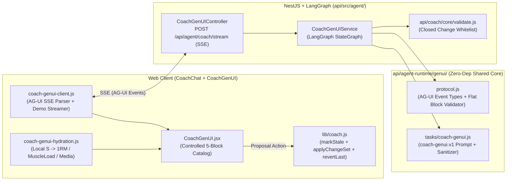

# AI Coach 生成式 UI（路线 A：AG-UI 事件流 + A2UI 风格领域 Catalog）设计文档

> **状态**：`proposed`（待实施验收）
> **子系统**：`ai-agent`（主要）、`web-client`（主要）、`api-sync`（SSE 路由与打包清单）
> **关联执行计划**：[`EXECUTION.md`](EXECUTION.md)
> **子系统路由**：[`docs/subsystem/ai-agent/README.md`](../../../../docs/subsystem/ai-agent/README.md) · [`docs/subsystem/web-client/README.md`](../../../../docs/subsystem/web-client/README.md) · [`docs/subsystem/api-sync/README.md`](../../../../docs/subsystem/api-sync/README.md)

---

## 1. 背景、痛点与改造目标

### 1.1 现状基线与痛点
当前 openGym 的 AI Coach 停留在「固定模板卡片 + 3 秒轮询 + 自由问答纯文本」阶段（改前全流程实录见 [`evidence/baseline-ai-coach.gif`](evidence/baseline-ai-coach.gif)）：

1. **自由对话（`ask`）只能返回纯文本气泡**：在 [`CoachChat.jsx`](../../../../frontend/src/views/CoachChat.jsx#L137-L138) 中，非草案状态下的自由输入全部走 `askCoach()`，[`ASK_SCHEMA`](../../../../api/coach/core/schemas.js#L115-L119) 仅允许 `answer: string`，无法按需渲染 1RM 曲线、肌群热力图、替代动作演示卡或快捷操作按钮。
2. **可视化被锁死在重型固定卡片里**：`Insights` 图表与 `ChangeRow` 被硬编码在超长 `ReviewCard` / `DebriefCard` 中，模型无法针对具体问题只拼装最相关的组件。
3. **无流式推送（黑盒长等待）**：旧 Coach 采用异步队列 + 3 秒轮询，用户面对静态 Typing 动画干等几十秒直到整包 JSON 落盘。
4. **缺少双向动态微表单**：信息不足时只能纯文本反问或跳页重填 7 步全屏问卷 `CoachIntake`。

### 1.2 技术路线（路线 A：协议对齐 + 轻量化领域内核）
- **传输与运行时层（对齐 AG-UI 协议）**：在现有 NestJS + LangGraph（[`api/src/agent/langchain/`](../../../../api/src/agent/langchain/)）之上新增原生 SSE 流式端点，发射标准 **AG-UI 事件序列**（`RUN_STARTED` → `STEP_STARTED/FINISHED` → `TOOL_CALL_START/RESULT` → `TEXT_MESSAGE_START/CONTENT/END` → `CUSTOM(genui.block_upsert)` → `RUN_FINISHED/RUN_ERROR`），无需引入 CopilotKit 全家桶或 LangGraph Cloud。
- **UI 表现规范层（吸收 A2UI 思想）**：坚持 **Data, Not Code**，在跨端零依赖共享核 [`api/agent-runtime/`](../../../../api/agent-runtime/) 中定义 **扁平受控领域组件目录（Domain Catalog，5 类核心 Block，无递归嵌套）**，兼容云端强模型与本地小模型（Ollama），并为未来 `mobile-rn` 原生复用保留 100% 同一协议。
- **核心防幻觉原则（Intent + Client Data Hydration）**：模型只输出受控参数与真实词库 `exId`（如 `{ type: 'exercise_trend', exId, metric, weeks }`），图表数值、肌群负荷与缩略图均由客户端纯函数从本地真实训练记录实时水合，实现零数值幻觉与极低 Token 消耗。
- **核心安全边界（读写严格解耦）**：GenUI Block 负责展示与采集用户输入；任何修改计划的按钮（`proposal_action`）必须封装为受控白名单变更，复用现有 [`validateReview`](../../../../api/coach/core/validate.js) + `planHash` 乐观锁 + [`applyChangeSet`](../../../../frontend/src/lib/coach.js) 快照原子回滚机制。

---

## 2. 改前语义级变更声明（Semantic Change Declaration）

### 子系统：`ai-agent`
- **涉及模块与真实入口**：
  - 共享协议与任务核（纯 JS，零 Node/第三方依赖）：
    - 新增 `api/agent-runtime/genui/protocol.js`、`protocol.d.ts`、`index.js`
    - 新增 `api/agent-runtime/tasks/coach-genui.js`
    - 更新 [`api/agent-runtime/index.js`](../../../../api/agent-runtime/index.js)（仅追加导出）
  - 服务端 LangGraph 流式编排：
    - 新增 `api/src/agent/coach-genui.service.ts`、`api/src/agent/coach-genui.controller.ts`
    - 更新 [`api/src/agent/agent.module.ts`](../../../../api/src/agent/agent.module.ts)
  - 测试：`api/test/coach-genui-protocol.test.js`、`api/test/nest/coach-genui-sse.test.js`
- **触发条件（Trigger）**：
  - 已登录用户（或前端 Demo 模式）在 Coach 对话页发起自由提问，或提交动态微表单（`quick_form`）答案时，调用 `POST /api/agent/coach/stream`（`Accept: text/event-stream`）。
- **改前 / 改后行为（Before / After）**：
  - **Before**：服务端仅有轮询型 `POST /api/coach/ask`（纯文本）与轮询型 `POST /api/agent/runs`，无 SSE 流式输出，无受控 GenUI Block 契约与校验。
  - **After**：服务端新增基于 LangGraph `StateGraph` 的 `POST /api/agent/coach/stream` SSE 接口，按 AG-UI 协议实时推送执行阶段、工具调用、流式文本增量与经过词库/白名单校验的扁平 GenUI Blocks；若模型返回非法组件类型、未知 `exId` 或非法变更，经 `sanitizeGenUIBlocks()` 自动剥离或降级为 `fallback_notice`，绝不向客户端下发未校验的写入指令。
- **接口 / 状态 / 兼容性变化（Contract, State & Compatibility）**：
  - **接口契约**：新增 `POST /api/agent/coach/stream`（`text/event-stream`），**不修改**任何现有 `/api/coach/*` 与 `/api/agent/runs` 接口，保持 100% 向后兼容；同步更新 [`api/openapi.yaml`](../../../../api/openapi.yaml) 并通过 `node scripts/build-api-docs.mjs --check`。
  - **跨端共享约束**：新增于 `api/agent-runtime/` 的全部模块严格零 `node:`、零 `Buffer`、零 `process`、零第三方库依赖，保持 `api/test/agent-portability.test.js` 100% 通过。
- **失败模式与降级兜底（Failure Modes & Fallback）**：
  - 未登录报 `401`；`AGENT_RUNTIME_DISABLED=1` 报 `503`；请求体非法报 `400`。
  - 客户端断开连接（`req.on('close')`）立即触发 `AbortController.abort()` 取消进行中的模型/工具调用并停止心跳定时器。
  - 模型输出非 JSON / Schema 校验失败 / 词库 ID 幻觉时，单块降级为 `fallback_notice` 或整体退化为纯文本 `TEXT_MESSAGE_CONTENT`，并正常发送 `RUN_FINISHED`（或传输错误时发送 `RUN_ERROR`）。
- **实测证据（Empirical Evidence）**：
  - **改前基线**：[`evidence/baseline-ai-coach.gif`](evidence/baseline-ai-coach.gif)（展示当前 `ask` 仅返回纯文本气泡与 3 秒轮询等待）。
  - **改后闭环实测证据**（实施后回填）：`agent-portability.test.js`、`coach-genui-protocol.test.js`、`coach-genui-sse.test.js` 全绿日志与 `npm.cmd --prefix api run build` 构建通过日志。

### 子系统：`web-client`
- **涉及模块与真实入口**：
  - 入口页面：[`frontend/src/views/CoachChat.jsx`](../../../../frontend/src/views/CoachChat.jsx)（路由 `#/coach`）
  - 新增流式客户端与水合纯函数：`frontend/src/lib/coach-genui-client.js`、`frontend/src/lib/coach-genui-hydration.js`
  - 新增受控组件目录与渲染器：`frontend/src/components/CoachGenUI.jsx`
  - 样式与多语言：[`frontend/src/coach.css`](../../../../frontend/src/coach.css)、`frontend/src/locales/*.js`
  - 测试：`frontend/src/lib/coach-genui-hydration.test.js`、`frontend/src/components/CoachGenUI.test.jsx`
- **触发条件（Trigger）**：
  - 用户在 `#/coach` 聊天输入框发送自由文本问题，或点击渲染出的动态微表单（`QuickFormBlock`）提交按钮，或点击 `ExerciseAlternativesBlock` / `ProposalActionBlock` 的应用按钮。
- **改前 / 改后行为（Before / After）**：
  - **Before**：发送自由消息后显示静态等待气泡，轮询完成后仅追加一条纯文本 `{ role: 'coach', kind: 'text', text }`。
  - **After**：发送自由消息后立即进入流式状态，实时渲染步骤进度条、打字机文本增量与动态插卡（动作 1RM 趋势图、肌群 72h 负荷图、带缩略图的替代动作对比卡、可交互微表单、可一键安全写入并可撤销的变更提案卡）；回复完成后持久化 `{ role: 'coach', kind: 'genui', text, blocks }` 到 `S.coach.chat`，刷新后仍基于真实本地数据水合渲染；在 `VITE_DEMO=1` 下通过本地 AG-UI 流式生成器完整演示全部 5 类 Block（含多轮微表单互动与安全提案写入）。
- **接口 / 状态 / 兼容性变化（Contract, State & Compatibility）**：
  - **状态持久化**：`S.coach.chat` 新增消息形态 `{ id, role: 'coach', kind: 'genui', text, blocks, at }`；旧存档中 `kind: 'text' | 'applied' | 'dismissed' | 'debrief' | 'intake' | 'nochange' | 'error' | 'reverted'` 全部保留原渲染逻辑，零迁移成本、完全向后兼容。
  - **写操作安全**：`ProposalActionBlock` 复用 `markStale` + `applyChangeSet` + `pushSnapshot` / `revertLast` 路径，不绕过任何既有校验。
- **失败模式与降级兜底（Failure Modes & Fallback）**：
  - 若服务端不支持 SSE（如旧版后端返回 `404` / `503` 或手机 BYOK 模式），`coach-genui-client.js` 自动优雅回退至原有 `askCoach()` 通道，保证既有功能零退化。
  - 若单个 Block 数据不足（如某动作尚无历史记录）或类型未知，展示友好的空态提示或 `FallbackNoticeBlock`，不白屏不崩溃；支持“停止生成”按钮主动中止流。
- **实测证据（Empirical Evidence）**：
  - **改前基线**：[`evidence/baseline-ai-coach.gif`](evidence/baseline-ai-coach.gif)（展示当前纯文本 `ask`）。
  - **改后闭环实测证据**（实施后回填）：Vitest 单元/组件测试全绿、`check-locales.mjs` + `check-source-strings.mjs --strict` 通过、`npm.cmd --prefix frontend run build` 通过、以及真实浏览器操作 GIF `evidence/coach-genui-after.gif`。

### 子系统：`api-sync`
- **涉及模块与真实入口**：[`api/scripts/build-api.mjs`](../../../../api/scripts/build-api.mjs)、[`api/openapi.yaml`](../../../../api/openapi.yaml)
- **触发条件**：执行 `npm.cmd --prefix api run build` 与 `node scripts/build-api-docs.mjs --check`。
- **改前 / 改后行为**：打包校验清单新增 GenUI 共享核与控制器产物；OpenAPI 新增 `/api/agent/coach/stream` SSE 接口契约。
- **失败模式与降级兜底**：`build-api.mjs` 在产物缺失时直接非零退出阻止残缺镜像发布。
- **实测证据**：`npm.cmd --prefix api run build` 与 `node scripts/build-api-docs.mjs --check` 实测通过日志。

---

## 3. 协议与架构详细设计

### 3.1 分层架构



### 3.2 AG-UI 兼容 SSE 事件流协议（`api/agent-runtime/genui/protocol.js`）

每条 SSE 帧使用标准格式 `data: <JSON>\n\n`（心跳使用 `: ping\n\n`），事件类型严格对齐 AG-UI 规范：

| 事件 `type` | 载荷结构 | 前端状态机行为 |
|---|---|---|
| `RUN_STARTED` | `{ type, runId, threadId, timestamp }` | 初始化本次流式消息槽位、展示停止按钮 |
| `STEP_STARTED` | `{ type, stepName, label, timestamp }` | 渲染/更新当前执行阶段进度条（如“分析训练历史”） |
| `STEP_FINISHED` | `{ type, stepName, timestamp }` | 标记该步骤完成 |
| `TOOL_CALL_START` | `{ type, toolCallId, toolCallName, args?, timestamp }` | 展示对应工具加载骨架态 |
| `TOOL_CALL_RESULT` | `{ type, toolCallId, toolCallName, summary?, timestamp }` | 结束工具骨架态并记录证据摘要 |
| `TEXT_MESSAGE_START` | `{ type, messageId, role: 'assistant', timestamp }` | 打开文本流缓冲区 |
| `TEXT_MESSAGE_CONTENT` | `{ type, messageId, delta, timestamp }` | 逐块追加 Markdown/纯文本流（打字机效果） |
| `TEXT_MESSAGE_END` | `{ type, messageId, timestamp }` | 封口文本段 |
| `CUSTOM` | `{ type: 'CUSTOM', name: 'genui.block_upsert', value: { block } }` | 经客户端校验后按 `block.id` 增量插入/更新受控 UI 块 |
| `RUN_FINISHED` | `{ type, runId, threadId, text, blocks, timestamp }` | 固化为 `S.coach.chat` 持久化消息并关闭流 |
| `RUN_ERROR` | `{ type, runId?, code, message, timestamp }` | 显示可恢复错误提示，不丢弃已接收文本 |

### 3.3 扁平受控领域 Catalog（5 类 Block + 1 类降级块）

单次响应 `blocks` 上限 **6 块**，扁平数组、零递归嵌套（兼容 Ollama 小模型与未来 RN 端直接渲染）：

1. **`exercise_trend`**（客户端数据水合 · 防幻觉）
   ```json
   {
     "id": "blk_trend_1",
     "type": "exercise_trend",
     "exId": "barbell-bench-press",
     "metric": "e1rm",
     "weeks": 8,
     "title": "Bench Press e1RM Trend",
     "caption": "Flat across your last 3 sessions",
     "highlightStall": true
   }
   ```
   - 水合规则：客户端调用 `hydrateExerciseTrend(S, { exId, metric, weeks })` 从 `S.workouts` 精确算出 `points`、`first`、`last`、`delta`、`pct`、`stalled`，渲染现有 [`LineChart`](../../../../frontend/src/components/LineChart.jsx)。

2. **`muscle_load`**（客户端数据水合 · 复用 `BodyMap`）
   ```json
   {
     "id": "blk_muscle_1",
     "type": "muscle_load",
     "window": "72h",
     "focusMuscles": ["chest", "deltoids", "triceps"],
     "title": "72h Muscle Load",
     "caption": "Front delts and chest still carry recent volume"
   }
   ```
   - 水合规则：客户端调用 `hydrateMuscleLoad(S, { window, focusMuscles })` 从 `S.workouts` 统计真实肌群工作组负荷 `load`（复用 [`muscles.js`](../../../../frontend/src/lib/muscles.js) 的 18 肌群规范映射），渲染 [`BodyMap`](../../../../frontend/src/components/BodyMap.jsx) + 焦点肌群工作组摘要。

3. **`exercise_alternatives`**（富媒体替代动作对比卡）
   ```json
   {
     "id": "blk_alt_1",
     "type": "exercise_alternatives",
     "forExId": "barbell-bench-press",
     "routineId": "r1",
     "title": "Shoulder-Friendly Swaps",
     "items": [
       { "exId": "dumbbell-incline-bench-press", "reason": "Neutral wrist angle reduces front-delt impingement", "tag": "Dumbbell" }
     ]
   }
   ```
   - 安全校验：`items[].exId` 必须存在于真实词库，非法 ID 在服务端与客户端双层剥离；前端水合动作名与 [`Thumb`](../../../../frontend/src/components/Media.jsx) 缩略图，并提供一键「生成替换提案」按钮。

4. **`quick_form`**（动态微表单 · 双向 Generative Input）
   ```json
   {
     "id": "blk_form_1",
     "type": "quick_form",
     "formId": "shoulder_triage",
     "title": "Quick check before I adjust",
     "submitLabel": "Send answers",
     "fields": [
       { "name": "painArea", "label": "Where does it bother you?", "kind": "single_choice", "options": [{"value": "front_shoulder", "label": "Front shoulder"}, {"value": "elbow", "label": "Elbow"}] },
       { "name": "intensity", "label": "Discomfort (1–10)", "kind": "scale", "min": 1, "max": 10 }
     ]
   }
   ```
   - 交互规则：表单提交后标记为已提交态（锁定防重放），将结构化选择汇总为用户消息 + `formSubmission` 元数据自动发回下一轮 Agent 流。

5. **`proposal_action`**（受控安全写提案 · 读写彻底隔离）
   ```json
   {
     "id": "blk_prop_1",
     "type": "proposal_action",
     "title": "Swap Bench Press in Push Day",
     "summary": "Replaces Barbell Bench Press with a kinder pressing angle for 4 weeks.",
     "planHash": "<hash>",
     "changes": [
       { "id": "gc1", "type": "swap-exercise", "target": { "routineId": "r1", "exId": "barbell-bench-press" }, "before": "Barbell Bench Press", "after": { "id": "dumbbell-incline-bench-press", "name": "Dumbbell Incline Bench Press" }, "why": "..." }
     ]
   }
   ```
   - 安全约束：后端必须经 `validateReview` 校验通过，前端复用 `markStale` + `applyChangeSet` + `pushSnapshot`，支持一键「Undo the last Coach changes」完全回滚；若计划已变动则自动置灰禁止覆盖。

6. **`fallback_notice`**（降级兜底块）
   - 当某 Block 校验失败或客户端收到未知 `type` 时自动转为温和提示块 `{ id, type: 'fallback_notice', text }`，绝不阻断其余块或文本渲染。

---

## 4. Web UI 设计系统九维审查清单（改前锁定）

1. **Token 与原语合规**：`.genui-*` 全部使用 [`index.css`](../../../../frontend/src/index.css) 变量（`--surface`、`--surface-2`、`--acc`、`--acc-soft`、`--acc-ink`、`--label`、`--label-2`、`--sep-op`、`--r-lg`、`--r-xl`、`--fs-*`），零硬编码色值。
2. **间距与基线对齐**：复用 `.pcard` 卡片节奏（内边距 `14px 16px`、圆角 `var(--r-xl)`），指标数值使用 `font-variant-numeric: tabular-nums`。
3. **截断与多语言/RTL**：所有标题与动作名设 `min-width: 0; overflow-wrap: anywhere`；所有固定按钮/标签文案走 `t('...')` 并补齐全部 19 个 locale 包，通过 `check-locales.mjs` 与 `check-source-strings.mjs --strict`。
4. **触摸热区与手势防冲突**：所有微表单 Chip、滑块、应用按钮最小高度 `44px`，无嵌套横向滑动冲突。
5. **宽度变化与输入框焦点保持**：`CoachChat` 底部 `ChatInput` 保持稳定挂载与受控引用，流式更新只刷新消息列表状态，不卸载输入框。
6. **安全区与留白**：保持 `.chat` 既有 `padding-bottom` 避让底部输入栏。
7. **五态完备**：流式加载骨架态、无训练记录空态、完整多块常规态、断网/超时可重试错误态、提交后禁用防连点态。
8. **双主题与减动效**：同时适配 Dark / Light 主题与 `prefers-reduced-motion`（骨架闪烁动画在减动效下静止）。
9. **渲染性能**：水合计算用 `useMemo` 按 `(S.workouts, block)` 缓存，流式文本更新不反复重算已完成块的数据水合。

---

## 5. 改后四步核对与实测验收记录（Post-Edit 4-Step Verification）

1. **① 受影响子系统与真实运行时路径**：
   - 已核实子系统：`ai-agent`、`web-client`、`api-sync`。
   - 真实运行时链路：
     - 服务端：`POST /api/agent/coach/stream` -> [`CoachGenUIController`](../../../../api/src/agent/coach-genui.controller.ts) -> [`CoachGenUIService`](../../../../api/src/agent/coach-genui.service.ts)（LangGraph 4 节点图：`prepare` → `analyze` → `compose` → `validate`）-> [`api/agent-runtime/genui/protocol.js`](../../../../api/agent-runtime/genui/protocol.js) & [`api/coach/core/validate.js`](../../../../api/coach/core/validate.js)。
     - 前端：[`CoachChat.jsx`](../../../../frontend/src/views/CoachChat.jsx) -> [`streamCoachGenUI`](../../../../frontend/src/lib/coach-genui-client.js) -> [`GenUISurface`](../../../../frontend/src/components/CoachGenUI.jsx) -> [`coach-genui-hydration.js`](../../../../frontend/src/lib/coach-genui-hydration.js) & [`applyChangeSet`](../../../../frontend/src/lib/coach.js)。
2. **② 调用链行外副作用追踪**：
   - 上游调用方：`CoachChat` 的 `PlanCard` / `ReviewCard` / `DebriefCard` / `AdaptProposal` / 既有 5 组 `CoachChat.*.test.jsx` 均保持 100% 兼容；服务端返回 `404`/`503` 或手机 BYOK 模式时自动回退至既有 `askCoach()`。
   - 下游共享状态：`S.coach.chat` 持久化 `{ kind: 'genui', text, blocks }`，刷新后仍通过本地真实数据重新水合；写提案复用 `markStale` + `applyChangeSet` + 快照回滚（`revertLast`），未绕过任何计划版本锁。
   - 已知跨包细微观察：`coach-genui-client.js` 传递 `today`（进行中训练对象），`CoachGenUIController` 当前仅按字符串可选 ID 读取并忽略对象体，不影响 200 流式执行与校验；后续接入训练中实时上下文时可将 `today` 扩展为受控白名单对象。
3. **③ 契约文档与源码链接反向同步**：
   - [`api/openapi.yaml`](../../../../api/openapi.yaml) 已补齐 `POST /api/agent/coach/stream` 并通过 `node scripts/build-api-docs.mjs --check`（`109 endpoints, 45 schemas`）。
   - [`docs/subsystem/ai-agent/README.md`](../../../../docs/subsystem/ai-agent/README.md) 已登记本方案路由；`verify-governance.ps1` 全绿通过。
4. **④ 实测证据汇总**：
   - `node --test api/test/agent-portability.test.js api/test/coach-genui-protocol.test.js`：**35/35 通过**（确认 `api/agent-runtime/` 严格零 Node/第三方依赖）。
   - `npm.cmd --prefix api run build` & `node api/scripts/test-nest.mjs test/nest/coach-genui-sse.test.js test/nest/agent-langchain.test.js`：**15/15 通过**（含 SSE 时序、401/400/503、幻觉 ID 降级、客户端断连取消、脱敏 `RUN_ERROR`）。
   - `frontend` Vitest 7 套件：**43/43 通过**（`coach-genui-hydration` 8 + `CoachGenUI` 9 + `CoachChat*` 26）；`check-locales.mjs`（19 语种 / 3732 键完全同步）；`check-source-strings.mjs --strict`（3079 词条 0 缺失）；`npm.cmd run build` 退出码 `0`。
   - 改前基线动图：[`evidence/baseline-ai-coach.gif`](evidence/baseline-ai-coach.gif)
   - 改后实操验收动图：[`evidence/coach-genui-after.gif`](evidence/coach-genui-after.gif)（`460×667`，8 帧，233.6 KB，真实浏览器录制）。

