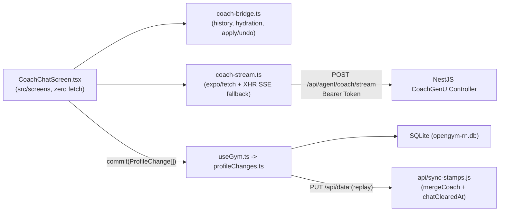

# RN 客户端接入 AI Coach GenUI（`rn-coach-genui`）— 设计文档

- **生命周期**：`proposed`
- **日期**：2026-11-27
- **目标**：在 `mobile-rn/`（Expo SDK 55 / React Native 0.83）中接入完整的 AI Coach GenUI 流式对话体验，与 Web 端（`coach-genui-v2` + `v2.1` + `coach-genui-create-plan`）保持协议、数据水合、提案应用/撤销与跨端同步完全一致；所有界面严格遵循 `mobile-rn/src/design/` 设计系统与 ESLint 架构边界。

---

## 1. 现状与复用分析

### 1.1 `mobile-rn` 已有资产（直接复用，不重复造轮子）
| 层级 | 已有模块 | 复用方式 |
|---|---|---|
| 跨目录 Metro 共享 | `mobile-rn/metro.config.js`（已挂载 `../frontend/src` 与 `../api/agent-runtime`） | 直接复用 `api/agent-runtime/genui/` 协议常量/类型、`frontend/src/lib/coach-genui-hydration.js` 纯函数水合、`frontend/src/lib/coach.js` 提案应用与撤销引擎 |
| 服务端连接与认证 | `mobile-rn/src/server.ts`（`Connection { server, token, user }`）与 `mobile-rn/src/agent/server-client.ts` | 复用配对的 Bearer Token 访问 `POST /api/agent/coach/stream` 与 `/api/config` |
| 原生图表与肌群图 | `mobile-rn/src/design/patterns/Chart.tsx`（`LineChart`、`BarChart`）、`BodyMap.tsx`、`ExerciseMedia.tsx`、`ActionSheet.tsx` | 直接承接 `exercise_trend`、`muscle_load`、`exercise_alternatives`、右上角菜单 |
| 基础设计系统原语 | `mobile-rn/src/design/components/`（`Screen`、`Header`、`Card`、`Chip`、`Badge`、`Button`、`StatTile`、`Segmented`、`Sheet`、`ListRow`、`TextField`、`Text`、`EmptyState`、`Divider`、`ProgressBar`） | 100% 使用语义 Token 与设计系统组件，通过 `npm.cmd run design:check` 与 `eslint` 门禁 |
| 状态与同步管线 | `mobile-rn/src/useGym.ts` + `profileChanges.ts` + `storage.ts` + `server.ts` | 新增可重放 `ProfileChange` 意图，经 SQLite 持久化与 `/api/data` 乐观同步实现 Web ↔ RN 双向对齐 |

### 1.2 本期范围与非目标
- **本期包含（Phase 1–5）**：
  - 已配对自托管服务器模式下的全功能 AI Coach GenUI 流式对话（分析训练、自由组件叙事、工具检索动作、0 计划账号新建单日/多日计划 + 周历排期、10 轮上下文、新对话清空与 `chatClearedAt` 跨端防复活、提案一键应用与一键撤销）；
  - 未配对状态下的清晰引导页（直达 `QrPairScreen` 配对扫码）；
  - 深链 `opengym://coach`（支持 `e2e=1`）与首页/计划页入口。
- **本期非目标**：
  - 不在本期实现无后端的手机本机 BYOK 直连大模型流式推理（保留 `coach-stream.ts` 抽象接口供二期扩展）；
  - 不改造或删除现有 `AgentScreen`（`opengym://agent` 保留作为 Agent 配置/记忆调试台，可从菜单跳转）。

---

## 2. 按受影响子系统的语义级变更声明

### 2.1 `mobile-rn`（RN 客户端、设计系统渲染与本地同步）
- **触发条件（Trigger）**：
  1. 用户从首页 Coach 入口、计划页入口或深链 `opengym://coach` 打开 `CoachChatScreen`；
  2. 用户发送消息、提交 `quick_form`、点击底部快捷胶囊（检查训练 / 上次训练 / 改进计划 / 新对话）、采纳 `proposal_action` 提案或执行「撤销教练上次的更改」。
- **改前行为（Before）**：
  - `mobile-rn` 无 AI Coach 对话页，无 `/api/agent/coach/stream` 客户端，也未在 `Profile` 类型与 `profileChanges.ts` 中处理 `coach.chat` / `chatClearedAt` / 提案应用同步。
- **改后行为（After）**：
  - **网络流式层（`src/agent/coach-stream.ts`）**：封装 `POST ${connection.server}/api/agent/coach/stream` 的 AG-UI SSE 流式消费（优先使用 Expo SDK 55 内置 `expo/fetch` `ReadableStream`，并内置 `XMLHttpRequest` `onprogress` 增量切片兜底以兼容 Android Hermes 环境），完整解析 `RUN_STARTED`、`STEP_STARTED/FINISHED`、`TOOL_CALL_START/RESULT`、`CUSTOM(genui.*)`、`RUN_FINISHED`、`RUN_ERROR` 与 `429 turn_limit`，支持 `AbortController` 随时中断；
  - **桥接与类型层（`src/agent/coach-bridge.ts`、`src/training.ts`）**：
    - 扩展 `Profile` 类型定义可选 `coach?: CoachState`（含 `chat`、`chatClearedAt`、`log`、`snapshots`、`profile`、`consent`、`cadence`）；
    - 封装类型安全的 `buildGenUIHistory`、`countGenUITurns`、`hydrateExerciseTrend`、`hydrateMuscleLoad`、`hydrateKpiStrip`（直接桥接 `frontend/src/lib/coach-genui-hydration.js` 与 `mobile-rn/src/catalogue.js` 本地化动作名）；
    - 封装 `applyCoachProposal`、`revertLastCoachChanges`（复用 `frontend/src/lib/coach.js` 的 `applyChangeSet` / `revertLast` 原子逻辑，确保 RN 与 Web 提案校验、快照、周历排期、撤销 100% 字节级一致）；
  - **可重放同步意图（`src/profileChanges.ts`）**：新增 4 类可重放 `ProfileChange`：
    - `coachChatAppend`（按 `message.id` 幂等追加，且强制 `at > chatClearedAt` 并裁剪旧消息）；
    - `coachChatClear`（单调推进 `coach.chatClearedAt` 并清空 `coach.chat`）；
    - `coachProposalApplied`（按 `messageId` + `nodeId` 幂等标记节点 `applied: true`）；
    - `coachApplyProposal` / `coachRevertLast`（在最新远端快照上原子重放提案或撤销最后一次快照，同时更新 `routines`、`week`、`coach.log`、`coach.snapshots`）；
  - **原生 GenUI 渲染组件（`src/coach/`）**：基于 `src/design` 语义 Token 与原语实现全部 GenUI 节点原生渲染（详见 §3.2），`src/screens/CoachChatScreen.tsx` 负责流式叙事线程、10 轮计数、快捷胶囊与底部键盘安全输入栏；
  - **导航与深链（`App.tsx`、`HomeScreen.tsx`、`PlanScreen.tsx`）**：`Panel` 新增 `{ kind: 'coach' }`，注册 `opengym://coach` 深链，在首页与计划页提供入口。
- **接口、状态与兼容性**：
  - RN 通过 `server.ts` 发送未带 `stamped: true` 的 `PUT /api/data`；服务端 `api/sync-stamps.js` 的 `stampPut` 会自动执行 `mergeCoach` 与单调 `chatClearedAt` 裁剪，实现 **Web ↔ RN 聊天记录、清空水位、已采纳卡片、新建/修改计划与撤销**全双向一致，无需修改后端任何 HTTP 契约；
  - `mobile-rn/src/screens/` 严禁直接调用全局 `fetch`、严禁导入 `react-native` 原生 `Text`/`TextInput`/`Pressable`、严禁手写裸色值/裸像素，全部通过 `src/agent/` 与 `src/design/` 访问，保证 `npm.cmd run check` 零错误。
- **失败模式**：
  - 未配对或网络断开：展示友好 `EmptyState`（附「去配对」/「重试」），不崩溃、不丢已写草稿；
  - 服务端返回 `404`/`503`（未开启 Agent）或 `429 turn_limit`（达 10 轮上限）：展示明确中文提示条与「开始新对话」主按钮；
  - 流式进行中点击「停止」或「新对话」：通过 `chatGenRef` 代次守卫 + `AbortController` 立即终止旧流，严禁旧流残片写入新会话（遵循 `L-010`）。

### 2.2 `api-sync` / `ai-agent`（验证零改动或最小鉴权确认）
- **核查点**：确认 `POST /api/agent/coach/stream` 与 `GET /api/config` 在携带手机配对 `Authorization: Bearer <token>` 时与 Web Cookie 会话表现完全一致（复用同一 `@SessionRequired()` 守卫，预期零后端改动；若 Bearer 鉴权存在任何遗漏则在 Phase 1 同步补齐并补单测）。

---

## 3. 核心架构与原生 UI 映射设计

### 3.1 RN 流式传输与状态流架构

#### Android / Hermes SSE 流式实现策略（`src/agent/coach-stream.ts`）
1. 优先尝试 `import { fetch as expoFetch } from 'expo/fetch'`：若 `response.body?.getReader` 可用，按标准 `TextDecoder({ stream: true })` 逐块拆帧（`\r\n\r\n` / `\n\n`），逐事件回调 `onEvent(event)`；
2. 若当前运行环境不支持 `getReader`（例如部分 Android 机型/测试环境），自动回退到 `XMLHttpRequest`：监听 `onprogress`，用 `lastOffset` 切片 `xhr.responseText.slice(lastOffset)` 增量喂给同一 SSE 帧解析器，同样实现真正的流式渲染与 `xhr.abort()` 随时中断；
3. 两种传输共用同一纯函数 SSE 帧解析器 `createSseFrameParser()`，便于在 Node `node --test` 中做 100% 单元测试（覆盖分片中文 UTF-8、心跳注释行、粘包、429 JSON 错误体与中断）。

### 3.2 GenUI 10 类节点 → RN 设计系统组件映射表

所有渲染组件放在 `mobile-rn/src/coach/`（独立于 `src/screens/`，统一仅使用 `src/design` 语义 Token 与组件）：

| GenUI 节点 `type` | RN 原生实现 | 复用的 `src/design` 组件 | 关键交互与防溢出设计 |
|---|---|---|---|
| `prose` | `ProseNode` | `Text`（`body` / `headline`） | `tone: 'lead'` 略强权重；无外框气泡，与 Web 叙事简报视觉一致 |
| `kpi_strip` | `KpiStripNode` | `StatTile`（2×2 或横向等宽网格） | 本地 `hydrateKpiStrip` 注入真实数值 + 趋势角标（`Badge`），`tabular-nums` |
| `exercise_trend` | `ExerciseTrendNode` | `Card` + `Segmented` + `LineChart` | 顶部指标切换（`1RM` / `重量` / `总量`）与周期切换（`4周`/`8周`/`12周`/`24周`）纯本地重算不发请求 |
| `muscle_load` | `MuscleLoadNode` | `Card` + `Segmented` + `BodyMap` + `ProgressBar` | `72h` / `7d` / `28d` 本地切换，复用现有 `BodyMap` 热力图 + 重点肌群组数进度条 |
| `comparison_table` | `ComparisonTableNode` | `Card` + `Divider` + `Text` | 列 0 若为 `{ exId }` 本地解析中文动作名；窄屏 360dp 下自动换行不裁切 |
| `callout` | `CalloutNode` | `Card` + 左侧语义色条（`accent`/`warning`/`info` Token） | 标题 + 简明正文 |
| `exercise_alternatives` | `AlternativesNode` | `Card` + `ExerciseMedia`（缩略图）+ `Badge` + `Button` | 展示动作图/名/理由，支持一键套用替换（触发 `proposal_action` 同款确认写入） |
| `quick_form` | `QuickFormNode` | `Card` + `Chip`（单选/多选）+ `Segmented`/尺度按钮 + `Button` | 提交后锁定为已提交态并将结构化 `formSubmission` 发往下一轮流式请求 |
| `proposal_action` | `ProposalActionNode` | `Card` + `ListRow`/勾选框 + `RoutinePreview` + `Button` | 支持修改类 diff 标签（`before → after`）与 `add-routine` 周几胶囊 + 完整动作处方列表；勾选确认后写入 `commit()` 并置为「已采纳」 |
| `fallback_notice` | `FallbackNoticeNode` | `Card`（次级表面）+ `Icon(info)` + `Text` | 柔和降级提示 |
| 历史兼容 `checklist` | `LegacyChecklistNode` | 编号纯文本 `Text` 列表 | 与 Web v2.1 一致：只读编号列表，无交互复选框 |

### 3.3 九维 UI 规范前置核查（移动端 Android 360dp / 412dp）
1. **间距与对齐**：全部引用 `theme.space.*`、`theme.radius.*`、`theme.colors.*`，通过 `npm.cmd run design:check` 静态扫描。
2. **输入栏与软键盘焦点保持**：`CoachChatScreen` 底部 composer 保持固定组件树位置与稳定 `key`，不因流式节点增减或轮次变化卸载 `TextField`；配置 `KeyboardAvoidingView`（Android `height` / `padding` 适配）+ 安全区底距。
3. **顶部快捷胶囊与轮次**：与 Web 最新布局一致，单行横向可滚动 `ScrollView` 胶囊（`检查我的训练`、`上次训练`、`改进一个计划`、`新对话`），下方仅一行紧凑轮次计数（`N/10 轮`）；满 10 轮展示锁定提示卡 + 「开始新对话」主按钮。
4. **触控热区**：发送按钮、停止按钮、提案勾选项、应用按钮、胶囊按钮、菜单行全部满足 ≥ 44dp 触控高度。
5. **流式过程状态条**：`StreamStepsBar` 原生实现（展示当前阶段如「正在查看你的训练…」+ `search_catalogue` 工具调用态 + 右侧「停止」按钮）。

---

## 4. 关键风险与防护

| 风险 | 影响 | 防护措施 |
|---|---|---|
| Android Hermes 上 `fetch().body` 为空导致无法流式 | 卡片等到整段结束才一次性弹出 | `coach-stream.ts` 实现 `expo/fetch` + `XMLHttpRequest` `onprogress` 双栈并真机/模拟器实测逐块到达 |
| `frontend/src/lib/coach.js` 内部依赖 Web `i18n.js` / `exercises.js` 导致 RN 打包或翻译异常 | Metro 报错或中文变英文 | 在 `coach-bridge.ts` 中核查并封装依赖：优先复用纯算法，动作名和周几标签使用 `mobile-rn` 自带中文词库/映射表 |
| `ProfileChange` 重放顺序与 Web 同步冲突 | 手机清空对话后被 Web 旧数据复活 | `coachChatClear` 单调推进 `chatClearedAt`，与后端 `stampPut` 单调水位双向配合；单元测试覆盖 5 切面（`L-010`） |
| Windows 250 字符路径限制导致 Gradle/CMake 失败 | 无法构建 APK | 遵循 `[L-001]` 与 `[L-003]`：在短路径工作树 `D:\wt\rn-coach-genui` 开发，UI 阶段全程用 Debug APK + Metro 热更新验收，仅收尾编一次 Release APK |
| ESLint 严格边界规则拦截 | `npm run check` 标红 | `src/screens/CoachChatScreen.tsx` 严格零 `fetch`、零原生 `Text/Pressable`、零裸色值、零 `any`、零悬空 Promise |
