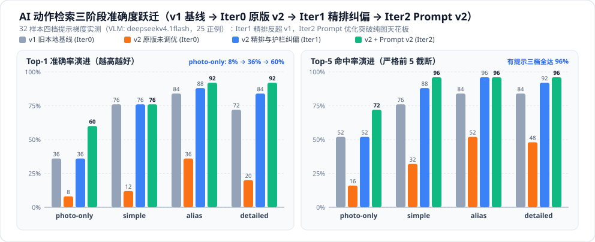
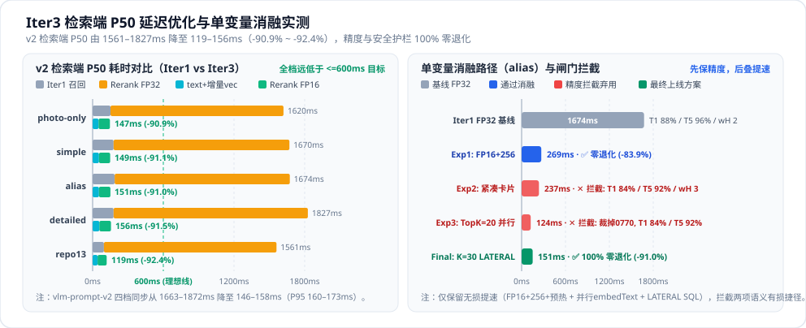

<div align="center">

<p>
<picture>
  <source media="(prefers-color-scheme: dark)" srcset="assets/readme/hero-dark.png">
  <source media="(prefers-color-scheme: light)" srcset="assets/readme/hero-light.png">
  
</picture>
</p>

# ili-s-openGym

**面向原生 Android 体验、工程化后端演进与多模态智能动作检索的 openGym 衍生分支**

[](https://github.com/DuarteSantos8/openGym)
[](docs/subsystem/mobile-rn/README.md)
[](docs/subsystem/api-sync/README.md)
[](LICENSE)

[智能动作检索优化](docs/AI_EXERCISE_SEARCH_OPTIMIZATION.md) · [系统架构](docs/ARCHITECTURE.md) · [自托管指南](docs/SELF_HOSTING.md) · [文档总路由](docs/README.md)

</div>

---

## 关于本项目与 Fork 来源

本项目 Fork 自优秀开源自托管健身追踪应用 **[openGym](https://github.com/DuarteSantos8/openGym)**（基于上游 **`v1.4.4`** 版本分叉，遵循 GNU AGPL v3.0 协议）。

原版 openGym 已经构建了非常完整的本地优先训练体系——包含 5,632 个带演示动画的动作库、Passkey 无密码认证、离线记录、多设备增量同步、自托管 Docker 部署以及可选的 AI Coach 与 MCP 接入。在此基础之上，本分支主要做了三件事：**将移动端从 Web 套壳迁移到原生 React Native、将服务端重构升级为可扩展的工程化架构、以及新增「多模态智能检索动作库」功能**。

### 与原版 openGym 的主要区别

| 维度 | 原版 openGym (`v1.4.4`) | 本分支 (`ili-s-openGym`) |
|---|---|---|
| **Android 客户端** | Capacitor 封装 Web 应用 | 新增独立 **React Native (Expo)** 原生 Android 客户端，独立持久化与系统通知提醒，并完整补全动作库中文内容 |
| **UI 与设计体系** | Web CSS 设计系统 | 在 RN 端沉淀并统一了一套**跨端语义设计系统**（Tokens、双主题、图标与肌群图原语），与原版视觉语言一脉相承 |
| **服务端框架** | 单体 `node:http` 服务 | 迁移至 **NestJS** 模块化架构，保持原有接口与数据协议 100% 向后兼容 |
| **Agent 与检索底座** | 轻量 Coach / 本地关键词搜索 | 引入 **LangChain / LangGraph** 服务端编排与 **PostgreSQL（混合文本+向量召回）+ BGE 精排** 检索底座 |
| **新增业务功能** | 关键词筛选与部位浏览 | 暂时仅新增 **「智能检索动作库」**（拍照/文字/图+文识别器械并匹配动作库，支持端侧与服务端双模式） |

---

## 本项目做了什么

### 📱 原生客户端迁移与中文补全

为了获得更流畅的原生手势、更可靠的本地数据库与后台通知能力，本项目在 [`mobile-rn/`](docs/subsystem/mobile-rn/README.md) 中构建了独立的 React Native Android 客户端（可与原版共存，支持无服务器单机练习或扫码配对自托管服务器）：

- **核心训练与数据能力迁移**：将原版的主流程全面迁移至原生端——包括训练计划与排程轮换、组间休息倒计时与锁屏提醒、沿用上次正式组重量、热身组与备选动作替换、超级组、表格化训练组与递减组/休息暂停组、RPE/RIR 努力度评分、个人纪录（PR）与估算 1RM、训练趋势与肌群负荷图、体重/围度/进度照片、FitNotes/Strong/Hevy 历史导入与计划 JSON 分享，以及离线队列与多设备冲突合并同步。
- **交互一致性与本地化补全**：对齐了 Web 端的核心训练与计划编辑交互体验（如多计划合并开训、多种训练布局、后台收起与恢复、已完成组数值更正等）；同时针对中文用户痛点，**补全了全部 5,632 个内置动作的 30,709 条中文动作步骤翻译**，内置 180px 动作演示静图与动画，并支持中英文别名检索与拼写纠错建议。

### 🎨 跨端设计系统积累

本项目参照原版 Web CSS 变量、图标与人体肌肉路径图，在 RN 客户端积累了一套严谨、可复用的 **设计系统（[`mobile-rn/src/design/`](docs/RN_UI_DESIGN_SYSTEM.md)）**：

- **统一视觉与语义规范**：沉淀了完整的色彩、字号、圆角、间距与动效 Token，原生支持 Dark / Light 双主题切换与多种自定义强调色；
- **组件与图形原语库**：封装了 127 个统一描边图标、可交互的正反面人体肌群图（`BodyMap` / `MiniBodyMap`）、动作媒体缩略图、步进器（`Stepper`）、底部操作面板与带 AI 入口的搜索框，并配套了开发画廊与自动规则校验，确保双端界面风格高度统一且易于后续扩展。

### ⚙️ 服务端迁移：向下兼容，向上扩展

本项目对 [`api/`](docs/subsystem/api-sync/README.md) 后端进行了系统性的架构升级，做到**对原有客户端完全兼容、对未来 AI 能力平滑支撑**：

- **完全对齐兼容原版体系**：无缝兼容原版 Web 客户端、Passkey 与密码认证、一次性二维码/配对码流程、基于磁盘目录的原子化 JSON 存储，以及多设备 `409` 字段级增量同步合并协议——老版本数据、部署习惯与原有接口契约无需迁移即可继续运行，同时改善了服务优雅停机与回滚可靠性。
- **新增与改造内容**：
  - **NestJS 架构迁移**：将原本单文件式的 HTTP 服务重构为清晰的 NestJS 模块化工程架构，提升可维护性与可测试性；
  - **Agent 运行时升级**：搭建了跨端共享、可在手机本机与服务端双端运行的 Agent 核心，并将服务端执行引擎迁移至 **LangChain / LangGraph**，以标准多轮消息序列替代早期文本拼接以提升多轮缓存命中与扩展能力（支持配置开关一键回退旧引擎）；
  - **混合检索与推理底座**：为动作检索引入独立的 **PostgreSQL（`pgvector` + `pg_trgm`）** 公开动作索引库与本机/远程 **BGE 模型推理服务**（Embedding + Cross-Encoder 精排），个人账户与训练数据仍保留在轻量 JSON 存储中互不耦合。

### ✨ 新增功能：多模态智能检索动作库

在继承 openGym 现有全部功能的前提下，本分支目前**唯一新增的面向用户业务功能为「智能检索动作库」**（覆盖 Web 端与 RN Android 端的动作库及训练换动作场景）：

- **听得懂大白话，也看得懂健身器械**：支持**纯文字、拍照/相册纯图、图 + 文**三种输入方式，无需记住动作的标准英文名，拍下健身房陌生器械即可匹配出 5,632+ 动作库中最符合的动作并给出匹配依据与高/中/低置信等级；
- **多轮消歧与器械限定**：面对双功能器械或易混角度，支持点击预设的一键消歧标签或发起连续多轮图文追问逐步收窄结果，也支持显式限定目标器械类型；
- **兜底直达与双轨运行**：未找到理想动作时可直接结合识别描述与照片快速新建自定义动作；既支持在有服务端时启用高精度双路混合检索，也支持在无后端或离线练习时于手机端直连大模型完成轻量检索。

---

## 检索优化

> 📖 **完整优化过程与实验数据：[`docs/AI_EXERCISE_SEARCH_OPTIMIZATION.md`](docs/AI_EXERCISE_SEARCH_OPTIMIZATION.md)**

“智能检索动作库”经历了一段循序渐进的演进过程。本项目从最早期仅靠端侧词法匹配的简单 Agent 起步，随后在服务端接入 PostgreSQL 混合检索，针对初版重排准确率下降的问题，通过漏斗拆解、单变量实验、Prompt 结构化调优与推理延迟压降，最终实现了高精度、低误报、亚秒级响应的完整方案（上游多模态理解实测采用 **`deepseekv4.1flash`**）：

1. **早期端侧 Agent 演进**：从最初仅取词法首位结果导致误排，逐步优化跨查询排序、商业器械同义词与冲突矩阵、一键消歧标签、姿势标注与幻觉闸门 BM25 兜底（同时果断回退了延迟翻倍且降质的二阶段 LLM 闭集重排）；
2. **服务端 PostgreSQL 双路融合**：结合 **名称模糊/短词/分词召回（`pg_trgm` + `ILIKE` + `tsvector`）** 与 **语义向量召回（`BAAI/bge-m3` + `pgvector` HNSW）** 做 RRF 融合，再用 Cross-Encoder（`bge-reranker-v2-m3`）精排；
3. **重排与领域护栏纠偏**：修复 Query 模板缺动作名与 Sigmoid `0.99` 饱和失效问题，通过 Logit 反算联合排序、跨器械/部位冲突惩罚与双门控置信校准，一举扭转初版崩盘并在留出集上取得 `90.9% Top-1 / 100% Top-5`；
4. **上游 VLM 提示词优化**：克制 Prompt 篇幅，建立“驱动机构 → 人体接触垫与发力肢体先判 → 观察-候选强一致”推理链并明确废片拒识边界，将最难的**纯图场景 `Top-1` 由 `36.0%` 推升至 `60.0%`**、易混器械切片达 **`100%`**；
5. **P50 延迟优化与消融守护**：通过 ROCm 半精度推理（`fp16` + 预热）、`embedText` 并发重叠与 `CROSS JOIN LATERAL` 索引化 SQL，将服务端检索延迟 **P50 从 `1.56–1.87s` 压降至 `119–158ms`（提速 11–13 倍）**，同时拦截了两项虽能再省几十毫秒但会损失准确率的捷径。

<p align="center">
  
</p>
<p align="center">
  
</p>

---

## 仓库结构概览

<p align="center">
<picture>
  <source media="(prefers-color-scheme: dark)" srcset="docs/diagrams/architecture-dark.png">
  
</picture>
</p>

| 目录 | 职责说明 |
|---|---|
| [`mobile-rn/`](docs/subsystem/mobile-rn/README.md) | React Native (Expo) 原生 Android 客户端与跨端设计系统 |
| [`frontend/`](docs/subsystem/web-client/README.md) | Web / PWA 客户端、纯函数训练引擎、多语言包与智能检索评测脚本 |
| [`api/`](docs/subsystem/api-sync/README.md) | NestJS 后端服务、同步与认证、LangGraph Agent 及 PostgreSQL 检索模块 |
| [`api/agent-runtime/`](docs/subsystem/ai-agent/README.md) | 跨端共享、零外部依赖的纯 JS Agent 核心与任务定义 |
| [`services/retrieval-model/`](services/retrieval-model/main.py) | 独立的 Python FastAPI 推理服务（`bge-m3` 与 `bge-reranker-v2-m3`） |
| [`catalogue/`](docs/subsystem/catalogue/README.md) | 5,632 个内置动作的原始数据、多语言译文、演示媒体与词库生成管线 |
| [`scripts/`](scripts/README.md) | 索引构建、中文步骤翻译、Windows 检索服务启停与治理检查工具 |
| [`docs/`](docs/README.md) | 子系统路由、架构文档、部署指南与智能动作检索优化文档 |

---

## 快速开始

### 基础自托管（Web + API）

与原版一致，只需一条 Docker Compose 命令即可在本地拉起 Web 与后端服务（详细配置见 [自托管指南](docs/SELF_HOSTING.md) 与 [`.env.example`](.env.example)）：

```bash
cp .env.example .env
docker compose up -d --build
```

启动后访问 <http://localhost:8080> 创建账号即可使用。

### 可选：启用服务端智能检索 v2（Windows 环境）

如需启用服务端双路混合检索，可通过仓库内置脚本在独立运行目录下初始化并启动 PostgreSQL（`pgvector` + `pg_trgm`）、推理模型服务与 NestJS：

```powershell
# 1. 初始化独立运行环境（不污染原有数据目录）
.\scripts\windows\Initialize-Retrieval.ps1 -RuntimeRoot D:\dev\.tools\opengym-retrieval

# 2. 启动 PostgreSQL -> 模型服务 -> 校验公开索引 -> 启动 API
.\scripts\windows\Start-Retrieval.ps1 -RuntimeRoot D:\dev\.tools\opengym-retrieval
```

> 可通过环境变量 `EXERCISE_SEARCH_VERSION=v1` 切回轻量端侧检索，或通过 `AGENT_SERVER_ENGINE=legacy` 切回旧版 Agent 编排。

---

## 相关文档与开源协议

- **检索优化与研发文档**：[智能动作检索优化](docs/AI_EXERCISE_SEARCH_OPTIMIZATION.md) · [RN 设计系统](docs/RN_UI_DESIGN_SYSTEM.md) · [系统架构概览](docs/ARCHITECTURE.md) · [子系统文档索引](docs/README.md)
- **原版使用与部署指南**：[自托管指南](docs/SELF_HOSTING.md) · [移动端说明](docs/MOBILE.md) · [AI Coach](docs/AI_COACH.md) · [外部集成](docs/INTEGRATIONS.md) · [MCP 服务](mcp/README.md) · [常见问题](docs/FAQ.md)
- **版本与协议**：[更新日志](CHANGELOG.md) · [路线图](ROADMAP.md) · [贡献指南](CONTRIBUTING.md) · [安全规范](SECURITY.md)

**License & 致谢**
- 本仓库代码沿用上游 [GNU AGPL v3.0](LICENSE) 开源协议；若以网络服务形态提供修改版本，须遵守 AGPL-3.0 开源要求。
- `catalogue/media/` 中的动作静图与演示动画版权归 © Aliaksandr Makatserchyk（[Gym visual](https://gymvisual.com/)），按上游授权随非商业分叉保留使用，详见 [NOTICE.md](NOTICE.md)。
- 衷心感谢 **[DuarteSantos8/openGym](https://github.com/DuarteSantos8/openGym)** 及其社区贡献者构建的杰出开源基座。
