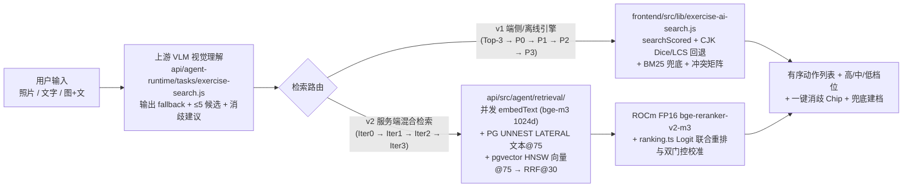
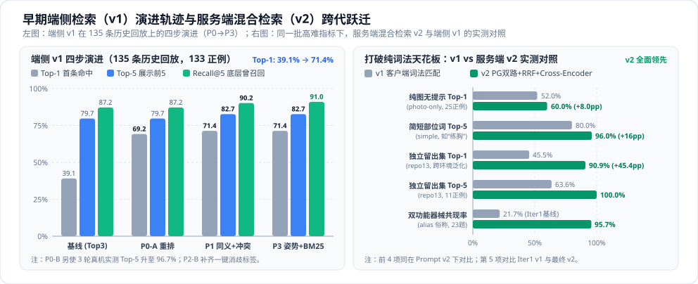
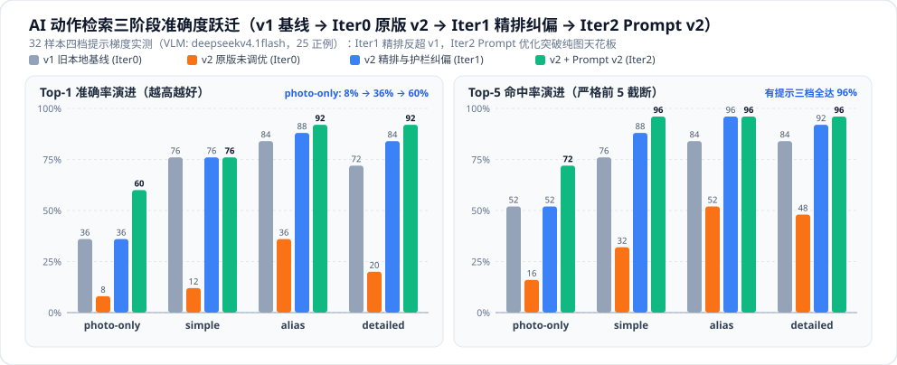
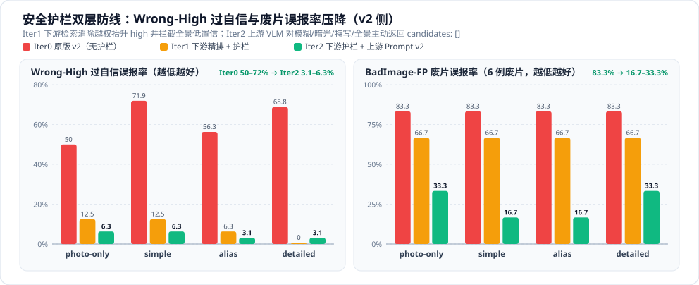
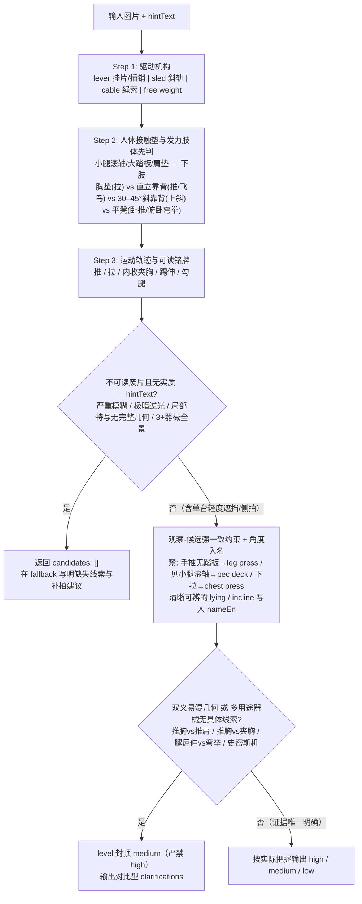
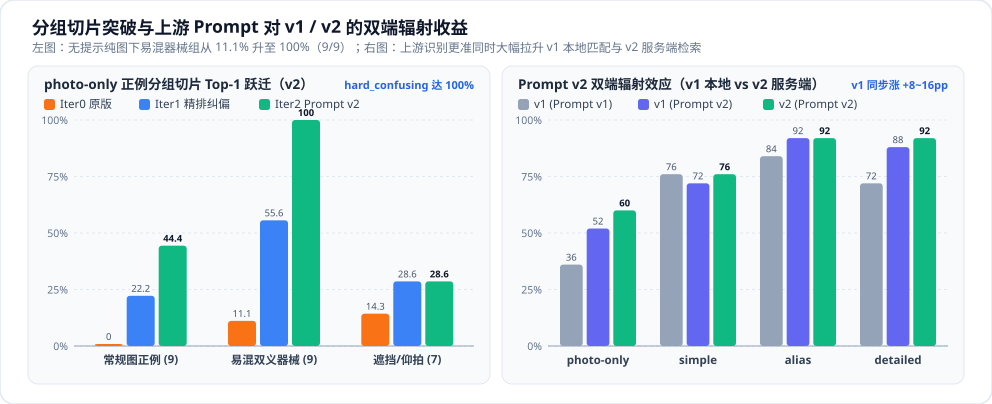
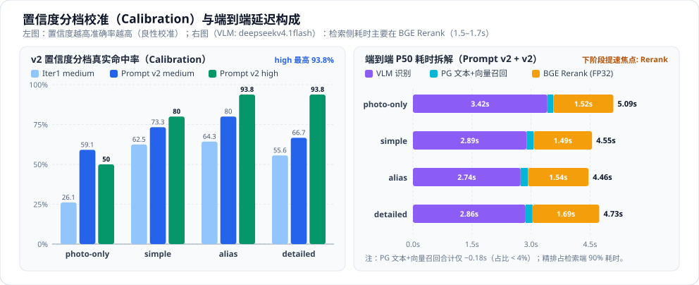
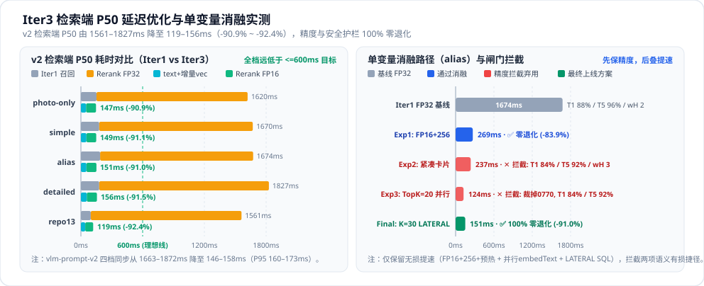
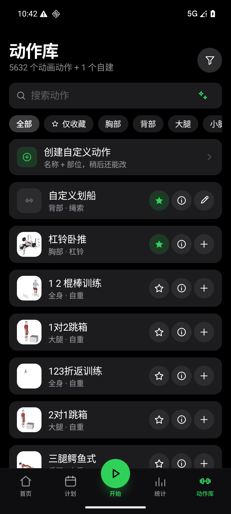
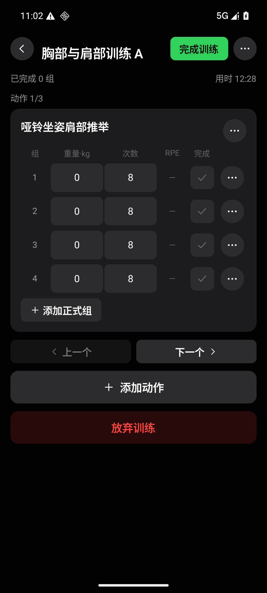

# 智能动作检索优化：从端侧轻量 Agent 到服务端双路融合、重排、Prompt 与 P50 优化

> 本文介绍本项目在 **openGym `v1.4.4`** 基础上新增「多模态智能检索动作库」功能的完整优化过程——上游多模态理解模型实测采用 **`deepseekv4.1flash`**，检索侧涵盖从最初客户端轻量词法 Agent（`exercise-search.v1`）起步，到服务端 **PostgreSQL 名称模糊搜索 + pgvector（`BAAI/bge-m3`）向量双路召回融合（`exercise-search.v2`）**、**`BAAI/bge-reranker-v2-m3` Logit 联合重排与领域护栏**、**VLM Prompt 结构化优化**，以及 **ROCm 半精度与并发 SQL 的 P50 延迟压降**。
>
> 返回项目总览：[README.md](../README.md) · 子系统技术路由：[ai-agent/README.md](subsystem/ai-agent/README.md)

---

## 1. 背景与两代架构演进总览

openGym 内置了 **5,632** 个标准化力量与有氧训练动作（包含中英文名称、身体部位、器械类型、目标肌群及动作要领）。用户在健身房面对一台不认识的商用固定器械、双功能复合器械，或不了解标准英文/中文译名时，传统关键词搜索往往束手无策。

如果直接把 5,632 个动作塞给大模型或让模型直接输出内部数字 ID，会立刻遇到三大问题：**上下文窗口爆炸、模型捏造不存在的动作 ID（幻觉），以及无法兼容用户的自定义动作与别名**。因此，本项目从最初设计阶段起就确立了**「上游多模态理解（不接触目录 ID）+ 下游受控检索与领域校准」**的两段式架构，并先后经历了两代架构与八轮核心迭代：

---

## 2. 第一阶段：早期端侧轻量 Agent（`v1`）起步与五轮迭代

> ℹ️ 文中图表涉及的测试集样本构成与指标缩写含义，见文末 [§8 测试数据集与指标说明](#datasets-and-metrics)。

下面左图总结了端侧 `v1` 在 **135 条历史回放**上的四步演进，右图对比了端侧 `v1` 与后续服务端 `v2` 的实测差距：

> **图 1 读图要点**：左图中 `Recall@5` 始终高于 `Top-5`（`91.0% vs 82.7%`），说明端侧词法层能捞回 9 成答案，主要失分点在多查询汇总排序（`P0-A` 后 `Top-1` 跃升 `+30.1pp`）；右图显示 `v1` 在**纯图无提示**、**`repo13` 留出集**与**双功能器械共现**上触及瓶颈，进而引入 §3 的服务端混合检索方案。

最初的 `exercise-search.v1`（[`api/agent-runtime/tasks/exercise-search.js`](../api/agent-runtime/tasks/exercise-search.js) + [`frontend/src/lib/exercise-ai-search.js`](../frontend/src/lib/exercise-ai-search.js)）设计非常轻量：VLM 看图或读文字后吐出最多 5 个候选（中文/英文名 + 猜测 `equipment`/`bodyPart` + `level`）与 `fallback`；客户端本地用 `searchScored`（空格分词评分）+ CJK 字符级回退（Bigram Dice ≥ `0.60`、LCS ≥ `3`、Margin ≥ `0.12`）+ 属性加分（`BASE_FLOOR=60`、`EQ_BONUS=+25`、`BP_BONUS=+15`）匹配本地词库，Web 与 RN 共用完全一致的纯 JS 逻辑。

在实际运行真实器材照片（尤其是商用固定器械与仰拍图）时，系统依次暴露出四类关键问题，并驱动完成了 `Top-3 → P0 → P1 → P2 → P3` 五轮演进：

1. **问题一：`results[0]` 截断与低置信变体抢占首位（→ `Top-3` + `P0-A` + `P0-B`）**
   - **现场**：坐姿推胸 `0576`/`0577` 经常排在词法查询第 2–3 名，而旧匹配器每条查询只取第 1 名直接丢掉正解；同时 3–4 个词的 `lever incline chest press`（`1299`）因原始词数多、关键词得分更高，跨查询反超了高置信主动作。
   - **做法**：改为每条查询取 **Top-3** 按候选级 `equipment` 选优（严禁 `fallback.equipment` 污染具体候选）；落地 **`P0-A`**（跨查询改用来源可靠性 → 模型等级 → 精确匹配 → 器械/部位一致 → 无证据变体数词典序，不再跨查询硬比关键词原始分）；落地 **`P0-B`**（Prompt 要求先在 `fallback.understanding` 写视觉观测再出候选）。同时实测验证并**果断回退**了让准确度从 `83.3%` 跌回 `76.7%` 的 `P0-C`（`temperature: 0`）。
   - **效果**：135 条回放 RN `Top-1` 由 **`39.1% (52/133) → 69.2% (92/133)`（`+30.1pp`）**，`1299` 抢占 `0576` 从 9 例直接**清零**；3× 真实 E2E `Top-1` 达 **`83.3%`**、`Top-5` 达 **`96.7%`**。

2. **问题二：跨语言、商业连写词与跨器械误配（→ `P1-A` + `P1-C`）**
   - **现场**：法语名、英文口语名（如 `pecdeck`、`latpulldown`、`plateloaded`）在本地中文库召回困难；个别挂片器械因缺词误命中自重或杠铃动作。
   - **做法**：**`P1-A`** 支持跨语言启用 `nameEn` 查询；**`P1-C`** 增补 14 条商业器械同义词，并建立**固定器械 ↔ 自由重量双向硬冲突矩阵**（同时按门槛回退了引入 `cable` 误配的 `P1-B` 查询松弛）。
   - **效果**：135 条回放 `Top-1` 升至 **`71.4% (95/133)`**、`Top-5` 升至 **`82.7%`**、`Recall@5` 升至 **`90.2%`**。

3. **问题三：两阶段 LLM 闭集重排退化，转向一键消歧（→ `P2-0` + `P2-B`）**
   - **现象与尝试**：面对纯图下的近义器械（推胸 vs 推肩、腿屈伸 vs 腿弯举），曾尝试 **`P2-A` 两阶段闭集重排**（首轮宽召回 12–15 个相似动作名，再把图片和候选名单送给 VLM 二次选择）。
   - **实测与回退**：两组 3× E2E 实测显示，把高度相似的近亲名称连同单视角静态糊图喂回 VLM，不仅不能补充运动轨迹信息，反而放大了干扰项错位——**纯图 `Top-1` 从 `66.7%` 跌至 `60.0%`、错器械升至 `3/30`、纯图 P50 延迟翻倍到 `22.7–24.8 秒`**。因此完整回退了 `P2-A`，保留 `P2-0`（只读 `search_catalogue` 基础设施），并落地 **`P2-B` 一键消歧 Chip**：清晰高置信结果直接展示，歧义场景给用户提供最多 3 个中文点选短语（1 次点击即可收敛）。

4. **问题四：姿势差异与严格 AND 零命中（→ `P3-0` + `P3-A` + `P3-B`）**
   - **现场**：`1041`（`lever lying chest press (plate loaded)`）因尾部括号无法触发精确匹配；VLM 吐出 `"lever lying bench press"` 时，严格 AND 词法引擎零命中并把无关耸肩动作 `1221` 拉进结果。
   - **做法**：构建 **2,720 条动作结构化 `posture` 姿势标注与 244 个动作 446 条标准别名**（`P3-0`）；落地去非语义后缀精确判定与跨部位冲突守卫 `body_part_conflict`（`P3-A`）；引入带**非健身陌生词幻觉闸门**的 3 字段加权 BM25 零命中兜底且封顶 `medium`（`P3-B`）。同样按门槛回退了破坏聚合 `Top-5` 的 `P3-C`（`candidate.posture` Schema 实验）。
   - **效果**：在新增 5 台器材 `manifest-p3.json` 回放中，`p3-hinted-lying-chest-press` 从第 17 名跃居 **`Top-1` 命中 `1041`**；135 条回放 `Recall@5` 达 **`91.0%`**。

### 为什么仍必须走向服务端混合检索（`v2`）？

到 `P3` 结束时，端侧 `v1` 已经把纯词法与规则压榨到极致，却也清晰触及了天花板：
- **字面重合依赖**：在留出集 `repo13`（含更多口语/中文模糊描述）上，`v1` `Top-1` 仅 **`45.5% (5/11)`**、`Top-5` 仅 **`63.6%`**。
- **二合一多动作共现极弱**：面对双功能器械（如同时支持髋内收/外展或腿屈伸/腿弯举的器械），`v1` 的 `multiValidCoverage` 仅 **`13.0%–30.4%`**，很难把同器械兄弟动作一并召回进首屏。

---

## 3. 第二阶段：服务端 PostgreSQL 双路召回融合架构与基线崩溃诊断（Iter0）

为了突破字面词法瓶颈，本项目在 NestJS 服务端引入了 **`exercise-search.v2`**（[`api/src/agent/retrieval/`](../api/src/agent/retrieval/)）与独立推理服务 [`services/retrieval-model/main.py`](../services/retrieval-model/main.py)，同时将服务端 Agent 运行时迁移至 LangChain / LangGraph（[`api/src/agent/langchain/`](../api/src/agent/langchain/)）以规范原生多轮消息并保护 KV Prefix Cache。

### 3.1 PostgreSQL + pgvector 索引与双路融合设计

1. **隔离可重建索引（5,632 条公开动作）**：
   - 在独立 PostgreSQL 18 实例（`UTF8` + ICU `zh-CN` 集群）启用 `pgvector 0.8.7` 与 `pg_trgm 1.6`。
   - [`catalogue.ts`](../api/src/agent/retrieval/catalogue.ts) 从 `exercise-search-catalogue.json` 关联中英文步骤与说明（严格排除含 `variantOf` 的重定向条目，如 `0004`），为每个动作构造两份文档：
     * **`embed_text`**：双语名 + 标准别名 + 属性（部位/器械/目标肌群/姿势）+ 英文描述 + 过滤掉通用尾句（“重复所需的重复次数”“回到起始位置”）的中英文要领。
     * **`rerank_text`**：突出双语名、别名、属性与前两条核心步骤，按确定性预算截断在 ≤ 384 tokens。
   - **原子化批次切换**：`retrieval_index_builds` 按目录哈希与模型配置隔离版本，建库脚本写入 `status='building'` 并在单事务内原子切换为 `'ready'`；每次在线检索通过 `pg_advisory_lock_shared` 锁定当前 `ready` 批次，保证重建期间零断流。
2. **双路召回 + RRF 融合流水线（[`retrieval.service.ts`](../api/src/agent/retrieval/retrieval.service.ts)）**：
   - **文本模糊召回（Top 75）**：在 `retrieval_exercise_terms` 上同时利用 **规范化精确 B-Tree**、`pg_trgm` GIN（`word_similarity` / `similarity`）、英文 `tsvector` GIN，以及针对 ≤8 字短中文词（如“推胸”“划船”）的 **`ILIKE` 兜底（基分 0.88）**——专门解决纯 `pg_trgm` 对 2–3 字短中文词易漏召回的问题。
   - **语义向量召回（Top 75）**：使用 `BAAI/bge-m3` 将查询编码为 **1024 维**向量，通过按 `build_id` 构建的部分 **HNSW 余弦索引**（`hnsw.ef_search = 100`）检索最相似的 75 条动作。
   - **唯一硬过滤边界**：仅当用户在前端显式勾选「限定器械（`confirmedEquipment`）」时，同时对两路 SQL 追加 `equipment = $confirmedEquipment` 并开启 `SET LOCAL hnsw.iterative_scan = 'relaxed_order'`；模型猜测的器械与部位**绝不硬过滤**，避免因 VLM 看错器械把真动作直接杀掉。
   - **RRF 融合（Top 30）**：采用倒数秩融合 `1 / (60 + rank)`（`k = 60`）合并文本 Top-75 与向量 Top-75，取前 **30** 条送入 Cross-Encoder（`BAAI/bge-reranker-v2-m3`）精排，最终返回最多 **10** 条结果。

### 3.2 上线首轮碰到的灾难性问题（Iter0：“不升反降”）

初版 `v2` 接入 32 样本四档评测后，端到端指标反而在全部四档上显著低于 `v1`：
- `simple` `Top-1` 从 `v1` 的 **`76.0%`** 降至 **`12.0%`**；`alias` 从 **`84.0%`** 降至 **`36.0%`**；
- **`Wrong-High` 过自信误报从 `12.5%–21.9%` 升至 `50.0%–71.9%`**。

通过**分阶段召回漏斗埋点（`Text@75 / Vec@75 / RRF@30`）**拆解后可以明确看出：**双路召回本身表现强劲，性能衰减集中在下游精排构造、打分和置信校准环节**：

| 梯度 / 数据集 | `v1` Top-1 | `v2` `RRF@30` 召回率 | 精排前 **`RRF #1` Top-1** | 接上初版 Rerank 后 **`v2` Top-1** | 瓶颈表现 |
|---|---:|---:|---:|---:|---|
| `simple` (32) | 76.0% | 88.0% | **72.0% (18/25)** | **12.0% (3/25)** | 18 个排第 1 的正解在精排后跌落 15 个 |
| `alias` (32) | 84.0% | **100.0%** | **68.0% (17/25)** | **36.0% (9/25)** | 100% 召回，但精排后过半跌出第 1 |
| `detailed` (32) | 72.0% | **100.0%** | **76.0% (19/25)** | **20.0% (5/25)** | 精排前已反超 `v1`，精排后下降 56pp |
| `repo13` (13) | 45.5% | **100.0%** | **72.7% (8/11)** | **18.2% (2/11)** | 精排前领先 `v1` 27pp，精排后跌至 18% |

逐项排查实现细节后，定位到 **6 项核心问题**：
1. **`rerankQuery` 漏掉了动作名 + Sigmoid 饱和掀翻 `RRF #1`**：初版 `rerankQuery` 只拼了 `hintText` + 冗长中文 `fallback.understanding` + 裸 slug，**居然遗漏了 VLM 识别出的动作名称（`name`/`nameEn`）**！结果 Cross-Encoder 用中文长描述去匹配 384 token 的英文步骤，所有 30 个候选经 Sigmoid 后全挤在 **`0.97–0.9999`** 饱和区间，偏门长描述变式（如 `11567`、`5815`、`1073`、`v. 2`）靠 `0.0001` 微差把排在 `RRF #1` 的标准主动作掀翻。
2. **VLM 候选序位与置信度全被丢弃**：`textRecall` 把 `candidates[0..4]` 平权取最高分，排在后面的 `low` 候选可轻易盖过首位 `high`；`vectorQuery` 把长段 `understanding` 放在英文名之前，稀释了主动作语义。
3. **首轮缺少跨器械/跨部位冲突惩罚与标准主动作优先**：自重拉伸（`2100`）、悬吊带（`1073`）在首轮无惩罚地盖过 `leverage machine`，导致 `simple` `WrongEq` 飙升到 **`56.0%`**。
4. **单靠饱和分 `>= 0.8` 越权抬升 VLM `low`**：Cross-Encoder 看不到原图画质，却把 VLM 已经诚实标为 `low` 的健身房杂乱全景废片（`machine_028`）按文本分 `0.99` 强行抬成 `high`。
5. **缺少 Score Floor 与全景低置信废片拒识**：除 VLM 零候选外一律硬吐 10 条推荐。
6. **无条件透传消歧 Chip**：`standard_positive` 清晰组打扰率暴涨至 `66.7%–100%`，而 `hard_confusing` 因错标 `high` 导致 `clarificationNoHigh` 归零。

---

## 4. 第三阶段：多信号重排、领域护栏与置信校准（Iter1）

针对上述 6 项问题，本项目在 [`api/src/agent/retrieval/ranking.ts`](../api/src/agent/retrieval/ranking.ts) 中落地了纯 TypeScript 联合重排与安全校准层（零模型重训、零 PG 索引变更，保持 `v1` 不变做同口径对照）：

### 4.1 查询对齐与序位加权召回

- **序位 × 置信加权（`buildWeightedTerms`）**：对 `candidates[0..4]` 按序位衰减 `[1.0, 0.90, 0.80, 0.72, 0.65]` × VLM 置信权重（`high=1.0, medium=0.93, low=0.84`）加权，`hint` 取 `0.95`，彻底终结后排弱候选反超首位强候选。
- **Query 对齐索引文档格式**：`buildVectorQuery` 与 `buildRerankQuery` 将 VLM 主动作 `English` / `Chinese` 名称置顶，紧跟 `Attributes`（器械/部位/姿势）与精简 `hint`，剥离冗长 `understanding` 自由文本噪声。

### 4.2 破除 Sigmoid 饱和的 Logit 多信号重排（`scoreAndRankCandidates`）

针对 Sigmoid 在 `0.99` 附近的极端压缩问题，先将 Cross-Encoder 原始分 `rawScore` 钳位至 `[1e-6, 1 - 1e-6]` 后做 **Logit 反算**：
$$\text{logit} = \ln\left(\frac{p}{1 - p}\right), \quad \text{normLogit} = \text{clamp}\left(\frac{\text{logit} + 6}{12}, 0, 1\right)$$

原先仅差 `0.004` 的 `0.995` 与 `0.999` 在 Logit 空间被重新拉开了整整 `1.61` 的差距；随后联合多项可解释领域信号加权计分（权重定义见 `RANKING_WEIGHTS`）：
- **正向信号**：`normLogit (0.50)` + `normRrf (0.25)` + 去非语义后缀精确匹配（`exactDirect 0.22` / `exactStripped 0.15`，如剥离 `(plate loaded)` / `v. 2`）+ 器械/部位/姿势一致（`0.11 / 0.08 / 0.08`）+ 用户明确提到的变体加分（`0.09`）+ 标准别名（`0.02`）。
- **负向护栏惩罚**：跨大类器械冲突 `-0.36`（固定器械 vs 自重/悬吊带/自由重量，仅当候选池存在非冲突项时触发）、跨部位冲突 `-0.30`、显式姿势冲突 `-0.22`、无证据变体（如擅自加 `incline`/`single arm`）`-0.20`、尾部版本号（`v. 2`/`v. 4`）`-0.26`。

### 4.3 双门控置信校准、废片拒识与双向消歧

- **VLM 硬上限铁律（`calibrateLevels`）**：检索重排**只能降级、绝不越权抬升** VLM 对该候选给出的 `level`。要最终标为 `high`，必须**同时**闯过 6 道门：① `idx === 0` 且 VLM 上限为 `high`；② `rawScore >= 0.85`；③ 零器械/部位/姿势冲突且无未支持变体/版本号；④ 具备 `exactMatch` 强名称证据；⑤ Top 候选间不构成易混动作对（推胸/肩推/蝴蝶机、腿屈伸/腿弯举、哈克/腿举、髋内收/外展）；⑥ 具备足够分差 Margin（`fusedDiff >= 0.05` 且非同义动作下 `logitDiff >= -0.15`）。
- **废片与低分回落（`shouldRejectToFallback`）**：命中 `rawScore < 0.42`（且非精确匹配），或 VLM 全员 `low` 且分散跨越 `>= 3` 组 `(equipment, bodyPart)` 的全景废片（如 `machine_028`），立即弃置列表回落 `rankedIds: []` + `fallback`。
- **双向消歧（`deriveClarificationChips`）**：当首项为 `high` 且无易混近亲时自动静默 `clarifications`（压低清晰组打扰率）；歧义场景自动补齐最多 3 条中文点选 Chip。

### 4.4 Iter1 优化效果：全面逆转“不升反降”

> **图 2 & 图 3 读图要点**：四组横轴对应 32 台实拍器械的 4 级用户输入提示（`photo-only` 纯图 → `simple` 简短词 → `alias` 俗称 → `detailed` 详述）；左图 2 基于 **25 例正例**统计首条/前 5 命中率，图 3 左半 **Wrong-High** 以全部 32 样本为分母（错答或废片误给 `high` 的红线比例），右半 **BadImage-FP** 专测 6 张模糊/全景/特写废片未能拒识为空的比例（越低越好）。

- **一举追平并全面反超 `v1`**：`alias` `Top-1` 由 `36.0% → 88.0%`（`Top-5 96.0%`）；`detailed` `Top-1` 由 `20.0% → 84.0%`（`Wrong-High` 由 `68.8%` 直接归零 **`0.0%`**）；**独立留出集 `repo13` 跃升至 `Top-1 90.9% (10/11)`、`Top-5 100.0% (11/11)`、`Wrong-High 0%`**（同样本 `v1` 仅为 `45.5% / 63.6%`）。
- **二合一多动作爆发式收益**：`simple`/`alias`/`detailed` 下双合法动作共现率由 `v1` 的 `13.0%–21.7%` 跃升至 **`78.3%–87.0%`**。
- **精准暴露下一瓶颈**：Iter1 对 128 条样本实现相对 `v1` **0 翻错**，同时明确卡点已经不在下游检索——**`photo-only` 卡在 `36.0%`、`BadImage-FP` 卡在 `4/6`**，根因 100% 落在上游 VLM 识别。

---

## 5. 第四阶段：上游 VLM 提示词优化（Iter2 — `Prompt v2`）

逐条分析 Iter1 冻结回放中 **`deepseekv4.1flash`** 的输出后，纯图与边界样本的误差主要集中在 **4 类可通过 Prompt 约束消解的上游模式**：
1. **观察与候选自相矛盾**：`machine_005`（腿屈伸）在 `understanding` 中明确写出了“低位水平黑色圆柱小腿滚轴”，`candidates` 却输出 `lever pec deck fly (high)`；`machine_026`（高位下拉）写出“杠杆臂朝使用者拉下”，却给出 `lever standing chest press`。
2. **清晰平凳/斜背姿势未写入英文检索名**：`machine_020`（仰卧推胸）在描述中写出“仰卧躺在黑色平凳上”，英文名却只给 `lever chest press`，导致三档全部错配坐姿推胸 `0576` 并触发 `Wrong-High`。
3. **易混双义几何与多用途器械过自信 `high`**：在无文字线索的纯图或史密斯机（“深蹲卧推”）上过早输出 `high`，绕过下游 VLM 硬上限。
4. **不可读图片强行输出 `medium`**：在逆光多器械全景（`machine_022`）与严重运动模糊（`machine_031`）中模型都已判断“无法锁定单一器械”，却仍生成 `medium` 候选。

### 5.1 控制 Prompt 增量长度的设计原则

轻量多模态模型通常对冗长清单较为敏感，规则过多容易引发幻觉或误拒正常遮挡图。因此，本项目在 [`api/agent-runtime/tasks/exercise-search.js`](../api/agent-runtime/tasks/exercise-search.js) 中**仅修订规则 4、规则 6 与 `## Names` 末句**，保持 JSON Schema、字数上限与 11 项既有单测子串契约 100% 不变：

### 5.2 Iter2 量化效果与双端辐射收益

> **图 4 & 图 5 读图要点**：图 4 左半仅看最难的无提示纯图（`photo-only`）正例切片，拆解 `常规图 (9)`、`易混双义器械 (9)` 与 `遮挡/仰拍 (7)` 各自表现；右半验证 Prompt v2 同时提升端侧 `v1` 与服务端 `v2`。图 5 左半检验置信度校准（`high` 档真实准确率需显著高于 `medium` 档），右半拆解端到端请求中 **VLM 识别 / PG 召回 / FP32 Rerank** 三段 P50 耗时（揭示精排是后续提速焦点）。

- **纯图瓶颈大幅突破**：最难的 **`photo-only` Top-1 从 `36.0% → 60.0% (+24.0pp)`**，`Top-5` 从 `52.0% → 72.0% (+20.0pp)`；结构性部位大错 **`WrongBP` 从 `48.0%` 直接腰斩至 `24.0%`**。
- **易混器械切片全四档 100%**：`hard_confusing`（9 例）在 `Prompt v2` 下实现 **`photo-only` / `simple` / `alias` / `detailed` 全四档 `9/9 (100.0%)` Top-1 命中且 `Wrong-High = 0/9`**。
- **高提示档位与安全双优**：`alias` 与 `detailed` 双双站上 **`92.0% Top-1 / 96.0% Top-5`**；`BadImage-FP` 骤降至 **`16.7%–33.3%`**，`simple`/`alias`/`detailed` 三档 `BadImage-High-FP` 全部保持 **`0/6`**；与此同时，全四档正例 `Coverage` 保持 **`25/25 (100%)` 零误拒**。
- **良性置信度校准**：`alias`/`detailed` 标 `high` 的真实命中率达 **`93.8%`**，`medium` 在 `photo-only` 由 `26.1%` 翻倍至 **`59.1%`**（严格满足 `Acc(high) > Acc(medium) > Acc(low)`）。
- **天然惠及 `v1` 本地端**：由于 `exercise-search.js` 由双端共享，本地 `v1` 在 `photo-only` 与 `detailed` 同步暴涨 **`+16.0pp`**（`36% → 52%`、`72% → 88%`），`alias` 涨 **`+8.0pp`**（`84% → 92%`）。

---

## 6. 第五阶段：检索端 P50 延迟优化与单变量消融（Iter3）

精度与安全防线闭环后，图 5 右图暴露出清晰的工程性能靶点：扣除上游 VLM 调用后，`v2` 检索端 P50 高达 **`1,561–1,872ms`**（P95 **`1,833–2,215ms`**），远超流畅交互的 `<= 600–800ms` 目标。

现场性能剖析揪出四大硬件与 SQL 根因：
1. 在 `AMD Radeon RX 9070 XT`（PyTorch 2.9.1 + ROCm 7.2.1）上，`CrossEncoder`（`bge-reranker-v2-m3`）默认以 **FP32 + `max_length=512` + 无启动预热**运行，单步独占 **`1,443–1,665ms`（占检索总耗时 ~90%）**；
2. `textRecall` 在 `for` 循环中逐词串行发 SQL 到 PG，耗时 **`95–132ms`**；
3. `textRecall` 完成后才串行发 `embedText` HTTP 请求，白白浪费 **`~55ms`** 并发重叠窗口；
4. `rerank_text` 均值 367 字符，送入 30 条候选产生较大注意力计算量。

### 6.1 三项“零精度损失”提速方案与 SQL 索引调优

1. **ROCm 半精度推理 + `max_length=256` + 8 对齐 + 启动预热（[`services/retrieval-model/main.py`](../services/retrieval-model/main.py)）**：
   - 在 GPU 上开启 `RETRIEVAL_RERANK_DTYPE=fp16` `torch.autocast`、`RERANK_MAX_LENGTH=256`、`pad_to_multiple_of=8`（对齐 ROCm WMMA 矩阵内核），并在 `_load_models()` 末尾完成预热消除首请求 HIP JIT 尖刺。
   - **数值溢出防护**：在转 FP32 计算 Sigmoid **之前**显式检查 `torch.isfinite(logits)`（防止 `+inf` 被 Sigmoid 掩盖成 `1.0`）；一旦异常则仅对当前 batch 自动回退 FP32 并计数 `rerank_fp32_fallbacks`（全量测试实际回退 **`0` 次**，分数漂移仅 **`0.0001–0.002`**）。`embedding` 维持 `fp32` 以确保查询向量与已入库向量零余弦漂移。
   - 仅此一项即将 `rerankMs` P50 压降 **94%**（`1443–1665ms → 78–88ms`）。
2. **`embedText` 与 `textRecall` 并发重叠（[`retrieval.service.ts`](../api/src/agent/retrieval/retrieval.service.ts)）**：
   - 在 `textRecall` 事务启动前同步发出 `embedText` HTTP 请求，用独立 `AbortController` + `.catch(() => undefined)` 管理异常与取消清理，严守连接池事务语义，使感知增量 `vectorMs` 压至 **`9–17ms`**。
3. **`UNNEST + CROSS JOIN LATERAL` 批量 `textRecall`（基于 `EXPLAIN ANALYZE` 调优）**：
   - **遇到的问题**：第一版改写为 `WITH q AS (UNNEST(...)) JOIN retrieval_exercise_terms ON (... OR ...)` 后，`EXPLAIN (ANALYZE, BUFFERS)` 实测发现 PG 优化器无法把 `OR` 条件下推至 B-Tree/GIN 索引，退化为全表 `Seq Scan + Nested Loop`，6 词实测 **`153ms`（反而比旧循环 `151ms` 更慢）**。
   - **优化方案**：改写为 `WITH q AS MATERIALIZED (...) CROSS JOIN LATERAL (exact UNION trgm UNION fts)` + 外部单次 `short_cjk ILIKE` 后聚合回表，真正命中 `retrieval_terms_exact_idx`、`retrieval_terms_trgm_idx` 与 `retrieval_terms_english_idx`，6 词实测降至 **`43ms`**（纯英文 3 词 `24ms`），与原循环返回 75 条结果逐行一致。

### 6.2 单变量消融实验：严守“不用准确率换速度”红线

> **图 6 读图要点**：左图对比检索端 **P50 中位耗时**（已扣除上游 VLM 耗时），绿色虚线 `600ms` 为交互流畅目标，`text+增量vec` 指 SQL 文本召回与并发向量编码的净增等待；右图记录 `alias` 档 3 轮消融，`T1 / T5 / wH` 分别对应 `Top-1 / Top-5 / Wrong-High` 误报数，其中 **`0770` 是被裁断的史密斯深蹲标准动作 ID**（完整实验定义见下表 §6.2）。

Iter3 严格执行单变量消融并设下硬闸门：**任何损失 `Top-1` / `Top-5` 或抬高 `Wrong-High` 的提速捷径一律拦截**：

| 消融实验 | 改动内容 | 延迟变化（`alias` P50） | 精度与安全变化 | 裁决 |
|---|---|---:|---|---|
| **Exp 1 (`fp16` vs `bf16`)** | ROCm `fp16` + `max_length=256` + 预热 | `1674ms → 269ms` (`-83.9%`) | **0 变化**（`fp32_fallbacks = 0`） | ✅ **采纳锁定 `fp16`** |
| **Exp 2 (紧凑 `rerank_text`)** | 删去描述与动作步骤（仅再省 ~30ms） | `269ms → 237ms` | `alias` `Top-1` **`88% → 84%`**、**`Top-5 96% → 92%`**、`Wrong-High` `2 → 3`（丢失如 `1350` 步骤中的 `"with chest support"`） | ❌ **拦截弃用** |
| **Exp 3 (`rerankTopK=20/16`)** | 将送精排池从 30 缩减到 20 / 16（再省 ~25ms） | `151ms → 124ms` | `alias machine_024` 标准动作 **`0770` 位于融合第 21–30 位**，截断后 `alias` `Top-1`/`Top-5` 各掉 **4pp** | ❌ **拦截，锁定默认 `30`** |
| **Final (`K=30` + 并发 + `LATERAL`)** | `Exp 1` + 并发 `embedText` + `LATERAL` SQL | `1674ms →` **`151ms`** (`repo13` **`119ms`**) | **9 份冻结回放 100% 零退化** | ✅ **上线方案** |

---

## 7. 全周期量化总账与端上真实交互效果

### 7.1 全流程演进总账（`v1` 基线 → `Iter0` → `Iter1` → `Iter2` → `Iter3`）

| 评测梯度（样本数） | `v1` (Prompt v1) Top-1 / Top-5 | `Iter0` 原版 `v2` Top-1 / Top-5 | `Iter1` 精排纠偏 `v2` Top-1 / Top-5 | **`Iter2+3` 最终 `v2`** Top-1 / Top-5 | `Wrong-High` (`I0 → 最终`) | `BadImage-FP` (`I0 → 最终`) | 检索 `P50` (`I1/I2 → I3`) |
|---|---:|---:|---:|---:|---:|---:|---:|
| **`photo-only`** (32) | 36.0% / 52.0% | 8.0% / 16.0% | 36.0% / 52.0% | **`60.0%` / `72.0%`** | `50.0% →` **`6.3%`** | `83.3% →` **`33.3%`** | `1620–1677ms →` **`146–147ms`** |
| **`simple`** (32) | 76.0% / 76.0% | 12.0% / 32.0% | 76.0% / 88.0% | **`76.0%` / `96.0%`** | `71.9% →` **`6.3%`** | `83.3% →` **`16.7%`** | `1663–1670ms →` **`149ms`** |
| **`alias`** (32) | 84.0% / 84.0% | 36.0% / 52.0% | 88.0% / 96.0% | **`92.0%` / `96.0%`** | `56.3% →` **`3.1%`** | `83.3% →` **`16.7%`** | `1674–1725ms →` **`148–151ms`** |
| **`detailed`** (32) | 72.0% / 84.0% | 20.0% / 48.0% | 84.0% / 92.0% | **`92.0%` / `96.0%`** | `68.8% →` **`3.1%`** *(正例 0%)* | `83.3% →` **`33.3%`** | `1827–1872ms →` **`156–158ms`** |
| **`repo13` 留出** (13 回放) | 45.5% / 63.6% | 18.2% / 63.6% | 90.9% / 100.0% | **`90.9%` / `100.0%`** | `46.2% →` **`0.0%`** | `NearOOD` **`0/2`** | `1558–1561ms →` **`119ms`** |

> **表注**：`I0 / I1 / I2 / I3` 分别指 `Iter0 / Iter1 / Iter2 / Iter3`；`detailed` 档最终 `Wrong-High 3.1%` 仅来源于 1 例负例（`25` 例合法正例的 `Wrong-High` 已降至 `0%`）；`repo13` 中 `NearOOD 0/2` 表示其 2 条库外/无关预期空例全部正确拒识、零误报。

> **端到端瓶颈转移（Amdahl 视角）**：经过 Iter3 优化，服务端混合检索 P50 已压缩至 **`119–158ms`**（P95 **`160–252ms`**），提速 **11.0x–13.1x**；在完整用户请求（~3.0–3.6 秒）中，检索耗时占比已从早期约三分之一降至 **< 5%**，超过 **95%** 的等待时间来自上游 **`deepseekv4.1flash`** 多模态推理（2.74–3.42 秒）。

### 7.2 客户端实机落地交互展示

以下为 RN Android 客户端实际运行「动作库页面 → 点击 ✨ 发起拍照检索 → 识别结果与置信度展示 → 底部会话追问 → 训练中直接替换动作」的实机验收截屏（采自 `.agent/notes/implemented/ai-exercise-search/evidence/` `0.1.6` 验收基线；后续进一步隐藏了 AI 识别态顶部重复搜索框、将追问栏独立固定于软键盘上方，并在候选末尾支持结合描述与图片「一键新建自定义动作」）：

<table>
  <tr>
    <td align="center"> 1. 动作库（5,632 中文动作与 ✨ 入口）</td>
    <td align="center"> 2. 拍照/相册选择与图+文发起</td>
    <td align="center"> 3. 识别结果卡片、依据与等级徽标</td>
    <td align="center"> 4. 会话追问（如限定 dumbbell only）</td>
    <td align="center"> 5. 训练选择器选中候选完成替换</td>
  </tr>
</table>

---

## 8. 测试数据集与指标说明

### 8.1 测试样本集

评测脚本位于 [`frontend/scripts/ai-search-eval*.mjs`](../frontend/scripts/ai-search-eval.mjs)，共使用以下几套样本集：

| 测试集 | 样本规模 | 说明 |
|---|---|---|
| **`test_pic` 四档提示梯度集** （`test_pic/benchmark.json`） | **32 张实拍图 × 4 档提示 = 128 用例** | 同一批 32 张器械照片分别搭配 4 级用户输入提示： • **`photo-only`**：纯图无任何文字提示； • **`simple`**：2–4 字泛指词（如“练胸”“练腿”）； • **`alias`**：日常俗称（如“蝴蝶机”“插片坐姿推胸机”）； • **`detailed`**：较完整的座椅姿势、接触部位与发力轨迹描述。 |
| **`test_pic` 内部 5 类样本切片** | **25 正例 + 7 负例** | 32 张照片包含以下 5 类： 1. **`standard_positive`（9 例）**：角度清晰的常规器械正例； 2. **`hard_confusing`（9 例）**：推胸/肩推/蝴蝶机、腿屈伸/弯举、髋内收/外展、45° 倒蹬、史密斯机等易混或二合一器械正例； 3. **`cross_domain_occlusion`（7 正例 + 1 逆光全景 `machine_022`）**：仰拍、侧拍及带遮挡照片； 4. **`near_ood`（1 例负例）**：词库未收录的近似器械 `machine_027`； 5. **`bad_image`（5 例 + 上述 `machine_022` 共 6 例废片）**：局部特写、严重模糊、过曝、多器械全景及非器械图。 |
| **`repo13` 独立留出集** | **评测期 18 条：13 回放 / 10 实况 E2E** （[`manifest.json`](../.agent/notes/implemented/ai-exercise-search/eval/manifest.json)） | 独立于 `test_pic` 之外的仓库真实图文集（含带提示、纯图、多语言边界及回归样例，主干后续扩至 38 条），用于验证跨场景泛化效果。 |
| **`135 条历史配对回放集`** | **133 正例 + 2 预期空例** | `v1` 早期开发阶段积累的 135 条真实请求快照，用于 `v1` 四步迭代（`P0 → P3`）离线回归对比。 |
| **`manifest-p3.json` 与 `88 条黄金单测`** | **5 台补测（10 用例）+ 88 条离线单测** | [`manifest-p3.json`](../.agent/notes/implemented/ai-exercise-search/eval/manifest-p3.json) 补测平卧/上斜姿势易混器械；[`exercise-ai-search.test.js`](../frontend/src/lib/exercise-ai-search.test.js) 覆盖中英文词法与防幻觉边界单测。 |

### 8.2 评测运行方式

- **配对冻结回放（Paired Replay）**：每样本调用 **1 次** `deepseekv4.1flash` 并通过 `--save-replay` 冻结输出，下游调优共用同一份模型返回，剥离模型采样随机性；
- **实况 `3× E2E`**：修改上游 Prompt（`P0-B`、`P2-A`、`Iter2`）时连续跑 3 轮端到端实测验证稳定性；
- **公平截断**：`v2` 最多返回 10 条候选、算 `Top-5 / MRR@5 / nDCG@5` 时强制只取前 5 名与 `v1` 对齐。

### 8.3 图表与表格指标速查

| 指标 / 缩写 | 含义与口径 |
|---|---|
| **`Top-1`** *(图 6 简写 `T1`)* | 首条结果落入可接受答案集 `expectedIds` 的比例（越高越好；`test_pic` 分母 25，`repo13` 分母 11，`135 回放` 分母 133）。 |
| **`Strict Top-1`** | 首条精确命中唯一标准主动作 `groundTruthId` 的比例，衡量主动作是否被冷门变式抢占首位。 |
| **`Top-5`** *(图 6 简写 `T5`)* | 最终展示前 5 条内至少命中 1 个可接受动作的比例（越高越好）。 |
| **`Recall@5`** *(图 1 左图，仅 `v1`)* | `v1` 多条查询的原始词法前 5 召回池里曾命中期望动作的比例（通常高于 `Top-5`，反映有多少已召回结果在汇总排序后未进入最终前 5）。 |
| **`MRR@5` / `nDCG@5`** | 首个正解排名的倒数均值 / 综合衡量前 5 条内多个相关动作的整体排位整齐度（主动作权重 2、近亲权重 1）。 |
| **`Text@75 / Vec@75 / RRF@30 / RRF #1`** | `v2` 分阶段召回漏斗：正解进入 PG 文本前 75、向量前 75、RRF 融合前 30 及融合首位的比例。 |
| **`Wrong-High`** *(图 6 简写 `wH`)* | **高置信误报率**（越低越好，第一安全红线）：全样本（`test_pic` 32，`repo13` 13）中标为 `high` 却答错或未拒识的比例。 |
| **`BadImage-FP` / `BadImage-High-FP`** | 6 张不可读废片中未能拒识为空的比例 / 其中错标为 `high` 的比例（越低越好）。 |
| **`NearOOD-FP`** | 库外近似器械未能拒识或高置信误报的比例。 |
| **`WrongEq` / `WrongBP`** | 首选结果出现器械大类错配 / 肌肉部位大错的比例（越低越好）。 |
| **`Coverage`** | 25 例合法正例返回非空候选的比例（衡量防拒识误伤正常图片，目标 `100%`）。 |
| **`Calibration`** | 按 `high / medium / low` 分档统计实际命中率，健康系统应满足 `Acc(high) > Acc(medium) > Acc(low)`。 |
| **`MultiValid` / `二合一共现`** | 存在 ≥2 个合法动作的器械（共 23 例），前 5 名同时覆盖 ≥2 个合理动作的比例。 |
| **`clarNoHigh`** | `hard_confusing` 易混组中不乱标 `high` 且给出消歧标签（`clarifications`）的保护比例。 |
| **`P50 / P95` & 分阶段耗时** | 扣除 VLM 后的检索端中位 / 95 百分位延迟，含 `textMs`（文本 SQL）、并发增量 `vectorMs`、`rerankMs`（Cross-Encoder）；`fp32_fallbacks` 为半精度溢出回退 FP32 次数。 |
| **`pp` / `Exp 1–3` / `0770`** | 百分点（percentage points）/ 图 6 中的 3 组消融实验 / 标准动作 ID（如 `0770` 为史密斯深蹲 `smith squat`）。 |

---

## 9. 检索优化的关键工程实践

1. **以漏斗指标定位阶段瓶颈**：借助 `Text@75 / Vec@75 / RRF@30` 分阶段埋点，能够在 Iter0 出现 `simple Top-1 12%` 时立即确认双路召回率已达 `100%`，从而将优化聚焦到 `rerankQuery` 缺失与 Sigmoid 饱和，避免盲目更换底层索引模型。
2. **严格单变量控制与冻结回放**：调检索（`P0/P1/P3`、`Iter1`、`Iter3`）始终冻结 VLM 输出做配对 replay；改 Prompt（`Iter2`）始终保持检索器零改动跑实况 E2E。整个过程对未通过验收闸门的 **`P0-C`、`P1-B`、`P2-A`、`P3-C`、`Exp2 紧凑卡片`、`Exp3 topK=20/16`** 6 项改动均直接回退，确保主线指标零退化。
3. **守住“不用准确率换 30ms”的底线**：当硬件半精度与并发 SQL 已经把 P50 压进 `150ms` 区间后，删动作步骤或裁减候选池只能省 `25–30ms`，却实打实丢失机械细节（如 `"with chest support"`）与标准动作（`0770`）。
4. **轻量 VLM 提示词贵在精不在长**：与其写十条 Checklist 让多模态模型凑字段脑补，不如只写“驱动机构 → 接触垫与发力肢体先判 → 观察-候选强一致”三步因果顺序与明确的废片拒识边界。
5. **SQL 优化必须看 `EXPLAIN (ANALYZE, BUFFERS)`**：`UNNEST JOIN (... OR ...)` 在逻辑上等价于多路查找，但在 PostgreSQL 执行计划里却会绕开 GIN/B-Tree 退化成全表 `Seq Scan`；改写为 `MATERIALIZED CTE + CROSS JOIN LATERAL (... UNION ...)` 才真正兑现 3.5x 加速。
