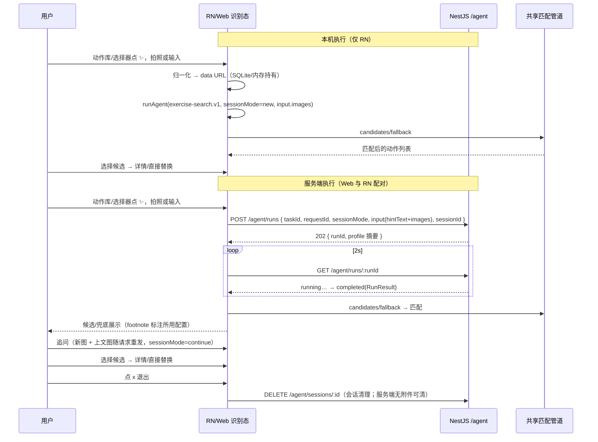

# AI 动作检索技术设计

[需求](REQUIREMENTS.md) · 执行计划（待写）

状态为待实施。前置：[agent-runtime](../agent-runtime/EXECUTION.md) 阶段 1–4 按其执行计划验收完成；本需求在其共享核心之上实施，不改动桩任务已验收的行为。本文已按 2026-11-21 的设计评审修订，修订项见 §12。

## 1. 模块与代码落点

| 设计落点 | 职责与现有边界 |
|---|---|
| `api/agent-runtime/contracts.js`、`contracts.d.ts`（改） | `TaskDefinition` 增加 `attachments(input, context)`、`capabilities(input)`、`userMessage(input)`、`assistantMessage(result)`、`memoryCategories: []` 语义；`RunRequest` 增加 `sessionMode`。 |
| `api/agent-runtime/run.js`（改） | 在组装模型输入前调用任务附件钩子；按任务输入动态校验能力；任务可声明“不读长期记忆”；模型输入仍只从 `ModelInput.user.attachments` 取图。 |
| `api/agent-runtime/tasks/exercise-search.js`（新） | 共享任务 `exercise-search.v1`：输入/输出 schema、受控词表 prompt、预算、fixture 用例、内联图片校验与 `parseOutput` 清洗。无平台依赖。 |
| `api/agent-runtime/tasks/exercise-search-vocabulary.json`（新） | 身体部位/器械 slug 的共享快照；由 API 测试对照 `frontend/src/lib/exercises-data.js` 和移动端目录校验，避免两端词表漂移。 |
| `api/agent-runtime/providers/fixture.js`（改） | 增加 `candidates`、`fallback-only` fixture 序列，或提供任务级 fixture 适配；未知用例仍返回明确错误。 |
| `api/agent-runtime/errors.js`（改） | 新增 `agent_media_invalid`（400）、`agent_media_too_large`（413）、`turn_limit`（429）、`session_busy`（409）、`session_conflict`（409）。五个码都不在 agent-runtime 现有错误清单（其执行计划 1.2）内，由本需求第一步一并落入共享 `errors.js`。 |
| `api/src/agent/tasks/index.ts`（新） | 服务端任务注册表：`taskId -> { task, tools, messageOf }`。桩任务保留为 `stub.v1`，AI 任务注册为 `exercise-search.v1`。 |
| `api/src/agent/agent.service.ts`（改） | 按 `taskId` 选择任务及其工具；按任务输入校验 schema；用任务消息投影写会话；校验 `sessionMode`、会话执行位置、轮次和并发；运行结果附带脱敏配置摘要。 |
| `api/src/agent/agent.types.ts`（改） | 配置能力显式覆盖；会话 `taskId`/`executionLocation`/`meta`；消息可选 `meta`；`AgentStartBody.sessionMode`；运行结果配置摘要。 |
| `api/src/agent/agent-session.store.ts`（改） | 会话增加 `taskId`、`executionLocation`、`meta`；消息增加可选 `meta`；`append` 接受期望的 `sessionVersion`；按 task/session 统计轮次；清理过期 AI 会话。 |
| `api/src/agent/agent-run.store.ts`（改） | AI 任务 run 记录 TTL 清理；保留轮询窗口，超时删除结果和请求索引。 |
| `api/src/agent/agent-config.store.ts`（改） | 配置能力支持显式 `image` 覆盖；默认配置支持管理员 `agentVision`；`list` 返回稳定排序；`resolve` 不改变已固定执行位置。 |
| `api/src/agent/agent.flags.ts`、`.env.example`（改） | 增加 `agentVision` 开关（默认可用），供服务端默认配置声明是否支持图像；与 `AGENT_RUNTIME_DISABLED` 区分。 |
| `api/src/agent/agent-media.ts`（不变） | 继续只解析已登记媒体；AI 内联图片不走这里，由共享任务附件钩子处理，避免服务端落盘。 |
| `api/openapi.yaml`（改） | `AgentRunRequest` 增加 `taskId` 可选值说明、`sessionMode`；错误枚举增加三个新码；`AgentRunStart`/`AgentRun` 增加脱敏配置摘要；不新增路由。 |
| `frontend/src/lib/exercise-ai-search.js`（新） | 双端共享匹配管道：模型候选 → 注入的检索器/匹配器 → 动作库对象；CJK 回退、提示词去歧义、去重、等级合成、兜底 slug 过滤。纯函数，不依赖平台、网络、存储。 |
| `frontend/src/lib/exercise-search.js`（改） | 增加 `searchScored(list, query)`，返回 `{ exercise, score }`；现有 `searchExercises` 行为保持不变。 |
| `frontend/src/views/Library.jsx`（改） | 动作库入口、AI 识别态、摘要卡、追问行、结果/兜底区；AI 模式忽略关键词与筛选；退出恢复快照。 |
| `frontend/src/views/AgentSetup.jsx`（改） | 配置表单增加“该模型可读取图片”的能力开关；服务端用户配置可显式覆盖 provider 默认能力。 |
| `frontend/src/sheets.jsx`（改） | `ExercisePicker` 搜索行增加 ✨；AI 检索以覆盖层替换选择器列表，不叠加 Sheet；候选沿用 `onPick(ex)` / `onPick(ex, true)` 语义。 |
| `frontend/src/components/ExerciseAiSearch.jsx`（新） | Web 动作库与选择器共用的识别态 UI：发起面板、摘要卡、候选行、兜底、追问行、错误态。 |
| `mobile-rn/src/agent/tasks.ts`（改） | 注册共享任务；宿主仍提供桩任务。 |
| `mobile-rn/src/agent/types.ts`（改） | `AgentStartInput.taskId`/`sessionMode`；配置能力覆盖；会话/消息 `meta`；运行结果配置摘要。 |
| `mobile-rn/src/agent/media.ts`（改） | 本机图片归一化与客户端持有：读取/压缩/校验 → data URL；识别态会话内 ≤2 张写 SQLite；会话删除/过期清理 blob；图片元数据写日志。 |
| `mobile-rn/src/agent/store.ts`（改） | 新增 `agent_ai_images` 表（scope、sessionId、turn、id、mime、size、width、height、bytes、createdAt）；会话/消息 meta；启动清理孤儿图片。 |
| `mobile-rn/src/agent/runtime.ts`（改） | `start` 接受 `taskId`、`sessionMode`；按会话固定执行位置；任务附件钩子；本机完成等待/轮询辅助；会话消息按任务投影；轮次/并发校验。 |
| `mobile-rn/src/agent/server-client.ts`（改） | `startRun` 传递 `taskId`、`sessionMode`、`input.images`；2s 轮询沿用；断线后按 run ID 查询。 |
| `mobile-rn/src/agent/config.ts`（改） | 配置能力显式 `image` 覆盖；首轮解析顺序；返回脱敏摘要。 |
| `mobile-rn/src/screens/AgentProfileScreen.tsx`（改） | 本机/服务端用户配置增加“该模型可读取图片”的能力开关；与 AgentSetup 行为一致。 |
| `mobile-rn/src/librarySearch.ts`（改） | 暴露 AI 匹配所需的完整候选池、别名和 `resolveCandidates` 入口；不改变现有关键词检索行为。 |
| `mobile-rn/src/agent/recovery.ts`（改） | 启动时把本机遗留 AI run 标记中断；保留最近 AI run 引用供 A12 提示。 |
| `mobile-rn/src/screens/ExerciseLibraryScreen.tsx`（改） | 识别态状态机、Sheet、追问行、结果区；动作库 Tab 与 `replacing` 选择器共用；候选按当前 `replacing`/`onPick` 语义处理。 |
| `mobile-rn/src/design/components/SearchField.tsx`（改） | 可选 ✨ 入口回调（传入才渲染）；识别态下文字禁用；按治理规则同步 `DesignGallery`。 |
| `mobile-rn/src/design/DesignGallery.tsx`（改） | 增加带 ✨ 回调和禁用文字两种 SearchField 演示。 |
| `docs/RN_UI_DESIGN_SYSTEM.md`（改） | 更新 SearchField props 与 AI 识别态使用约束，保持设计系统文档与组件一致。 |

无新增 npm 依赖：图片归一化与读取用已装的 `expo-image-manipulator`、`expo-file-system`；Web 归一化用 canvas；匹配回退使用共享 JS，不引入 Fuse 依赖。

**对共享核心的改动不再是 `errors.js` 一处。** 图片和任务注册都跨越 `contracts`、`run.js`、两个宿主；这是本设计的明确前提，实施计划必须按此拆步。

## 2. 任务契约（exercise-search.v1）

| 契约 | 内容 |
|---|---|
| 输入 | `hintText?`（≤500 字符）、`images?`（data URL 数组，≤2 张、每张归一化后 ≤1MB、新→旧排序）、`fixtureCase?`（仅 fixture/验收实例）。文字或图片至少一项；`maxItems`/`anyOf` 不在共享 schema 子集内，由任务校验补齐。 |
| 会话 | `sessionId` 使用 `RunRequest.sessionId`，不再放进任务输入；首轮 `sessionMode: 'new'`，追问 `'continue'`。 |
| 输出 | `candidates`（0..5）：`name`（≤80）、`nameEn?`（≤80）、`rationale`（≤200）、`level`（`high/medium/low`）、`equipment?`、`bodyPart?`；`fallback`（必返回）：`understanding`（≤400）、`bodyParts?`、`equipment?`（slug 枚举）。 |
| 步骤 | 单模型步骤：无工具调用、无 `targetScope`、无必要事实、无长期记忆。不触碰工具围栏与提案围栏。 |
| 预算 | `rounds: 1`；`attachments: 2`；`attachmentBytes: 1MiB`；首轮后最多 5 轮追问（每会话最多 6 个 run，服务端按 task + session 计数）。 |
| 受控词表 | `bodyPart`（11 项）和 `equipment`（34 项）的现有 slug 写入 prompt；使用共享 `exercise-search-vocabulary.json`，测试对照目录。`targetMuscle` 不进入本任务输出，因为 Web `Library` 没有该筛选，避免双端行为不一致。 |
| 能力 | `capabilities(input)` 返回 `['text']` 或 `['text','image']`；执行前按本轮输入校验，缺失返回 `profile_capability_missing`。任务不声明静态 `requiredCapabilities: ['text','image']`，否则纯文字请求会被误拒。 |
| 记忆 | `memoryCategories: []` 明确表示“不读任何长期记忆”；宿主不得把空数组解释为“全选”。输出 schema 不含 proposal，模型无法发起记忆提案。 |
| fixture | `input.fixtureCase` 仅在 `profileRef.provider === 'fixture'` 时生效：`candidates`、`fallback-only`、`error`。真实配置忽略该字段。 |

**输出清洗。** `parseOutput` 在 schema 校验前完成：
- 候选数组截断到 5；非对象/缺少 `name`/非法 `level` 的候选丢弃；`name`、`rationale` 超长截断。
- `level` 非法时丢弃该候选，不使整轮失败；`candidates` 可为空。
- `fallback` 缺失或非对象时生成安全默认：`understanding` 使用 `hintText` 截断，否则用“未能理解这次输入，请补充描述”；`bodyParts`/`equipment` 过滤为合法 slug。
- 非法 slug 丢弃该字段；额外字段忽略。这样“schema 校验”与“非法值丢弃”不冲突。

**结构化输出。** 模型必须返回单个 JSON 对象。共享 provider 在支持时请求 JSON 模式（`response_format: json_object` 或等价的兼容参数）；不支持或返回代码围栏/多余文本时，`parseOutput` 提取第一个完整 JSON 对象，再走清洗和 schema 校验。仍无法解析时返回可读的 `model_unavailable` 错误，不把原始响应直接展示给用户。首期 `rounds: 1`，不做自动二次修复；失败由用户重试或修改输入。

模型不输出动作库 ID：候选名/提示经匹配管道解析，兜底筛选直出合法 slug。幻觉防护与目录零依赖都由此成立。

## 3. 共享运行核心扩展

| 契约 | 行为 |
|---|---|
| `TaskDefinition.validateInput(input, context)` | 可选，任务级输入校验，在所有宿主创建 run 之前调用；用于表达 schema 子集无法覆盖的“文字或图片至少一项”“图片 ≤2 张”等条件。校验失败返回 `invalid_request`，不占用 requestId 的幂等指纹。 |
| `TaskDefinition.attachments(input, context)` | 可选异步函数，返回 `AttachmentReference[]`（可含 `dataUrl`/`mime`/`size`）。`run.js` 在 `readFacts` 后、组装 `ModelInput` 前调用；任务声明钩子时以返回值（包括空数组）为准，不与宿主 `context.meta.attachments` 合并；未声明时才使用宿主附件。随后统一走 `trimContext` 的媒体预算，避免宿主附件和任务附件叠加。 |
| `TaskDefinition.capabilities(input)` | 可选，返回本轮所需能力。`run.js` 在启动前校验；宿主在解析配置时使用同一函数，避免“解析时跳过、运行时又失败”。缺省回退 `requiredCapabilities`。 |
| `TaskDefinition.userMessage(input)` | 可选，返回写入会话的用户可见文本。AI 任务用 `hintText`；纯图时为 `[图片]`。缺省回退 `input.prompt`，保持桩任务行为。 |
| `TaskDefinition.assistantMessage(result)` | 可选，返回 `{ content, meta? }`。AI 任务写 `candidates/fallback` 的 JSON 文本，`meta` 只含张数/字节/MIME/尺寸，不含 data URL。缺省回退当前 `structured` JSON。 |
| `memoryCategories: []` | 表示不读长期记忆。服务端和 RN 宿主在传给 `selectMemories` 前直接使用空数组，不把空数组转成“不过滤”。 |
| `TaskDefinition.fixtureCase(input, context)` | 增加 `context` 参数（实现已可传，类型补齐）；任务据此判断是否 fixture 配置。 |

**任务注册。** 服务端 `api/src/agent/tasks/index.ts` 提供 `createTaskRegistry({ store, media })`，返回 `Map<taskId, { task, tools, messageOf }>`；`AgentService` 不再持有单一 `this.task`：
- `parseStart` 先按 `taskId` 取任务，未知任务返回 `invalid_request`。
- `start` 用任务自己的 `inputSchema` 和 `validateInput` 校验，避免用桩 schema 拒绝 AI 输入，也避免“至少一项/≤2 图”要到执行阶段才失败。
- `execute` 用任务自己的工具集合；AI 任务步骤没有工具，传入空工具列表即可。
- `session.append` 使用 `messageOf`，不再读取 `request.input.prompt`。

RN 同样在 `mobile-rn/src/agent/tasks.ts` 暴露 `createTaskRegistry(data)`；`AgentStartInput` 增加 `taskId`，`server-client.startRun` 不再硬编码 `stub.v1`。

## 4. 执行位置与配置解析

| 端 | 首轮解析顺序 | 追问 |
|---|---|---|
| Web | 服务端用户配置（按 ID 升序） > 服务端默认 | 同一服务端，优先会话已用配置；不可用则同环境下一个可用配置 |
| RN（配对） | 本机配置（按 ID 升序） > 服务端用户配置 > 服务端默认 | 同一执行位置；不在本机/服务端之间切换 |
| RN（练习模式） | 仅本机配置 | 同一本机 |

- **首轮固定执行位置**：客户端在创建 AI 会话时记录 `executionLocation`（`local`/`server`）；服务端会话也记录 `executionLocation: 'server'` 和 `taskId`。追问只在该执行位置内解析配置；任何能力不足都返回错误，不自动换端。
- **`sessionMode`**：`new` 时执行方 `ensure` 会话，若已有同 ID 会话且 `taskId` 不同则 `session_conflict`；`continue` 时只读取已有会话，缺失/已删除返回 `session_deleted`，**不自动创建空会话**。这防止本地会话 ID 被发到服务端后静默丢历史。
- **配置能力**：`AgentProfileInput.capabilities.image` 可显式覆盖服务端/本机配置的默认能力；服务端默认配置由管理员 `agentVision` 控制；fixture 验收配置可声明 `image:false`。能力不准确时 A10 无法复现。
- **配置摘要**：`AgentRunStart` 和 `AgentRun` 返回 `profile: { id, label, provider, model, version }`；不返回密钥，`keyHint` 仍只回尾号。客户端摘要卡显示 `经 <label> 检索`。
- **配置变更**：配置在运行中删除或版本变化，模型网关按 agent-runtime R1 以明确错误结束；追问可在同一执行位置重新解析，但不得换端。
- **`AGENT_RUNTIME_DISABLED`**：只关闭服务端执行路径。Web 入口隐藏；RN 服务端路径隐藏，练习模式/本机配置仍可用。若产品要求全局关闭，需要另加本机开关，不能复用服务端标志。
- **点 ✨ 预检**：无可用配置或本轮输入没有对应能力时不弹 Sheet，直接 EmptyState + 去配置/重新发起指引。

## 5. 附件：客户端持有，运行时钩子内联

图片不落服务端、不进运行库，是**按值传递**（attachment-by-value）的运行输入：

- **客户端持有**：RN 识别态存 SQLite `agent_ai_images`（会话内 ≤2 张，新图逐出旧图；只存当前 scope/session），Web 存识别态内存；离开页面或刷新即随会话删除。启动时清理已删除/过期会话的孤儿 blob。
- **请求时内联**：发起与每轮追问提交运行时，客户端把本轮模型输入所需图片（≤2 张，当前新图在前）放进 `input.images`；共享任务 `attachments` 钩子校验并转成 `ModelInput.user.attachments`，执行方只保留在运行内临时上下文，终态释放，**服务端不落盘**。
- **归一化**（RN 与 Web 同参数，选图时执行）：长边 ≤1280px、JPEG 质量 0.8；采用多档尝试（1280/0.85、1280/0.7、1200/0.7、960/0.6）直到解码后 ≤1MB；原始文件/解码尺寸设上限，解码失败即拒绝。RN 复用 `mobile-rn/src/body/photos.ts` 的压缩与 EXIF 处理方式，但不写入进度照片目录。
- **执行方校验**（共享任务内实现，不信任客户端）：data URL 前缀、MIME 与 magic bytes、base64 解码后字节数、像素尺寸、张数（≤2）；非法或超限返回 `agent_media_invalid` / `agent_media_too_large`。请求整体超过 `readBody` 5 MiB 上限时 413 兜底（[body-reader.ts](../../api/src/common/http/body-reader.ts)）；Nginx 已配 5m（[nginx.conf.template](../../web/nginx.conf.template)）。
- **会话与日志**：会话消息只含文本和图片元数据（张数、字节、MIME、尺寸）；运行记录不保存 `input.images`；日志沿用“只记元数据、排除请求正文”约定。幂等指纹对含大 base64 的输入取哈希，不做原文比较。
- **大小核算**：2 张 1MB 图片 base64 约 2.7MB，加文字和 JSON 外壳低于 5MiB；若未来提高图片预算，必须同步 API body limit、Nginx 和 provider 限制。

**权衡**：每轮追问重发上文图（归一化后典型 200–400KB/张），换取服务端零附件子系统（无上传路由、无落盘、无清理任务）。会话绑定页面生命周期（≤6 个 run）使传输总量有界。未来若会话需跨页面或跨设备续存，再演进为服务端引用式附件。

## 6. 匹配管道（frontend/src/lib/exercise-ai-search.js）

```text
输入：RunResult.structured.candidates + fallback + 注入的检索器
  1. 逐候选：name/nameEn → searchScored（精确/别名/模糊）→ 候选动作列表
  2. 候选的 equipment/bodyPart 提示用于消歧和加权；冲突则降权/丢弃
  3. 零命中且含 CJK：字符级回退（最长公共子串 + 二元组重合）→ 取高于阈值的唯一最优
  4. 仍歧义：保留最高分且等级降为 low；低于阈值丢弃
  5. 去重（同一动作保留等级最高者，拼接依据）→ 截断 5 条
  6. 未匹配候选丢弃；全部未匹配 → 视作零候选走兜底
输出：{ items: [{ exerciseId, name, rationale, level }], fallback }
兜底：understanding 直显；bodyParts/equipment slug → 现有筛选值（非法 slug 丢弃）
```

- **注入式**：`createExerciseAiSearch({ search, suggest, list, aliasesOf, translate })`。Web 用 `exercises.js` 的全局引擎与完整 `allExercises(S)`；RN 用 `createLibrarySearch` 的同一候选池（含自建动作和用户别名）。禁止直接 import Web 全局数据到 RN。
- **CJK 回退**：现有 `createExerciseSearch` 按空格切词，中文候选名（如“坐姿推举”）对“杠铃坐姿军事推举”不会精确命中。共享管道对 CJK 使用字符级相似度，阈值、最小公共子串长度和“歧义即丢弃”规则写入测试；英文仍走现有分词/纠错。
- **Fuse 建议**：RN 已有 `createFuseSuggestionIndex`，可作为 `suggest` 注入；Web 不新增 Fuse 依赖，使用共享 CJK 回退。两端对同一 fixture 候选必须得到相同动作集合。
- **等级合成**：模型 `level` 只是模型判断；UI 的 `高/中/低` 由“匹配强度 + 模型等级”合成：精确名/别名且模型 high → 高；精确但模型 medium/low 或模糊命中 → 中；CJK 回退/歧义 → 低。规则集中在一个函数并测试。
- **自建动作与别名**：候选池必须包含当前账号/工作区的 custom actions 和已保存别名；动作库 Tab 的当前筛选不进入候选池，AI 结果不被旧 chips 限制。
- **纯函数**：不依赖平台、网络与存储；Web vitest 与 RN typecheck 双覆盖，fixture 候选集相同。

## 7. 会话、追问与清理

- **首轮发起**：客户端生成 `sessionId`（共享 `createId`），`sessionMode: 'new'`；执行方创建会话并记录 `taskId`、`executionLocation`。服务端/本机按 agent-runtime R5 保存消息。
- **消息结构**：`user`（`hintText`；纯图为 `[图片]`；`meta` 含图片张数/字节/MIME/尺寸）与 `assistant`（校验后的 `candidates` + `fallback`；`meta` 含候选数/是否兜底）。会话存储不含图片数据。
- **追问**：新 `requestId`、`sessionMode: 'continue'`、复用 `sessionId`；模型输入 = 应用指令 + 会话最近文本消息 + 当前输入文字 + `input.images` 图像块。上文图由客户端重发，顺序为新→旧，并在 prompt 中标注“当前图片/上一轮图片”，避免模型把旧图当新图。
- **轮次**：首轮后最多 5 轮追问；客户端到限禁用输入行；服务端按 task + session 统计，超过返回 `turn_limit`。失败/取消的 run 是否计数固定为“已提交即计数”，避免重试绕过预算。
- **并发**：同一会话同时只允许一个活动 run；服务端/本机发现已有活动 run 返回 `session_busy`。客户端在新 run 前先取消旧 run。`append` 校验开始时的 `sessionVersion`，版本变化返回 `session_conflict`，晚到结果不写回。
- **退出**：`DELETE /agent/sessions/:id`（本机等价删除）；运行中的晚到结果不写回（R5 守护）；客户端图片随会话清理，服务端无附件可清。
- **保留**：AI 会话为临时会话，服务端在启动/新 run 时清理超过 2 小时未更新的 AI 会话；AI run 记录保留 1 小时用于轮询/重试后清理。用户退出即删，UI 不提供历史浏览。清理策略是“无历史”要求的一部分，不能只依赖客户端删除。
- **恢复**：客户端持久化最近一次 AI run 引用（runId/sessionId/location），直到终态或退出。应用重开/服务重启后若仍是非终态，显示“上次检索未完成”，本机 `recover` 标记 interrupted，服务端按 agent-runtime R6 标记；提供重新发起入口。

## 8. 客户端状态机

```text
idle → sheetOpen →（配置/能力不可用 → configMissing）
                  →（解析成功 + 发起）→ running → candidates | fallbackOnly | error
running（追问）→ running → …（首轮后 ≤5 轮）
running → sheetOpen（点 ✨ 修改）→ 取消旧 run → running
任意识别态 → 点 x → exited（恢复文字/筛选快照，删会话和图片）
识别态 + 选择器 → 点候选 → picked（按现有 onPick/替换语义提交，关闭选择器）
```

- 动作库 Tab：AI 模式保留 `SearchField`（文字禁用，sparkle 可用），隐藏 chips，忽略原筛选；AI 候选行统一打开动作详情（不复用关键词列表的快速开始/选择主操作），用户再走详情现有入口。退出 x 恢复快照；兜底 chip 退出规则见需求 R3（清空文字/其他筛选，应用该 chip）。
- 训练选择器：AI 模式覆盖选择器列表，保留选择器标题/关闭。Web 候选行沿用 `onPick(ex)`（打开配置/详情）和 `onPick(ex, true)`（快速添加/替换）；RN `replacing` 行沿用 `setDetail` → 详情页“选择此动作替换”的现有路径，非替换选择器沿用 `pickCatalogue`/`pickCustom` 或详情路径。选中后关闭 AI 模式并由调用方关闭选择器。
- Web：`ExerciseAiSearch` 作为 `Library` 页面状态或 `ExercisePicker` 内的覆盖层；不使用嵌套 Sheet。图片选择用隐藏 `<input type="file">`，追问相机在移动端仍走原生选择器。
- 本机运行：`start` 返回 run 后在识别态内轮询 SQLite/内存状态（提供 `waitForRun` 辅助）；离开页面调用 `cancel`。服务端运行 2s 轮询，仅识别态挂载期间执行。
- 识别态进入时快照文字查询与筛选；详情页往返不清识别态。切换工作区/连接变化视为离开页面，取消并清理当前会话图片。

## 9. 时序



## 10. 测试与验收策略

| 层 | 内容 |
|---|---|
| 共享核心 | `node --test`：任务注册、`validateInput`、`attachments` 钩子、动态能力、`memoryCategories: []` 不读记忆、`sessionMode`、`sessionVersion` 追加守卫、`turn_limit`、`session_busy`、配置摘要。 |
| 共享任务 | `node --test`：输入至少一项、≤2 图、data URL/MIME/magic bytes/解码后大小/尺寸、输出清洗（截断/丢弃非法候选/兜底默认）、词表 fixture 用例、fixture 配置忽略 `fixtureCase`。 |
| 匹配管道 | Web vitest：英文精确/模糊、中文“坐姿推举”、别名、自建动作、候选提示消歧、歧义丢弃、全未匹配转兜底、等级合成、Fuse 注入与共享回退结果一致。 |
| API 集成 | nest 测试：`exercise-search.v1` 启动、内联图片、413 兜底、`sessionMode=continue` 不创建空会话、轮次/并发、会话删除无消息/图片残留、运行记录 TTL、日志不含图片数据、配置能力 A10。 |
| Web | vitest：Library + ExercisePicker 识别态、A4 chip 规则、A14 重开、A12 恢复提示、轮询停止、退出快照。 |
| RN | `typecheck`/`lint`/`design:check`；fixture 驱动模拟器验收（本机 + 服务端两条路径），覆盖 A1、A6、A8、A15；图片表/清理用单测或设备日志核对。 |
| 验收映射 | 与 [REQUIREMENTS](REQUIREMENTS.md#首版验收) A1–A16 逐条对应；fixture 实例离线复现 A3–A7、A9–A12、A14–A16。 |

真实供应商至少做一次视觉模型 smoke test（1×1 PNG 或真实器械图 + fixture 候选）；只跑 fixture 不构成“真实模型可用”的证据，结果标记为待验。

## 11. 依赖与实施顺序

- 前置为 agent-runtime 阶段 1–4 验收；本需求对共享核心的改动见 §3，不再假设“只改 errors.js”。
- 实施使用当前 `feat/agent-runtime` 的独立 worktree `D:\dev\open-gym-agent-runtime`（按用户决定），文档随 worktree 提交；如需拆分业务分支，另建 `feat/ai-exercise-search`。
- 顺序建议：
  1. 共享核心契约 + 任务注册 + 会话模式 + 配置能力/摘要。
  2. `exercise-search.v1` 共享任务 + 词表 + fixture。
  3. 共享匹配管道 + `searchScored` + CJK 回退。
  4. Web `Library` + `ExercisePicker`。
  5. RN 任务/媒体/存储/运行时 + `ExerciseLibraryScreen`/`SearchField`。
  6. 清理/TTL/恢复提示 + 双端验收。
- 每步可用 fixture 独立验收；Web 与 RN 同批交付（R1 约束）。

## 12. 评审修订记录

| 评审项 | 修订 |
|---|---|
| P0 内联图片未进入 `ModelInput` | 增加 `TaskDefinition.attachments`，由 `run.js` 在组装模型输入前接管；不再只改 `errors.js`；错误码为新增的 `agent_media_*`。 |
| P0 多任务宿主与会话消息缺失 | 增加任务注册表、`AgentStartInput.taskId`、任务级 `userMessage`/`assistantMessage`、消息 `meta`。 |
| P0 追问可能切换执行位置并丢历史 | 首轮固定 `executionLocation`；`sessionMode: new/continue`；`continue` 不创建空会话；能力不足报错并提供重新发起。 |
| P1 fixture/能力桩不足 | fixture 增加 `candidates`/`fallback-only`；配置支持 `image:false`；服务端默认配置支持 `agentVision`。 |
| P1 中文/歧义匹配 | 增加 `searchScored`、候选提示、CJK 回退、等级合成、注入式检索器；不再只用 `createExerciseSearch`。 |
| P1 会话清理/并发/上限 | 增加 TTL、`turn_limit`、`session_busy`、`sessionVersion` 追加守卫；服务端限轮次。 |
| P1 A4/A14 状态矛盾 | 兜底 chip 清空文字/其他筛选后退出；x 才恢复快照；识别态保留 sparkle、禁用文字。 |
| P1 记忆/配置展示 | `memoryCategories: []` 表示不读；start/run 返回脱敏配置摘要；同层配置按 ID 排序。 |
| P1 schema/结构化输出/图片归一化 | `parseOutput` 清洗 + JSON 提取/JSON 模式；多档压缩；明确解码后 1MB 与尺寸上限。 |
| 入口与场景修正 | 入口扩展到训练添加/替换选择器；场景改为“看到器械拍照 → 加入训练/替换已有动作”，不包含自由问答。 |
| A11 冲突 | `AGENT_RUNTIME_DISABLED` 只关服务端路径；练习模式本机仍可用。 |
| 词表/错误码 | 删除未使用的 `targetMuscle`；词表改为 11/34 并共享快照；删除重复的 `attachment_*`。 |
